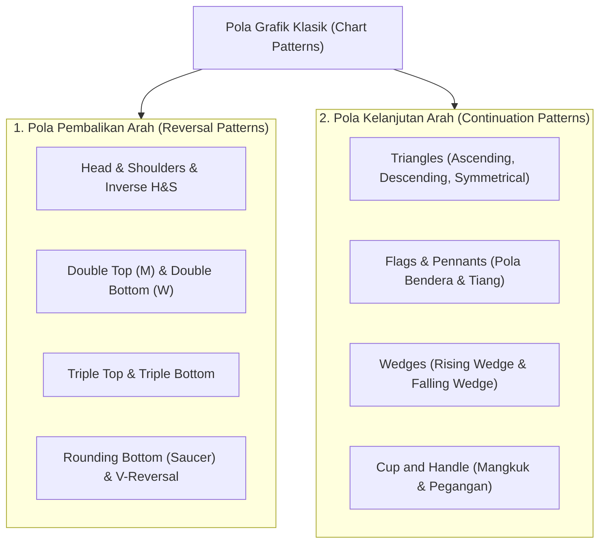
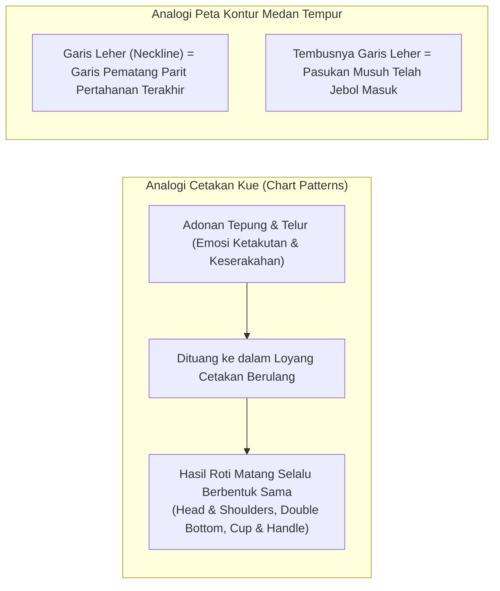
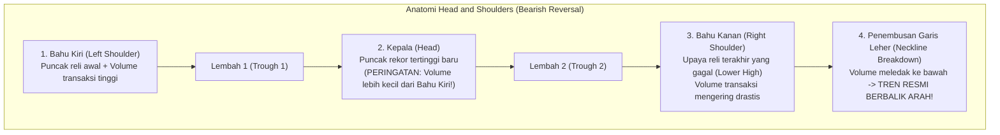
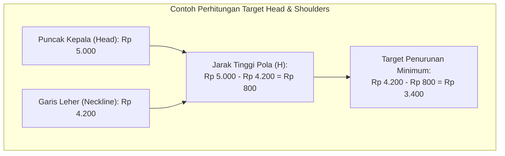
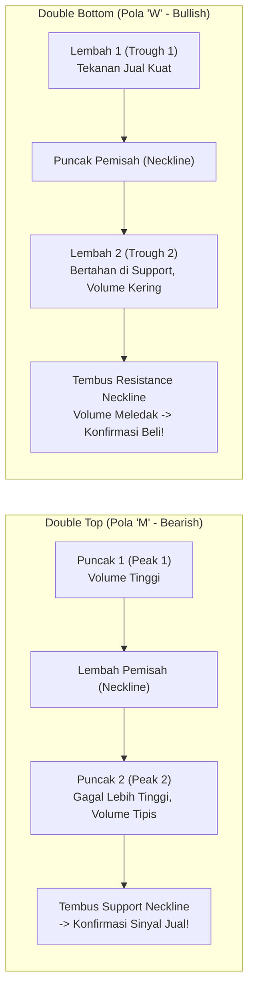
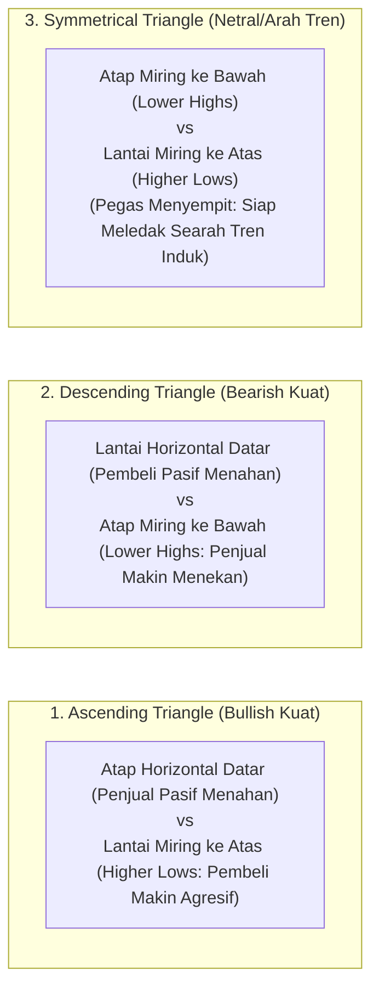
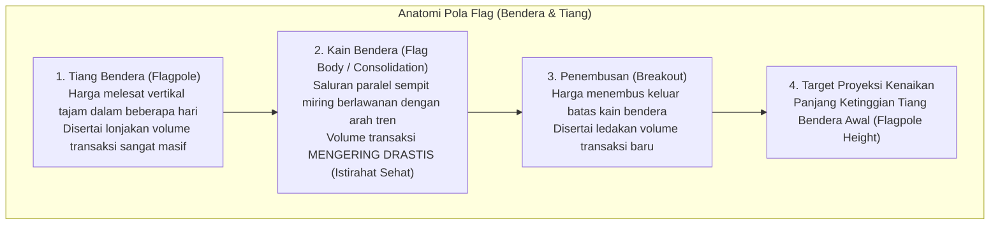
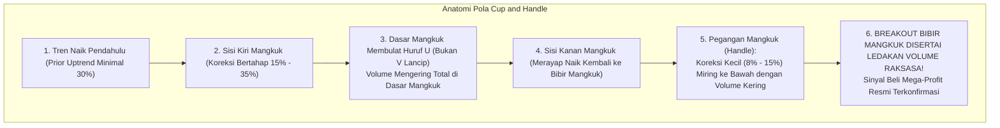
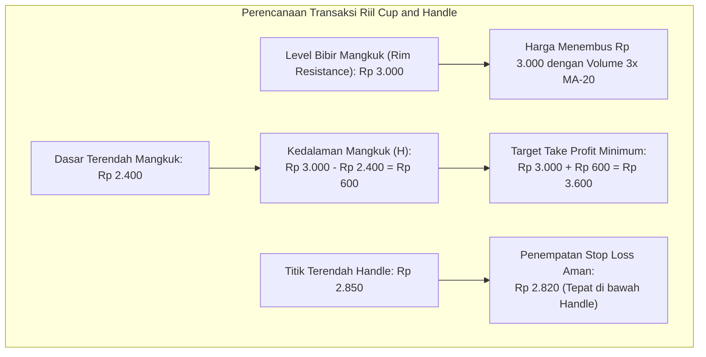

# Bab 21: Chart Patterns (Pola Grafik Klasik) — Cetakan Geometris Psikologi Massa

> "Pola grafik bukanlah sekadar gambar geometri abstrak di atas kertas milimeter. Pola grafik adalah cetakan kue dan peta kontur pertarungan emosi manusia—keserakahan, ketakutan, harapan, dan keputusasaan—yang terpatri secara konsisten di setiap era bursa saham sejak ratusan tahun lalu."  
> — **Edianto Ong**, *Technical Analysis for Mega Profit*

---

## 1. Hakikat dan Dua Keluarga Besar Pola Grafik

Dalam analisis teknikal klasik, **Pola Grafik (*Chart Patterns*)** adalah konfigurasi struktural pergerakan harga yang berulang (*recurring formations*) yang merefleksikan pergeseran perimbangan kekuatan antara penjual (*supply*) dan pembeli (*demand*).

Edianto Ong mengelompokkan seluruh pola grafik klasik ke dalam dua keluarga besar:
1. **Pola Pembalikan Arah (*Reversal Patterns*):** Menandakan bahwa tren yang sedang berlangsung telah kehabisan tenaga dan bersiap untuk berbalik arah 180 derajat secara fundamental.
2. **Pola Kelanjutan Arah (*Continuation Patterns*):** Menandakan bahwa pasar sedang mengambil jeda napas (*pause/consolidation*) sejenak untuk mengumpulkan amunisi baru, sebelum melanjutkan perjalanannya searah dengan tren induk sebelumnya.

---

## 2. Analogi Dunia Nyata: Cetakan Kue dan Peta Kontur Pertarungan

Bayangkan Anda sedang membuat kue di dapur atau mengamati peta kontur lereng bukit:

- **Cetakan Kue (Psikologi Massa yang Tak Berubah):**
  Sifat dasar manusia tidak pernah berubah dari abad ke-17 hingga era perdagangan kecerdasan buatan saat ini: manusia tetap serakah saat melihat harga melambung tinggi, dan panik histeris saat melihat portofolionya merah. Karena emosi massanya sama, maka reaksi kolektif ribuan investor di bursa selalu membentuk "cetakan kue" geometris yang sama di grafik.
- **Peta Kontur & Garis Parit Leher (*Neckline*):**
  Level garis leher (*Neckline*) pada pola *Head & Shoulders* atau *Double Bottom* ibarat garis parit pertahanan benteng terakhir dalam medan pertempuran. Selama parit tersebut belum jebol, pertempuran masih berlangsung seimbang. Namun begitu parit tersebut berhasil diterobos musuh diiringi ledakan suara meriam (lonjakan volume), arah kemenangan perang telah diputuskan!

---

## 3. Pola Pembalikan Arah (*Reversal Patterns*)

### A. Head and Shoulders & Inverse Head and Shoulders

Pola *Head and Shoulders (H&S)* adalah "Raja" dari seluruh pola pembalikan puncak (*Top Reversal Pattern*). Pola ini menandai kematian tren naik (*uptrend*) dan lahirnya tren turun (*downtrend*) yang menghancurkan.

#### Struktur 4 Komponen:
1. **Left Shoulder (Bahu Kiri):** Terbentuk di akhir tren naik yang kuat, diiringi lonjakan volume transaksi besar saat mencetak puncak harga baru.
2. **Head (Kepala):** Pembeli berhasil mendorong harga melesat lebih tinggi mencetak puncak tertinggi baru (*New High*). Namun perhatikan: volume transaksi pada pembentukan kepala **lebih rendah** daripada volume di bahu kiri. Ini adalah alarm peringatan dini bahwa tenaga pembeli mulai melemah (*Divergensi Volume*).
3. **Right Shoulder (Bahu Kanan):** Pembeli mencoba melakukan reli kembali, namun gagal total mencapai ketinggian kepala (*Lower High*), diiringi volume transaksi yang sangat sepi mengering.
4. **Neckline (Garis Leher):** Garis batas yang menghubungkan kedua lembah koreksi (Lembah 1 dan Lembah 2). Garis ini bisa mendatar horizontal atau sedikit miring.

#### Rumus Menghitung Target Penurunan Head & Shoulders:
Ukur jarak vertikal tegak lurus ($H$) dari titik puncak tertinggi kepala (*Head*) ke garis *Neckline*. Setelah terjadi penembusan (*breakdown*) di bawah garis *Neckline*, proyeksikan jarak $H$ tersebut lurus ke bawah:
$$\text{Target Penurunan Minimum} = \text{Harga Penembusan Neckline} - H$$

#### Inverse Head and Shoulders (Bullish Reversal):
Merupakan cermin terbalik dari pola di atas yang muncul di dasar tren penurunan panjang (*Bottom Reversal*).
- Pola terdiri dari: Bahu Kiri Bawah, Kepala Bawah Terendah, dan Bahu Kanan Bawah (*Higher Low*).
- **Syarat Mutlak:** Saat harga menembus ke atas garis leher (*Neckline Breakout*), **volume transaksi WAJIB melonjak masif (minimal 2x lipat)** untuk membuktikan bahwa akumulasi pemodal institusi telah rampung. Target kenaikan diukur dengan rumus:
$$\text{Target Kenaikan Minimum} = \text{Harga Penembusan Neckline} + H$$

---

### B. Double Top (Pola "M") & Double Bottom (Pola "W")

#### 1. Double Top (Pola "M"):
- Terjadi setelah tren naik yang panjang. Harga membentuk Puncak 1, terkoreksi membuat lembah, lalu mencoba menanjak kembali namun tertahan di area ketinggian yang sama membentuk Puncak 2.
- **Kunci Volume:** Puncak 1 diiringi volume ramai, sedangkan Puncak 2 diiringi volume yang loyo dan sepi.
- **Konfirmasi:** Sinyal jual resmi terpicu ketika lilin harian ditutup menembus ke bawah garis lembah (*Support Neckline*).
- **Target Profit:** Jarak dari puncak tertinggi ke garis *neckline* diproyeksikan ke bawah dari titik penembusan.

#### 2. Double Bottom (Pola "W"):
- Terjadi di ujung tren penurunan panjang. Penjual mencoba menekan harga dua kali (Lembah 1 dan Lembah 2) pada level harga lantai yang sama, namun gagal menembusnya.
- **Kunci Volume:** Batang volume mengering di Lembah 2, dan **meledak dahsyat saat harga menembus garis atap pemisah (*Resistance Neckline*)**.
- **Target Profit:** Jarak dari lembah terendah ke garis *neckline* diproyeksikan ke atas dari titik *breakout*.

---

### C. Rounding Bottom (Saucer / Mangkuk Landai)
- **Karakteristik:** Menandakan transisi perubahan tren yang sangat tenang, halus, dan bertahap dari tren turun menuju tren naik tanpa kepanikan mendadak.
- **Bentuk Volume:** Batang volume membentuk mangkuk cekung yang sejajar dengan grafik harga: volume mengering drastis di bagian tengah mangkuk (saat pasar jenuh dan sepi), lalu mulai membesar perlahan saat harga mulai merangkak naik meninggalkan dasar mangkuk.

---

## 4. Pola Kelanjutan Arah (*Continuation Patterns*)

### A. Pola Segitiga (*Triangles*)

Pola segitiga mencerminkan kontraksi volatilitas di mana pergerakan harga semakin menyempit diapit oleh dua garis tren konvergen. Selama proses penyempitan di dalam segitiga, **volume perdagangan selalu mengering drastis**, dan baru meledak saat terjadi *breakout*.

1. **Ascending Triangle (Segitiga Naik - Bias Bullish Kuat):**
   - Atap berupa garis mendatar horizontal (*Resistance* konstan di mana ada institusi yang memasang order jual pasif di harga yang sama).
   - Lantai berupa garis tren miring ke atas (*Higher Lows*), membuktikan bahwa setiap kali harga terkoreksi, pembeli berani memborong di harga yang semakin tinggi.
   - **Hasil Akhir:** Penjual di level atap akhirnya kehabisan barang (*exhausted supply*), dan harga meledak menembus ke atas (*Bullish Breakout*).
2. **Descending Triangle (Segitiga Turun - Bias Bearish Kuat):**
   - Lantai berupa garis horizontal datar (*Support* konstan).
   - Atap berupa garis tren miring ke bawah (*Lower Highs*), membuktikan bahwa penjual semakin agresif membanting harga di level yang kian rendah.
   - **Hasil Akhir:** Pembeli di garis lantai kehabisan uang, pertahanan jebol, dan harga terjun bebas ke bawah (*Bearish Breakdown*).
3. **Symmetrical Triangle (Segitiga Simetris - Bias Mengikuti Tren Induk):**
   - Kedua garis tren miring saling mendekat secara simetris. Menggambarkan pegas yang sedang ditekan semakin padat. Arah penembusan biasanya mengikuti arah tren sebelum segitiga terbentuk.
- **Cara Mengukur Target Segitiga:** Ukur ketinggian jarak vertikal terlebar pada pangkal mulut segitiga (*Base*), lalu proyeksikan jarak tersebut dari titik *breakout*.

---

### B. Flags & Pennants (Pola Bendera & Tiang)

Merupakan pola kelanjutan tren jangka pendek yang paling dinamis dan memiliki probabilitas keberhasilan tertinggi di bursa:

#### Komponen & Rumus Target Tiang Bendera:
- **Tiang Bendera (*Flagpole*):** Kenaikan harga hampir tegak lurus setinggi $T$ poin yang didorong oleh volume raksasa.
- **Kain Bendera (*Flag*):** Konsolidasi sempit yang memakan waktu 1 hingga 3 minggu dengan volume tipis.
- **Pennant (Umbul-Umbul):** Sama seperti flag, namun konsolidasinya berbentuk segitiga simetris mini.
- **Rumus Target Pengukuran (*Flagpole Target*):**
$$\text{Target Take Profit} = \text{Level Breakout Kain Bendera} + \text{Tinggi Tiang Bendera } (T)$$

---

### C. Cup and Handle (Mangkuk dan Pegangan)

Dipopulerkan oleh investor legendaris William J. O'Neil (pendiri *Investor's Business Daily*) dan diulas tuntas oleh Edianto Ong sebagai pola pencetak keuntungan terbesar (*super-performance stock pattern*):

#### Syarat-Syarat Mutlak Cup and Handle:
1. **Bentuk Mangkuk (Cup):** Harus membentuk kurva membulat menyerupai huruf **"U"**, bukan huruf "V" yang tajam. Bentuk "U" membuktikan adanya proses akumulasi yang tenang dan sabar dari investor institusi.
2. **Kedalaman Mangkuk:** Idealnya berkisar antara 15% hingga 35% dari titik puncak bibir kiri.
3. **Pegangan Mangkuk (Handle):** Terbentuk di dekat bibir kanan atas mangkuk. Berupa saluran koreksi kecil miring ke bawah dengan kedalaman tidak melebihi sepertiga kedalaman mangkuk. Volume transaksi saat pembuatan handle **WAJIB mengering drastis**.
4. **Titik Beli (*Buy Point*):** Beli tepat saat harga menembus level puncak bibir mangkuk (*Rim Resistance*) dengan lonjakan volume minimal 1,5x hingga 2x lipat.
5. **Target Pengukuran:** Kedalaman mangkuk (dari bibir mangkuk ke dasar mangkuk) diproyeksikan lurus ke atas dari titik penembusan.

---

### D. Pola Baji (*Wedges*)

Berbeda dari segitiga, kedua garis tren pada pola baji (*wedge*) **miring ke arah yang sama**, namun semakin menyempit:
- **Rising Wedge (Baji Naik):** Kedua garis tren miring ke atas. Garis bawah lebih curam daripada garis atas. Pola ini sering mengecoh pemula karena tampak seperti *uptrend*, namun sebenarnya mencerminkan kelelahan daya beli (*Bearish Reversal / Breakdown*).
- **Falling Wedge (Baji Turun):** Kedua garis tren miring ke bawah. Tekanan jual semakin melemah dan mengecil. Pola ini memiliki probabilitas sangat tinggi untuk meledak ke atas (*Bullish Reversal / Breakout*).

---

## 5. Matriks Ringkasan Karakteristik Pola Grafik

| Nama Pola Grafik | Golongan | Arah Ekspektasi | Karakteristik Volume Saat Pola | Syarat Volume Saat Breakout |
| :--- | :--- | :--- | :--- | :--- |
| **Head and Shoulders** | Reversal | Bearish (Turun) | Volume menurun dari bahu kiri ke kanan | Wajib Tinggi saat jebol Neckline |
| **Inverse Head & Shoulders**| Reversal | Bullish (Naik) | Kering di kepala, mulai naik di bahu kanan | Mutlak Sangat Meledak Tinggi |
| **Double Top (Pola M)** | Reversal | Bearish (Turun) | Puncak 2 volumenya jauh lebih sepi | Tinggi saat jebol Support |
| **Double Bottom (Pola W)** | Reversal | Bullish (Naik) | Lembah 2 volumenya sangat tipis | Wajib Melonjak Tinggi |
| **Ascending Triangle** | Continuation | Bullish (Naik) | Mengering bertahap selama konsolidasi | Sangat Tinggi di atas Atap |
| **Descending Triangle** | Continuation | Bearish (Turun) | Mengering bertahap selama konsolidasi | Tinggi saat jebol Lantai |
| **Symmetrical Triangle** | Continuation | Mengikuti Tren Awal| Mengering drastis mendekati ujung segitiga | Wajib Meledak Tinggi |
| **Flag & Pennant** | Continuation | Mengikuti Tiang | Sangat tipis kerdil di kain bendera | Meledak Sangat Raksasa |
| **Cup and Handle** | Continuation | Bullish (Naik) | Membentuk mangkuk U, kering di handle | Meledak Masif di Bibir Mangkuk |
| **Falling Wedge** | Reversal / Cont. | Bullish (Naik) | Volume penjualan mengering konstan | Meledak Tinggi saat tembus Atap |
| **Rising Wedge** | Reversal / Cont. | Bearish (Turun) | Volume mengecil saat harga dipaksa naik | Tinggi saat jebol Garis Lantai |

---

## 6. Kamus Istilah Pemula (Glossary Box)

| Istilah | Terjemahan Bebas | Arti Praktis untuk Pemula |
| :--- | :--- | :--- |
| **Neckline** | Garis Leher | Garis batas penentu konfirmasi pada pola Head & Shoulders dan Double Bottom. Penembusannya memicu sinyal eksekusi. |
| **Flagpole** | Tiang Bendera | Reli kenaikan harga tajam vertikal sebelum terbentuknya konsolidasi bendera. Menjadi tolok ukur target profit. |
| **Rim Resistance** | Bibir Mangkuk | Level resistensi horizontal tertinggi pada pola Cup and Handle yang menjadi batas picu *breakout*. |
| **Handle** | Pegangan Mangkuk | Koreksi kecil bervolume tipis di dekat bibir mangkuk sebelum harga meledak terbang. |
| **Front-Running** | Mendahului Pola | Kesalahan fatal membeli saham sebelum pola resmi terkonfirmasi breakout. Sama dengan berjudi menebak nasib. |
| **False Breakout** | Penembusan Palsu | Harga sempat melewati garis konfirmasi sekejap lalu berbalik arah menjebak trader karena ketiadaan volume. |
| **Throwback / Pullback**| Pengujian Ulang | Gerakan mundur harga secara tenang untuk mencium kembali garis neckline yang baru ditembus sebelum melaju kencang. |

---

## 7. Studi Kasus Konkret: Merencanakan Transaksi Pola Cup and Handle

Mari kita simulasikan trading plan konkret berbasis pola *Cup and Handle* pada saham unggulan:

### Rencana Eksekusi:
- **Identifikasi Pola:** Saham PT Berkah Industri membentuk pola mangkuk "U" sempurna dari harga Rp 3.000 turun ke Rp 2.400 lalu kembali ke Rp 3.000. Di level Rp 3.000 terbentuk koreksi kecil *handle* ke level Rp 2.850 dengan volume mengering.
- **Titik Beli (Entry):** Pasang antrean beli otomatis (*auto order*) di **Rp 3.020** saat harga menembus level bibir mangkuk dengan konfirmasi lonjakan volume harian.
- **Penempatan Stop Loss Protektif:** Letakkan batas *Stop Loss* aman di bawah titik terendah *handle*, yaitu di level **Rp 2.820** (risiko kerugian terukur ~6.6%).
- **Target Keuntungan (Take Profit):** Kedalaman mangkuk adalah: $\text{Rp } 3.000 - \text{Rp } 2.400 = \text{Rp } 600$. Proyeksikan Rp 600 ke atas dari titik breakout Rp 3.000:
$$\text{Target Minimum Take Profit} = \text{Rp } 3.000 + \text{Rp } 600 = \mathbf{Rp\ 3.600} \text{ (Potensi Profit +19.2\%)}$$
- **Evaluasi Risk-to-Reward:** Rasio potensi profit (+19.2%) terhadap risiko rugi (-6.6%) adalah hampir **1 : 3**. Transaksi ini sangat layak diambil (*High Quality Setup*)!

---

## 8. Kesalahan Fatal Pemula Terkait Chart Patterns

1. **Mendahului Pola Sebelum Terkonfirmasi (*Front-Running Patterns*):**
   Melihat pola baru membentuk bahu kiri dan kepala, lalu pemula langsung membeli sambil berandai-andai: *"Pasti nanti jadi Inverse Head and Shoulders!"*. Sering kali bahu kanan tidak pernah terbentuk dan harga malah longsor menembus lantai. Pola grafik **hanyalah sebuah imajinasi sampai garis Neckline resmi ditembus dengan penutupan lilin yang solid**.
2. **Mengabaikan Volume Saat Breakout:**
   Membeli saat harga menembus garis leher pola *Double Bottom* padahal volume transaksi hari itu sangat sepi dan loyo. Akibatnya, keesokan harinya harga langsung terpelanting jatuh kembali (*Bull Trap*). Tanpa bensin volume, pola grafik tidak memiliki daya dorong.
3. **Memaksa Mencari Pola di Grafik Acak (*Pattern Forcing / Pareidolia*):**
   Melihat pola segitiga atau kepala dan bahu di setiap sudut grafik padahal pergerakan harga sedang dalam kekacauan acak tanpa tren. Ingat kaidah pertama analisis teknikal: **Syarat mutlak pola pembalikan arah (*Reversal Pattern*) adalah harus ada tren nyata yang mendahuluinya**. Jika tidak ada tren sebelumnya, tidak ada yang bisa dibalikkan!
4. **Tidak Menghitung Rasio Risk-to-Reward Sebelum Masuk:**
   Membeli saham setelah harga melesat jauh meninggalkan titik *breakout*, sehingga jarak ke batas *Stop Loss* menjadi terlalu lebar (-15%), sementara target pola tinggal sedikit (+5%). Jangan mengejar kereta yang sudah meninggalkan stasiun!
