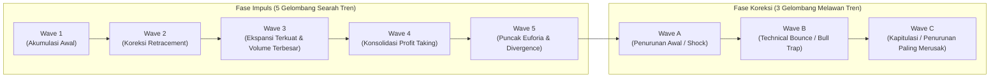
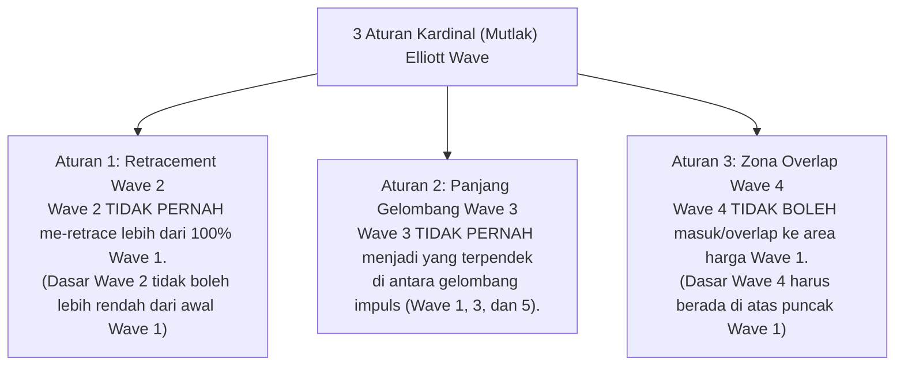
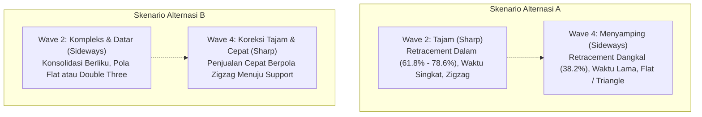
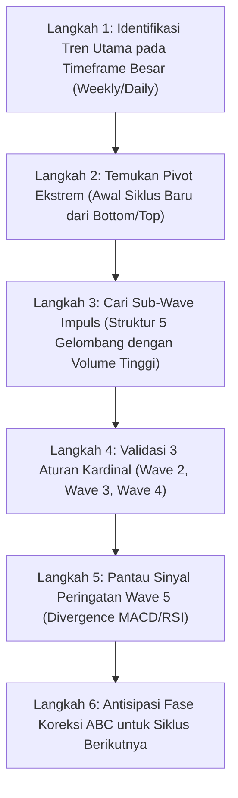

# Bab 22: Elliott Wave Theory

> "Pasar saham adalah kreasi manusia, yang merefleksikan sifat dasar manusia: ritme emosi massa yang berosilasi secara teratur antara optimisme dan pesimisme dalam urutan gelombang geometris alami."  
> — **Ralph Nelson Elliott** (diuraikan oleh **Edianto Ong**, *Technical Analysis for Mega Profit*)

---

## 1. Fondasi Filosofis & Struktur Dasar Gelombang

Teori Gelombang Elliott (*Elliott Wave Theory*) dikembangkan pada akhir tahun 1930-an oleh **Ralph Nelson Elliott** (1871–1948). Setelah mempelajari data pasar saham selama lebih dari 75 tahun dalam berbagai skala waktu (mulai dari grafik tahunan hingga grafik 30 menitan), Elliott menemukan bahwa pergerakan harga pasar tidak berlangsung secara acak, melainkan berulang dalam siklus ritmis yang teratur.

Edianto Ong menggarisbawahi bahwa pergerakan harga adalah ekspresi grafis dari **psikologi massa (*mass psychology*)**. Psikologi kolektif manusia berayun secara alami dari fase pesimisme ekstrem ke optimisme euforia, lalu kembali lagi ke pesimisme. Ayunan psikologis ini memanifestasikan dirinya dalam pola fraktal gelombang yang dapat dihitung dan dipetakan.

### Anatomi Siklus Lengkap: 5 Gelombang Motif & 3 Gelombang Koreksi

Satu siklus pergerakan Elliott Wave yang lengkap terdiri dari **8 gelombang utama**:
1. **Fase Motif / Impuls (5 Gelombang: 1-2-3-4-5):** Menggerakkan harga searah dengan tren utama (*dominant trend*).
2. **Fase Koreksi (3 Gelombang: A-B-C):** Mengoreksi atau melawan arah pergerakan tren utama sebelumnya.

### Karakteristik Psikologis Masing-Masing Gelombang

Edianto Ong merinci dinamika psikologis di balik setiap gelombang:

| Gelombang | Karakteristik Perilaku & Volume | Dinamika Psikologis Pasar |
| :--- | :--- | :--- |
| **Wave 1** | Kenaikan awal dari dasar pasar. Volume transaksi mulai meningkat dari titik nadir, namun mayoritas pelaku pasar masih skeptis dan menganggap kenaikan ini hanyalah pantulan sementara. | **Ketidakpercayaan (*Disbelief*):** Didorong oleh *smart money* dan investor institusional yang mulai mengakumulasi saham murah saat fundamental masih tampak suram. |
| **Wave 2** | Koreksi ke bawah yang tajam. Me-retrace sebagian besar keuntungan Wave 1 (seringkali 50% hingga 61.8% Fibonacci), namun tidak pernah menembus dasar Wave 1. | **Ketakutan (*Fear*):** Publik meyakini bahwa tren turun sebelumnya akan berlanjut, tetapi tekanan jual mengering sebelum titik terendah baru tercapai. |
| **Wave 3** | Gelombang paling kuat, paling panjang, dan paling dinamis. Volume melonjak drastis, *breakout* melampaui puncak Wave 1 terjadi dengan *gap* harga dan rentang lilin (*candlestick*) lebar. | **Keyakinan Masal (*Optimism & Conviction*):** Berita fundamental membaik, analis menaikkan target harga, publik dan manajer investasi berbondong-bondong masuk pasar. |
| **Wave 4** | Gerakan konsolidasi yang cenderung lambat, menyamping (*sideways*), atau membentuk pola segitiga (*triangle*). Penurunan volume terlihat jelas. | **Realisasi Keuntungan (*Profit Taking*):** Pelaku pasar mengambil laba parsial, sentimen tetap positif namun pasar membutuhkan waktu mencerna kenaikan Wave 3. |
| **Wave 5** | Gelombang kenaikan terakhir. Harga mencetak *Higher High*, namun momentum indikator (RSI/MACD) dan volume transaksi seringkali menunjukkan *bearish divergence*. | **Euforia & Keserakahan (*Greed / Climax*):** Publik ritel dan pemula agresif membeli karena tergiur berita spektakuler di media massa, tepat saat institusi mulai mendistribusikan barang. |
| **Wave A** | Penurunan awal yang sering dianggap oleh ritel sebagai koreksi sehat biasa untuk membeli saham murah (*buy on weakness* palsu). | **Penyangkalan (*Denial*):** Mayoritas analis dan ritel masih sangat *bullish*, meyakini reli akan segera berlanjut kembali. |
| **Wave B** | Pantulan teknikal (*dead cat bounce*) dengan volume relatif rendah. Membentuk *bull trap* klasik. | **Harapan Palsu (*False Hope*):** Ritel merasa lega dan menambah posisi beli, tepat sebelum gelombang likuidasi besar dimulai. |
| **Wave C** | Gelombang penurunan dahsyat yang melibas level support Wave A. Menghancurkan portofolio trader yang menolak *cut loss*. | **Keputusasaan & Kapitulasi (*Despair & Capitulation*):** Ketakutan massal mencapai puncak, semua orang melempar barang tanpa memedulikan harga, menandai akhir siklus bear. |

---

## 2. Tiga Aturan Kardinal (Mutlak) Elliott Wave

Dalam mengidentifikasi dan memberi label (*wave counting*), Elliott menetapkan **tiga aturan mutlak (*cardinal rules*)** yang tidak boleh dilanggar dalam kondisi apa pun. Jika salah satu aturan ini terlanggar, maka penghitungan gelombang (*wave count*) dipastikan **salah** dan harus diulang dari awal.

### Penjelasan Detail 3 Aturan Kardinal:

1. **Aturan 1: Wave 2 Pantang Menembus Titik Awal Wave 1**  
   Wave 2 dapat mengoreksi Wave 1 secara dalam (hingga 61.8%, 78.6%, bahkan 99%), namun **dasar (*bottom*) Wave 2 tidak boleh menyentuh atau menembus ke bawah titik awal dimulainya Wave 1**. Jika harga menembus titik awal Wave 1, maka pergerakan tersebut bukanlah Wave 1 dan 2, melainkan kelanjutan dari tren turun sebelumnya (*downtrend continuation*).

2. **Aturan 2: Wave 3 Pantang Menjadi yang Terpendek**  
   Di antara ketiga gelombang impuls searah tren (Wave 1, Wave 3, dan Wave 5), **Wave 3 tidak boleh menjadi yang terpendek**. Dalam pasar saham, Wave 3 hampir selalu merupakan gelombang yang paling panjang dan eksplosif (*extended wave*). Jika penghitungan Anda menunjukkan Wave 3 lebih pendek daripada Wave 1 dan Wave 5, label gelombang Anda wajib direvisi.

3. **Aturan 3: Wave 4 Pantang Masuk ke Teritori Harga Wave 1 (No Overlap)**  
   Titik terendah dari koreksi Wave 4 **tidak boleh tumpang tindih (*overlap*) atau menembus ke bawah titik puncak (*peak*) Wave 1**. Teritori harga Wave 1 dan Wave 4 harus terpisah jelas. Pengecualian sangat langka hanya terjadi pada pola khusus *Leading Diagonal* (pada Wave 1/A) atau *Ending Diagonal* (pada Wave 5/C), namun dalam gelombang impuls standar, aturan non-overlap ini bersifat mutlak.

---

## 3. Pedoman Alternasi (Rule of Alternation)

Berbeda dengan aturan mutlak di atas, **Pedoman Alternasi (*Guideline of Alternation*)** adalah prinsip probabilitas tinggi yang membimbing analis dalam mengantisipasi bentuk koreksi pasar. 

> **Prinsip Dasar Alternasi:**  
> Pasar cenderung menghindari pengulangan pola yang sama persis secara berurutan. Karakter Wave 4 hampir selalu **berbeda secara signifikan** dari karakter Wave 2 dalam hal kedalaman, kompleksitas waktu, dan pola struktural.

### Manfaat Praktis Pedoman Alternasi bagi Trader:
* **Menghemat Modal & Waktu:** Jika Wave 2 selesai dalam bentuk koreksi tajam (*sharp zigzag*) yang berlangsung hanya beberapa hari, trader harus bersiap bahwa Wave 4 akan memakan waktu konsolidasi mingguan atau bulanan yang melelahkan (*prolonged sideways*). Jangan terburu-buru masuk dengan asumsi harga akan segera melesat.
* **Membedakan Koreksi Sehat vs Pembalikan Tren:** Alternasi membantu trader memahami kapan harus menggunakan strategi *swing trading* di dalam *range* Wave 4 dan kapan harus bersiap menyambut akselerasi Wave 5.

---

## 4. Metodologi Praktis Menghitung Wave di Pasar Riil

Banyak trader pemula frustrasi karena menganggap perhitungan gelombang Elliott bersifat subjektif. Edianto Ong memberikan langkah-langkah praktis dan sistematis untuk memvalidasi perhitungan gelombang di pasar riil:

### Pedoman Lapangan Edianto Ong:
1. **Gunakan Volume Sebagai Konfirmator:**  
   Wave 3 wajib diiringi oleh lonjakan volume perdagangan yang masif. Jika harga mencetak rekor tertinggi baru tetapi volume transaksi menyusut drastis, waspadalah: Anda kemungkinan sedang berada di akhir Wave 5, bukan di tengah Wave 3.
2. **Kombinasikan dengan Rasio Fibonacci:**  
   - Wave 2 biasanya terhenti di area retracement **50% atau 61.8%** dari Wave 1.
   - Wave 3 seringkali mencapai ekstensi **161.8% atau 261.8%** dari panjang Wave 1.
   - Wave 4 seringkali mengoreksi sebesar **38.2%** dari panjang total Wave 3.
   - Wave 5 seringkali memiliki panjang yang setara (**100%**) dengan Wave 1, atau mencapai **61.8%** dari total kenaikan Wave 1 hingga puncak Wave 3.
3. **Posisikan Multi-Timeframe Analysis:**  
   Ingat sifat fraktal pasar: di dalam Wave 1 harian (*daily*), terdapat 5 sub-gelombang impuls pada grafik 1 jam (*hourly*). Selalu hitung gelombang dari skala waktu makro (*Top-Down Approach*) agar tidak tersesat dalam kebisingan jangka pendek (*noise*).
