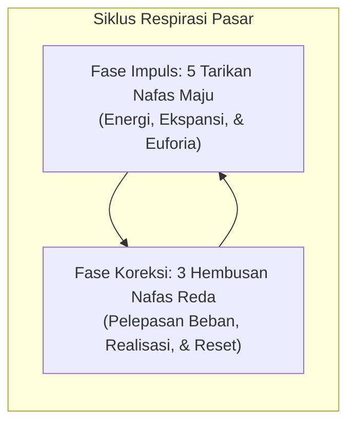
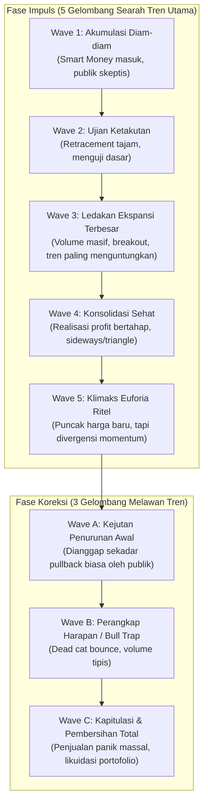
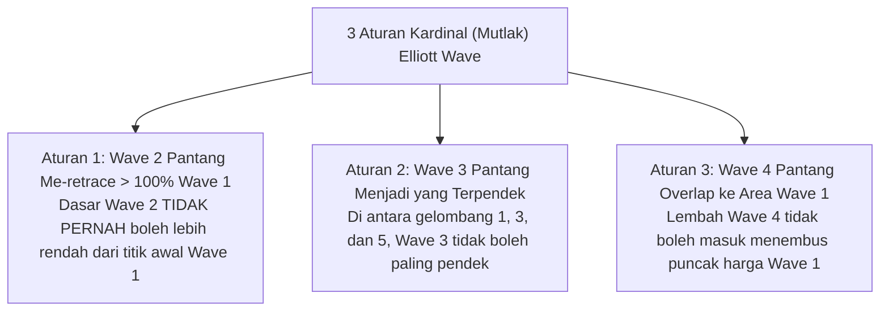
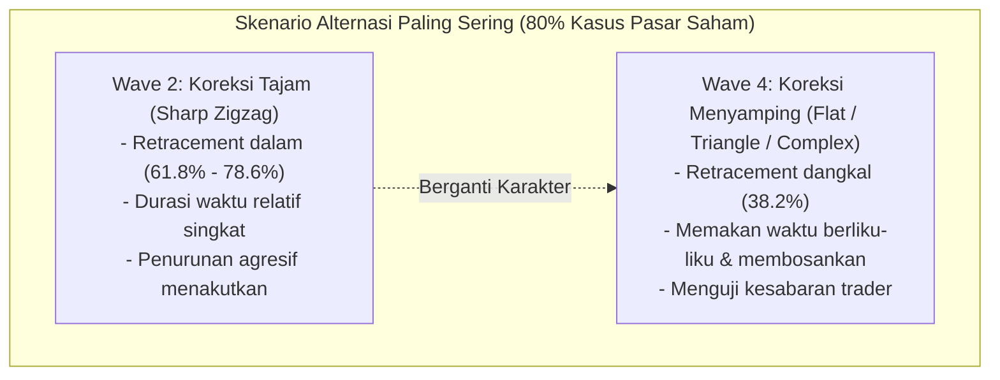
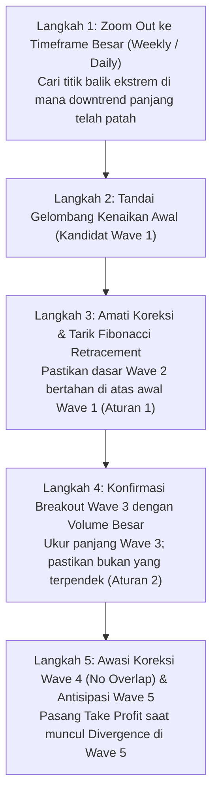

# Bab 22: Elliott Wave Theory

> "Pasar saham adalah kreasi manusia, yang merefleksikan sifat dasar manusia: ritme emosi massa yang berosilasi secara teratur antara optimisme dan pesimisme dalam urutan gelombang geometris alami."  
> — **Ralph Nelson Elliott** (diuraikan oleh **Edianto Ong**, *Technical Analysis for Mega Profit*)

---

## 1. Analogi Membumi: Irama Detak Jantung & 5 Tarikan Nafas Pasar

Bagi pemula yang baru pertama kali melihat grafik saham, pergerakan harga kerap tampak seperti kekacauan acak (*random walk*) tanpa pola dan makna. Namun, Ralph Nelson Elliott (1871–1948) menemukan bahwa pasar finansial bernapas persis seperti organisme hidup.

Bayangkan seorang atlet lari maraton:
1. Atlet tidak mungkin berlari kencang tanpa henti; setelah melakukan sprint bertenaga (**Tarikan Nafas Impuls / Motif**), tubuhnya membutuhkan jeda untuk membuang asam laktat dan menarik oksigen segar (**Hembusan Nafas Koreksi**).
2. Detak jantung manusia di monitor EKG (*elektrokardiogram*) selalu bergerak dalam ritme P-Q-R-S-T: ada dentuman kontraksi kuat ke atas, diikuti penurunan sejenak, disusul lonjakan terbesar, lalu relaksasi bilik jantung sebelum siklus baru dimulai.



Dalam pasar saham, **psikologi massa (*mass psychology*)** bergerak dalam ritme fraktal yang identik: ayunan dari titik nadir keputusasaan (*extreme fear*), berangsur-angsur naik menuju optimisme, meledak menjadi keserakahan massal (*greed/euphoria*), lalu mengempis kembali dalam 3 fase koreksi pembersihan sebelum siklus berikutnya dilahirkan.

---

## 2. Anatomi Siklus Lengkap: 5 Gelombang Motif & 3 Gelombang Koreksi

Satu siklus lengkap (*Complete Market Cycle*) Elliott Wave terdiri dari **8 gelombang utama**:
- **5 Gelombang Impuls / Motif (Diberi label angka 1 - 2 - 3 - 4 - 5):** Menggerakkan harga searah dengan tren utama (*dominant trend*).
- **3 Gelombang Koreksi (Diberi label huruf A - B - C):** Mengoreksi atau melawan arah tren utama sebelumnya guna menyeimbangkan valuasi pasar.



### Karakteristik Psikologis & Volume Tiap Gelombang

Edianto Ong merinci dinamika psikologis di balik setiap gelombang agar trader tidak hanya menghitung garis di layar, tetapi membaca emosi manusia di baliknya:

| Gelombang | Karakteristik Perilaku & Volume | Dinamika Emosional Pelaku Pasar |
| :--- | :--- | :--- |
| **Wave 1** | Kenaikan awal dari dasar jurang penurunan (*bear market bottom*). Volume transaksi mulai membesar dari titik terendah, namun kenaikan kerap diiringi berita fundamental yang masih sangat buruk. | **Ketidakpercayaan (*Disbelief*):** Didorong oleh *smart money* dan investor institusional yang mulai memborong saham murah saat publik masih dilanda trauma kerugian. |
| **Wave 2** | Koreksi ke bawah yang tajam. Me-retrace sebagian besar keuntungan Wave 1 (seringkali 50% hingga 61.8% Fibonacci), namun tidak pernah mencetak titik terendah baru di bawah awal Wave 1. | **Ketakutan (*Fear*):** Publik meyakini bahwa tren penurunan panjang akan berlanjut, tetapi volume penjualan mulai mengering sebelum titik terendah baru tercapai. |
| **Wave 3** | Gelombang paling kuat, paling panjang, dan paling dinamis. Volume melonjak drastis, *breakout* melampaui puncak Wave 1 terjadi dengan *gap* harga dan lilin-lilin hijau berbadan lebar (*Marubozu*). | **Keyakinan Masal (*Optimism & Conviction*):** Berita fundamental membaik, laba emiten melonjak, analis menaikkan target harga, publik dan manajer investasi berbondong-bondong memompa dana ke pasar. Inilah gelombang tempat trader meraup keuntungan terbesar (*Mega Profit*). |
| **Wave 4** | Gerakan konsolidasi yang cenderung lambat, menyamping (*sideways*), atau membentuk pola segitiga (*triangle*). Penurunan volume terlihat sangat jelas. | **Realisasi Keuntungan (*Profit Taking*):** Pelaku pasar mengambil laba parsial, sentimen tetap positif namun pasar membutuhkan waktu mencerna kenaikan Wave 3 yang terlalu cepat. |
| **Wave 5** | Gelombang kenaikan terakhir. Harga mencetak *Higher High*, namun momentum indikator (RSI/MACD) dan volume transaksi seringkali menunjukkan *bearish divergence*. | **Euforia & Keserakahan (*Greed / Climax*):** Publik ritel dan pemula agresif membeli karena tergiur berita spektakuler di media massa, tepat saat institusi mulai mendistribusikan barang dagangannya ke tangan ritel. |
| **Wave A** | Penurunan awal yang cepat. Sering dianggap keliru oleh ritel sebagai koreksi sehat biasa untuk membeli saham murah (*buy on weakness* palsu). | **Penyangkalan (*Denial*):** Mayoritas analis dan ritel masih sangat *bullish*, meyakini reli akan segera berlanjut kembali ke rekor tertinggi baru. |
| **Wave B** | Pantulan teknikal (*dead cat bounce*) dengan volume relatif rendah. Membentuk *bull trap* klasik. | **Harapan Palsu (*False Hope*):** Ritel merasa lega dan menambah posisi beli, tepat sebelum gelombang likuidasi besar dimulai. |
| **Wave C** | Gelombang penurunan dahsyat yang melibas level support Wave A. Menghancurkan portofolio trader yang menolak *cut loss*. | **Keputusasaan & Kapitulasi (*Despair & Capitulation*):** Ketakutan massal mencapai puncak, semua orang melempar barang tanpa memedulikan harga, menandai akhir siklus bear dan mempersiapkan benih siklus baru. |

---

## 3. Kamus Istilah Pemula (Glossary Box)

> [!NOTE]
> **Kamus Istilah Elliott Wave untuk Pemula:**
> - **Impulse / Motif Wave:** Rangkaian 5 gelombang yang mendorong harga ke arah tren dominan utama (1-2-3-4-5).
> - **Corrective Wave:** Rangkaian 3 gelombang penyeimbang yang bergerak melawan tren dominan sebelumnya (A-B-C).
> - **Wave Degree:** Skala waktu gelombang (mulai dari *Subminuette* pada grafik menit, *Minor/Intermediate* pada grafik harian, hingga *Grand Supercycle* pada grafik puluhan tahun).
> - **Fractal Nature:** Sifat geometris di mana bagian kecil dari gelombang memiliki struktur yang persis sama dengan gelombang besar (di dalam Wave 1 terdapat 5 sub-gelombang kecil).
> - **Extension:** Kondisi di mana salah satu gelombang impuls (biasanya Wave 3) memanjang secara dramatis dan terbagi menjadi sub-gelombang yang sangat jelas.
> - **Truncation (Truncated Wave 5):** Kondisi langka di mana Wave 5 gagal menembus titik puncak Wave 3 karena kehabisan tenaga pembeli sebelum target tercapai.
> - **Bearish Divergence:** Kondisi teknikal di mana harga mencetak rekor tertinggi baru pada Wave 5, namun grafik osilator (RSI atau MACD) justru mencetak puncak yang lebih rendah (*Lower High*), membocorkan rahasia bahwa tenaga pendorong telah habis.

---

## 4. Tiga Aturan Kardinal (Mutlak) Elliott Wave

Dalam mengidentifikasi dan menghitung gelombang (*wave counting*), Ralph Nelson Elliott menetapkan **tiga aturan mutlak (*cardinal rules*)**. Aturan ini bersifat matematis dan tidak boleh dilanggar dalam kondisi apa pun. Jika salah satu aturan ini dilanggar, maka label gelombang Anda **100% dipastikan salah** dan wajib dihitung ulang dari awal.



### Penjelasan Detail & Contoh Pelanggaran:

1. **Aturan Mutlak 1: Dasar Wave 2 Pantang Menembus Titik Awal Wave 1**  
   - *Prinsip:* Wave 2 dapat terkoreksi dalam (mengikis 50%, 61.8%, bahkan 88.6% dari Wave 1), namun **tidak boleh menembus 100%** dari titik terendah awal Wave 1.
   - *Jika Dilanggar:* Bila harga menembus di bawah titik awal mula Wave 1, maka kenaikan tersebut bukanlah Wave 1 baru, melainkan sekadar pantulan sementara di dalam kelanjutan tren turun (*downtrend continuation*).

2. **Aturan Mutlak 2: Wave 3 Pantang Menjadi yang Terpendek di Antara Gelombang Impuls**  
   - *Prinsip:* Di antara tiga gelombang impuls (Wave 1, Wave 3, dan Wave 5), **Wave 3 tidak boleh memiliki jarak harga paling pendek**.
   - *Catatan:* Wave 3 tidak wajib selalu menjadi yang paling panjang (meskipun di pasar saham 80% kasus memang yang terpanjang), namun Wave 3 **dilarang keras** menjadi yang paling kerdil di antara ketiganya. Jika Wave 1 panjangnya 500 poin dan Wave 5 panjangnya 400 poin, maka Wave 3 minimal harus lebih dari 400 poin.

3. **Aturan Mutlak 3: Lembah Wave 4 Pantang Masuk ke Teritori Puncak Wave 1 (*No Price Overlap*)**  
   - *Prinsip:* Titik terendah dari koreksi Wave 4 **tidak boleh tumpang tindih (*overlap*) atau turun ke bawah titik puncak harga Wave 1**.
   - *Pengecualian Khusus:* Tumpang tindih harga hanya diizinkan pada formasi diagonal khusus (*Leading Diagonal* di Wave 1 atau *Ending Diagonal* di Wave 5). Pada gelombang impuls standar, pemisahan harga antara puncak Wave 1 dan dasar Wave 4 adalah harga mati.

---

## 5. Pedoman Alternasi (Rule of Alternation)

Jika Aturan Kardinal adalah hukum mutlak, maka **Pedoman Alternasi (*Guideline of Alternation*)** adalah kompas probabilitas tinggi yang sangat disukai Edianto Ong untuk menghemat waktu dan modal.

> **Hukum Alam Alternasi:**  
> Pasar tidak suka mengulang drama koreksi yang persis sama secara berturut-turut dalam satu siklus. Jika Wave 2 berbentuk sederhana dan tajam, maka Wave 4 hampir pasti akan berbentuk kompleks, berliku-liku, dan datar (*sideways*), atau sebaliknya.



### Manfaat Alternasi bagi Strategi Trading:
- **Jangan Membuang Waktu di Wave 4:** Jika Anda melihat Wave 2 selesai hanya dalam tempo 4 hari dengan penurunan curam zigzag, maka ketika Wave 4 dimulai setelah Wave 3 berakhir, bersiaplah menghadapi konsolidasi berombak selama beberapa minggu. Jangan memaksakan diri memborong saham dengan ekspektasi harga akan langsung meroket esok pagi.
- **Identifikasi Pola Triangle:** Pola segitiga (*triangle pattern*) hampir selalu muncul di posisi Wave 4 sebelum ledakan Wave 5 terakhir.

---

## 6. Panduan Step-by-Step Pemula: Menghitung & Memvalidasi Gelombang

Berikut adalah panduan 5 langkah praktis untuk memetakan grafik saham menggunakan Elliott Wave tanpa terjebak kebingungan:



### Prosedur Lapangan:
1. **Langkah 1 (Temukan Titik Balik Siklus):** Buka grafik mingguan atau harian. Temukan titik *Major Swing Low* di mana tren turun sebelumnya terhenti dan garis *downtrend resistance* berhasil ditembus dengan lilin hijau kuat.
2. **Langkah 2 (Plot Wave 1 & 2):** Tandai reli kenaikan pertama sebagai Wave 1. Saat harga terkoreksi, tarik garis Fibonacci dari dasar Wave 1 ke puncak Wave 1. Jika harga berbalik arah di level 50% atau 61.8% tanpa menyentuh titik awal, beri label puncak koreksi tersebut sebagai **Wave 2**.
3. **Langkah 3 (Riding Wave 3):** Tunggu konfirmasi ketika harga menembus (*breakout*) puncak Wave 1 disertai lonjakan volume transaksi harian minimal 1.5x lipat rata-rata. Masuk ke pasar dan biarkan posisi Anda berkembang (*let your profits run*). Target Wave 3 biasanya berada di ekstensi 161.8% dari panjang Wave 1.
4. **Langkah 4 (Waspadai Wave 4):** Ketika reli Wave 3 mulai melambat dan bergerak *sideways*, gambar garis horizontal tepat di puncak tertinggi Wave 1. Batas bawah koreksi Wave 4 tidak boleh menyentuh garis horizontal ini.
5. **Langkah 5 (Exit di Wave 5):** Saat Wave 5 berjalan mencetak harga tertinggi baru, periksa indikator RSI atau MACD. Jika harga naik tetapi puncak histogram MACD atau RSI justru lebih rendah (*Bearish Divergence*), segera kunci keuntungan Anda (*Take Profit*). Jangan serakah menunggu keajaiban lebih lanjut.

---

## 7. Studi Kasus Konkret: Swing Trading Saham BBCA (Siklus Impuls Lengkap)

Mari telaah simulasi transaksi nyata pada saham perbankan berkapitalisasi besar (misal: Saham BBCA) dengan angka harga riil:

```
Puncak Wave 5: Rp 10.400 (Take Profit Final - Muncul RSI Bearish Divergence)
       ▲
      / \
     /   \ Wave A
    /     ▼
   /     Rp 9.800
  /
 / Wave 3: Rp 10.000 (Ekstensi 161.8% Wave 1, Volume Raksasa)
▲       \
│        ▼ Wave 4: Rp 9.400 (Koreksi Flat 38.2%, Bertahan Jauh di Atas Rp 8.800)
│
│ Wave 1: Rp 8.800
▲      \
│       ▼ Wave 2: Rp 8.200 (Koreksi 61.8% dari Rp 7.800 ke Rp 8.800)
│
Rp 7.800 (Awal Siklus Baru dari Bottom Akumulasi)
```

### Eksekusi Trading Plan Berbasis Confluence:
1. **Identifikasi Wave 1 & 2:**
   - Awal kenaikan dari Rp 7.800 melesat ke Rp 8.800 (Panjang Wave 1 = 1.000 poin).
   - Terjadi koreksi Wave 2 ke level Rp 8.200 (Retracement 60% Wave 1). Titik Rp 8.200 jauh di atas Rp 7.800 (**Aturan 1 Valid**).
2. **Titik Entry (Breakout Wave 3):**
   - Trader memasang *Buy Stop* saat harga menembus puncak Wave 1 di Rp 8.820.
   - *Stop Loss:* Dipasang di bawah swing low Wave 2 pada level Rp 8.150 (Risiko: 670 poin).
   - *Target Profit 1 (Wave 3):* Dihitung dari ekstensi Fibonacci 161.8% dari Wave 1 ($1.000 \times 1.618 = 1.618$ poin) $\to Rp\ 8.200 + 1.618 = \mathbf{Rp\ 9.818}$ (dibulatkan Rp 9.800 - Rp 10.000).
   - Keuntungan direalisasikan 50% di Rp 10.000 (Rasio Risk to Reward = $1.180 : 670 \approx 1 : 1.76$).
3. **Mengawal Wave 4 & Re-Entry Wave 5:**
   - Wave 4 mengoreksi harga dari Rp 10.000 ke Rp 9.400.
   - Puncak Wave 1 berada di Rp 8.800. Karena Rp 9.400 > Rp 8.800, **Aturan 3 Valid (No Overlap)**.
   - Pada Rp 9.400 terbentuk pola lilin *Hammer* tepat di garis EMA 50. Trader menambah kembali posisi (*pyramiding entry*).
4. **Exit Puncak Wave 5:**
   - Harga mencetak rekor baru di Rp 10.400.
   - Namun, indikator RSI 14 harian membentuk puncak di level 68 (lebih rendah dibanding puncak RSI saat Wave 3 yang mencapai 82) $\to$ **Konfirmasi Bearish Divergence**.
   - Trader menjual seluruh sisa posisi di level Rp 10.300 - Rp 10.350, mengamankan cuan maksimal tepat sebelum longsoran Wave A melanda pasar.

---

## 8. Kesalahan Fatal Pemula yang Wajib Dihindari

1. **Penghitungan Berdasarkan Keinginan Pribadi (*Wishful Counting*):**  
   Banyak pemula yang sedang memegang saham yang merugi memaksakan perhitungan gelombang agar sesuai dengan harapan portofolionya. Mereka menyebut penurunan tajam sebagai "hanya Wave 2 atau Wave 4" padahal harga sudah menembus titik awal Wave 1 atau tumpang tindih secara brutal. Jangan pernah memanipulasi aturan mutlak demi menenangkan emosi Anda.
2. **Mencoba Menghitung Semua Kerikil Gelombang (Over-Analysis):**  
   Pemula seringkali tersesat mencoba menghitung setiap gelombang kecil pada grafik 1 menit atau 5 menit. Ingat petuah Edianto Ong: struktur Elliott Wave paling andal dan berdaya guna tinggi pada grafik harian (*Daily*) dan mingguan (*Weekly*). Jangan biarkan fluktuasi minor mengaburkan tren besar.
3. **Bertransaksi Tanpa Menunggu Validasi Konfirmasi:**  
   Menebak dasar Wave 2 atau puncak Wave 5 sebelum muncul konfirmasi pola lilin pembalikan arah atau patahnya garis tren adalah tindakan bunuh diri finansial. Selalu tunggu sinyal *confluence* sebelum menekan tombol order.
4. **Mengabaikan Volume Transaksi:**  
   Menganggap suatu kenaikan sebagai Wave 3 padahal volume perdagangannya sepi dan terus menyusut. Wave 3 sejati selalu diiringi oleh ledakan volume dari investor institusi besar. Jika tidak ada volume, itu hanyalah jebakan *bull trap* Wave B!
