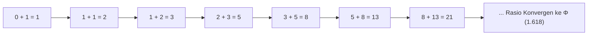
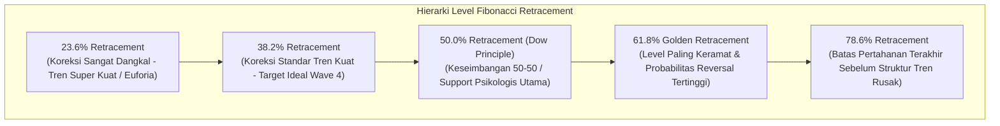
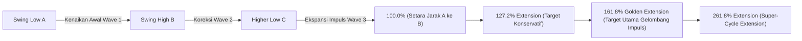
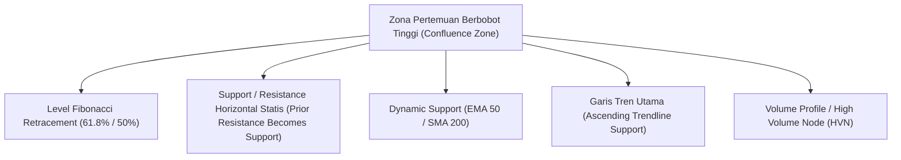

# Bab 23: Fibonacci dan Retracements

> "Di balik ketidakpastian pergerakan harga pasar finansial, tersembunyi harmoni matematis alam semesta. Rasio Emas Fibonacci bukanlah mistisisme, melainkan cetak biru geometris dari reaksi emosional massa terhadap keserakahan dan ketakutan."  
> — **Edianto Ong**, *Technical Analysis for Mega Profit*

---

## 1. Deret Angka Fibonacci & Rasio Emas (The Golden Ratio)

Konsep Fibonacci pertama kali diperkenalkan ke peradaban Barat oleh matematikawan asal Pisa, Italia, yaitu **Leonardo Fibonacci** (Leonardo Bonacci) pada tahun 1202 melalui mahakaryanya *Liber Abaci*.

### Urutan Deret Fibonacci

Deret angka Fibonacci terbentuk dari aturan penjumlahan sederhana: setiap angka berikutnya adalah hasil penjumlahan dari dua angka sebelumnya:

$$\mathbf{0, 1, 1, 2, 3, 5, 8, 13, 21, 34, 55, 89, 144, 233, 377, 610, 987, \dots}$$

Secara matematis dirumuskan sebagai:
$$F_n = F_{n-1} + F_{n-2}$$
dengan kondisi awal $F_0 = 0$ dan $F_1 = 1$.

### Keajaiban Rasio Emas (*The Golden Ratio* / $\Phi$)

Edianto Ong menerangkan bahwa yang terpenting bagi seorang analis teknikal bukanlah deret angkanya, melainkan **hubungan proporsional matematis (rasio)** antar angka-angka tersebut saat deret bertambah besar:

1. **Rasio Utama Emas ($\phi \approx 0.618$):**  
   Jika membagi suatu angka dengan angka berikutnya (misal: $55 \div 89 \approx 0.618$, $89 \div 144 \approx 0.618$, $144 \div 233 \approx 0.618$). Rasio ini dikenal sebagai *Golden Ratio* atau Proporsi Ilahi (*Divine Proportion*).
2. **Kebalikan Rasio Emas ($\Phi \approx 1.618$):**  
   Jika membagi suatu angka dengan angka sebelumnya (misal: $89 \div 55 \approx 1.618$, $144 \div 89 \approx 1.618$).
3. **Rasio Sekunder ($0.382$):**  
   Jika membagi suatu angka dengan angka dua langkah di depannya (misal: $55 \div 144 \approx 0.3819 \approx 0.382$). Alternatif matematis: $1 - 0.618 = 0.382$.
4. **Rasio Tersier ($0.236$):**  
   Jika membagi suatu angka dengan angka tiga langkah di depannya (misal: $55 \div 233 \approx 0.236$). Alternatif matematis: $0.382 \times 0.618 \approx 0.236$.
5. **Rasio Ekstrem ($0.786$):**  
   Merupakan akar kuadrat dari $0.618$ ($\sqrt{0.618} \approx 0.786$).

Di alam semesta, rasio ini ditemukan pada struktur cangkang Nautilus, spiral galaksi, susunan biji bunga matahari, proporsi anatomi tubuh manusia, hingga arsitektur Parthenon Yunani kuno. Dalam pasar modal, rasio ini merefleksikan titik ekuilibrium psikologis di mana partisipan pasar merasa harga telah "cukup murah untuk dibeli" atau "cukup mahal untuk dijual".

---

## 2. Level Fibonacci Retracement Kunci

**Fibonacci Retracement** digunakan untuk mengukur seberapa jauh harga suatu instrumen akan terkoreksi (*pullback*) sebelum melanjutkan kembali tren utamanya (*trend continuation*).

### Tabel Karakteristik Level Retracement

| Level Retracement | Karakter Tren & Makna Perilaku Pasar | Rekomendasi Tindakan Trader |
| :--- | :--- | :--- |
| **23.6%** | **Tren Hiper-Agresif:** Penjual sangat lemah, pembeli begitu dominan hingga tidak mengizinkan harga turun lebih jauh. | Cocok untuk strategi *breakout add-on*, namun waspadai risiko *whipsaw* karena *margin of safety* kecil. |
| **38.2%** | **Tren Kuat (*Healthy Strong Trend*):** Koreksi wajar dalam tren naik yang teratur. Sering menjadi dasar koreksi gelombang 4 pada Elliott Wave. | Area ideal untuk *entry swing trading* pertama dengan *risk-to-reward ratio* yang terukur. |
| **50.0%** | **Dow Theory Midpoint:** Secara matematis bukan angka turunan asli deret Fibonacci, namun diadopsi secara universal dari Teori Dow (koreksi separuh dari pergerakan impuls). | Titik ekuilibrium psikologis netral. Sering menjadi area pertahanan kuat bagi *institutional smart money*. |
| **61.8%** | **Golden Ratio Retracement:** Level paling dihormati oleh algoritma institusi dan trader global. Menandai batas koreksi paling bernilai (*deep value pullback*). | Zona beli dengan probabilitas tertinggi (*high probability reversal*), terutama untuk menangkap dasar Wave 2. |
| **78.6%** | **Deep Retracement (Last Bastion):** Level pertahanan terakhir. Jika ditembus, probabilitas besar harga akan menguji 100% (gagal melanjutkan tren / membentuk *double bottom*). | Area spekulasi risiko tinggi dengan *stop-loss* sangat ketat tepat di bawah level 100% (titik awal ayunan harga). |

---

## 3. Fibonacci Extension / Expansion (Mengukur Target Harga Baru)

Ketika suatu saham berhasil menembus rekor tertinggi sepanjang masa (*All-Time High / ATH*) atau menembus batas resistensi tertingginya, seorang analis teknikal tidak lagi memiliki level resistensi historis statis untuk menentukan target jual. 

Dalam situasi ini, Edianto Ong menekankan penggunaan **Fibonacci Extension / Expansion** sebagai kompas navigasi objektif untuk memproyeksikan target laba (*Take Profit*).

### Level Fibonacci Extension & Implikasinya:

1. **100.0% Extension:**  
   Jarak kenaikan gelombang baru tepat setara 1:1 dengan panjang gelombang sebelumnya ($Distance(C \to Target) = Distance(A \to B)$). Merupakan target minimal sebuah pergerakan tren terukur (*Measured Move*).
2. **127.2% Extension ($\sqrt{1.618}$):**  
   Sering menjadi target awal untuk saham yang mengalami *breakout* dari pola konsolidasi dasar (*cup and handle* atau *rectangle*).
3. **161.8% Golden Extension:**  
   Target paling krusial dalam analisa Elliott Wave untuk memproyeksikan puncak **Wave 3**. Institusi kerap memprogram algoritma mereka untuk merealisasikan keuntungan (*take profit*) di area ini.
4. **261.8% Extension:**  
   Dicapai pada saham-saham siklus komoditas super (*super-cycle rally*) atau saham *growth* yang mengalami euforia laba spektakuler.

---

## 4. Konvergensi Multi-Indikator: Fibonacci Confluence Zones

Sebuah level Fibonacci yang berdiri sendiri memiliki keandalan terbatas. Rahasia sukses trading berbasis Fibonacci ala Edianto Ong terletak pada pencarian **Confluence Zones (Zona Pertemuan Kunci)**.

> **Definisi Confluence Zone:**  
> Area harga di mana beberapa bukti teknikal yang independen berkumpul pada koordinat harga yang hampir sama, menciptakan "magnet" support/resistance dengan probabilitas reaksi pasar yang luar biasa tinggi.

### 3 Langkah Menemukan Confluence Zone Bernilai Tinggi:
1. **Langkah 1 (Tarik Fibonacci Retracement):** Tarik garis Fibonacci dari *Major Swing Low* ke *Major Swing High* terkini. Amati kluster level 50% dan 61.8%.
2. **Langkah 2 (Cari Level Struktur Statis):** Periksa grafik ke arah kiri (*look left*). Apakah pada kisaran harga tersebut terdapat puncak sebelumnya yang telah tertembus (*Resistance turned Support*)?
3. **Langkah 3 (Verifikasi Dinamis & Indikator):** Periksa apakah ada garis rata-rata pergerakan penting (misalnya EMA 50 atau SMA 200 harian) yang sedang melintas di area tersebut, serta konfirmasi ada tidaknya pola *candlestick reversal* saat harga menyentuh zona tersebut.

Jika tiga atau empat elemen ini berhimpit pada satu rentang harga yang sempit, maka zona tersebut menjadi **benteng pertahanan institusi** yang memberikan *Risk-to-Reward Ratio* terbaik bagi trader.
