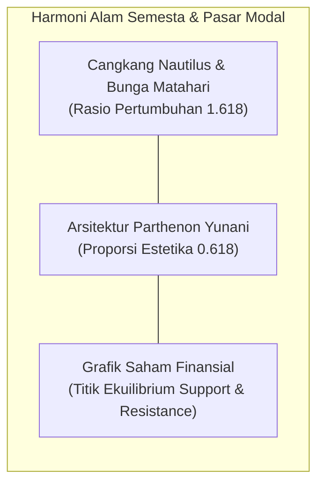
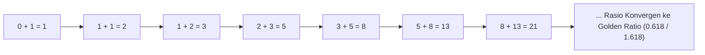
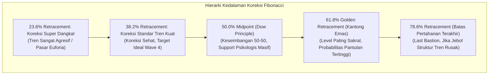
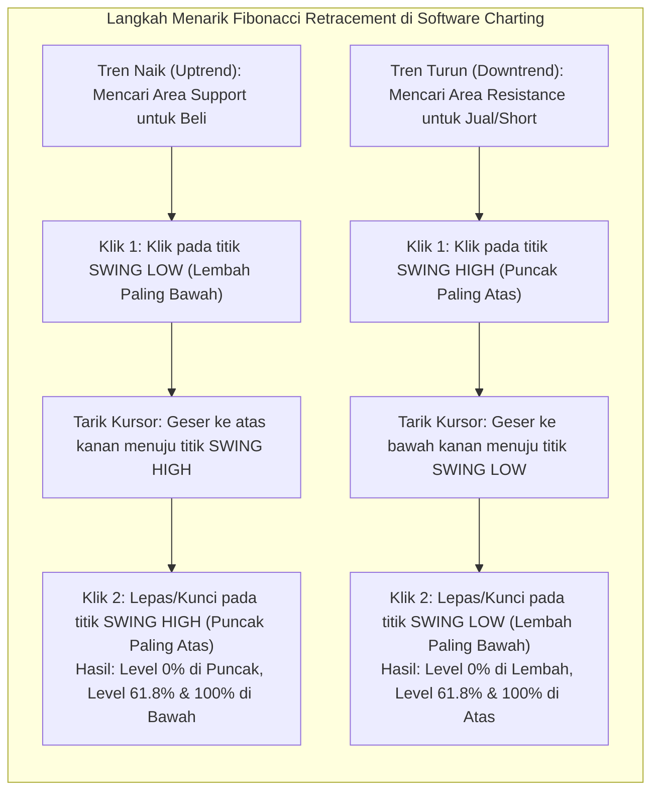
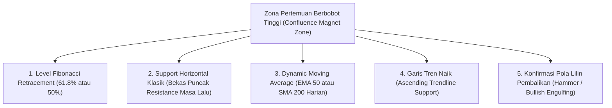

# Bab 23: Fibonacci dan Retracements

> "Di balik ketidakpastian pergerakan harga pasar finansial, tersembunyi harmoni matematis alam semesta. Rasio Emas Fibonacci bukanlah mistisisme, melainkan cetak biru geometris dari reaksi emosional massa terhadap keserakahan dan ketakutan."  
> — **Edianto Ong**, *Technical Analysis for Mega Profit*

---

## 1. Analogi Membumi: Pita Ukur Arsitek & Cangkang Kerang Emas

Bayangkan Anda sedang merancang sebuah mahakarya gedung pencakar langit atau mengamati sebuah rumah tinggal mewah. Seorang arsitek handal tidak pernah meletakkan pilar, jendela, atau langit-langit secara serampangan. Mereka menggunakan **pita ukur dengan proporsi geometris** tertentu agar bangunan tersebut kokoh, stabil, dan sedap dipandang mata.

Begitu pula dengan alam semesta:
- **Cangkang Kerang Nautilus:** Kamar-kamar cangkang hewan laut purba ini tumbuh melingkar membesar dengan proporsi yang persis sama, di mana setiap kamar baru selalu berukuran 1.618 kali lipat dari kamar sebelumnya.
- **Bunga Matahari:** Spiral biji bunga matahari tersusun dalam formasi 21, 34, 55, hingga 89 putaran berlawanan arah guna memaksimalkan penyerapan sinar matahari tanpa saling menghalangi.
- **Detak Tarikan Harga Saham:** Saat harga saham melesat naik setinggi 1.000 meter, wajar jika pendaki saham beristirahat sejenak untuk minum dan mengatur napas. **Fibonacci Retracement** adalah "pita ukur" milik trader untuk mengukur di pos peristirahatan manakah para pembeli besar (*smart money*) akan kembali memasang tenda dan melanjutkan pendakian.



---

## 2. Deret Angka Fibonacci & Rasio Emas (The Golden Ratio)

Konsep Fibonacci pertama kali diperkenalkan ke peradaban Barat oleh matematikawan asal Pisa, Italia, yaitu **Leonardo Fibonacci** (Leonardo Bonacci) pada tahun 1202 melalui mahakaryanya *Liber Abaci*.

### Urutan Deret Fibonacci

Deret angka Fibonacci terbentuk dari aturan penjumlahan sederhana: setiap angka berikutnya adalah hasil penjumlahan dari dua angka sebelumnya:

$$\mathbf{0, 1, 1, 2, 3, 5, 8, 13, 21, 34, 55, 89, 144, 233, 377, 610, 987, \dots}$$

Secara matematis dirumuskan sebagai:
$$F_n = F_{n-1} + F_{n-2}$$
dengan kondisi awal $F_0 = 0$ dan $F_1 = 1$.



### Keajaiban Rasio Emas (*The Golden Ratio* / $\Phi$)

Edianto Ong menerangkan bahwa yang terpenting bagi seorang trader teknikal bukanlah deret angka hitungannya, melainkan **hubungan proporsional matematis (rasio)** antar angka-angka tersebut saat deret bertambah besar:

1. **Rasio Utama Emas ($\phi \approx 0.618$ / 61.8%):**  
   Jika Anda membagi suatu angka dengan angka berikutnya (misal: $55 \div 89 \approx 0.618$, $89 \div 144 \approx 0.618$, $144 \div 233 \approx 0.618$). Rasio ini dikenal sebagai *Golden Ratio* atau Proporsi Ilahi (*Divine Proportion*).
2. **Kebalikan Rasio Emas ($\Phi \approx 1.618$ / 161.8%):**  
   Jika Anda membagi suatu angka dengan angka sebelumnya (misal: $89 \div 55 \approx 1.618$, $144 \div 89 \approx 1.618$). Angka ini menjadi basis penentuan target keuntungan masa depan (*Fibonacci Extension*).
3. **Rasio Sekunder ($0.382$ / 38.2%):**  
   Jika Anda membagi suatu angka dengan angka dua langkah di depannya (misal: $55 \div 144 \approx 0.3819 \approx 0.382$). Dihasilkan juga dari formula matematis: $1 - 0.618 = 0.382$.
4. **Rasio Tersier ($0.236$ / 23.6%):**  
   Jika Anda membagi suatu angka dengan angka tiga langkah di depannya (misal: $55 \div 233 \approx 0.236$). Dihasilkan dari formula: $0.382 \times 0.618 \approx 0.236$.
5. **Rasio Ekstrem ($0.786$ / 78.6%):**  
   Merupakan akar kuadrat dari $0.618$ ($\sqrt{0.618} \approx 0.786$). Level ini menjadi batas pertahanan benteng terakhir sebelum tren berbalik arah total.

---

## 3. Kamus Istilah Pemula (Glossary Box)

> [!NOTE]
> **Kamus Istilah Fibonacci untuk Pemula:**
> - **Swing Low:** Titik harga terendah signifikan sebelum harga mulai berbalik arah melesat naik (lembah grafik).
> - **Swing High:** Titik puncak harga tertinggi sebelum harga mulai berbalik arah terkoreksi turun (puncak grafik).
> - **Retracement:** Penurunan harga sementara (*pullback*) yang berlawanan dengan arah tren utama, sebelum harga melanjutkan kembali perjalanannya.
> - **Extension / Expansion:** Proyeksi target harga ke wilayah yang belum pernah tercapai sebelumnya (terutama saat harga mencetak rekor tertinggi baru / *All-Time High*).
> - **The Golden Pocket (Kantong Emas):** Area sempit antara level Fibonacci **61.8% hingga 65% (atau 61.8% - 78.6%)** yang secara historis memiliki tingkat probabilitas pembalikan arah paling akurat dan paling sering diincar oleh algoritma institusi.
> - **Confluence Zone:** Titik harga di mana garis level Fibonacci bertemu tepat bersamaan dengan support horizontal, garis rata-rata bergerak (MA), atau garis tren (*trendline*).

---

## 4. Level Fibonacci Retracement Kunci & Makna Perilaku Pasar

Level **Fibonacci Retracement** berfungsi memetakan area *support* potensial saat harga sedang terkoreksi turun dalam tren naik, atau area *resistance* potensial saat harga sedang memantul naik dalam tren turun (*bear market rally*).



### Karakteristik & Rekomendasi Tindakan:

| Level Retracement | Karakter Tren & Kondisi Psikologis Pasar | Rekomendasi Tindakan Trader |
| :--- | :--- | :--- |
| **23.6%** | **Tren Hiper-Agresif:** Tekanan jual sangat lemah, pembeli begitu rakus hingga tidak mengizinkan harga turun lebih jauh. | Jangan terlalu agresif menambah muatan di sini karena jarak ke dasar lembah masih jauh (*stop loss* menjadi lebar). |
| **38.2%** | **Tren Kuat (*Healthy Strong Trend*):** Koreksi wajar dan sangat sehat dalam tren naik teratur. Karakteristik khas koreksi Wave 4 pada Elliott Wave. | Zona ideal untuk melakukan pembelian bertahap (*buy on weakness*) pertama dengan rasio risiko dan potensi keuntungan yang menarik. |
| **50.0%** | **Dow Theory Midpoint:** Bukan angka deret asli Fibonacci, namun diadopsi secara universal dari Teori Dow (koreksi separuh dari seluruh keuntungan sebelumnya). | Titik ekuilibrium psikologis netral. Sering menjadi area pertahanan kokoh investor institusi untuk menyerap barang ritel. |
| **61.8%** | **Golden Ratio Retracement:** Level paling dihormati oleh algoritma institusi dan hedge fund global. Menandai batas diskon harga paling berharga (*deep value pullback*). | **Zona Beli Utama (*High Probability Reversal Zone*).** Wajib dipantau ketat untuk menangkap titik balik Wave 2. |
| **78.6%** | **Benteng Pertahanan Terakhir (*Last Bastion*):** Koreksi sangat dalam. Pembeli harus mempertahankan level ini dengan segala daya. | Spekulasi risiko tinggi dengan batas toleransi rugi (*stop loss*) sangat ketat tepat di bawah level 100% (titik awal ayunan harga). |

---

## 5. Panduan Step-by-Step Pemula: Cara Praktis Menarik Garis Fibonacci

Salah satu kebingungan terbesar bagi pemula adalah: *"Dari mana saya harus mulai mengklik mouse dan ke mana saya harus menarik garisnya?"* Berikut panduan baku yang tidak boleh terbalik:



### Tips Praktis Edianto Ong dalam Menarik Garis:
1. **Sumbu Lilin vs Tubuh Lilin (*Wick vs Body*):**  
   Selalu tarik garis dari **ujung sumbu lilin terendah (*shadow low*)** ke **ujung sumbu lilin tertinggi (*shadow high*)**. Sumbu lilin merefleksikan batas ekstrem psikologis pasar yang sesungguhnya di sesi tersebut.
2. **Identifikasi Titik Pivot yang Jelas:**  
   Jangan menarik Fibonacci pada gelombang kecil di tengah-tengah konsolidasi yang sempit. Carilah titik ayunan harga (*swing*) yang mencolok dan terlihat jelas bahkan ketika Anda menjauhkan mata dari layar (*obvious swings*).

---

## 6. Fibonacci Extension: Mengukur Target Harga Saat Menembus ATH

Ketika suatu saham menembus rekor tertinggi sepanjang sejarah (*All-Time High / ATH*), tidak ada lagi garis resistensi masa lalu yang bisa dijadikan panduan target jual. Dalam kondisi seperti ini, trader pemula seringkali bingung atau menjual saham terlalu cepat karena takut harga jatuh kembali.

**Fibonacci Extension** (sering disebut juga *Trend-Based Fibonacci Extension*) adalah kompas objektif untuk menentukan target ambil untung (*Take Profit*).

```mermaid
flowchart LR
    A["Titik A: Swing Low Awal"] -->|Dorongan Naik Gelombang 1| B["Titik B: Swing High Puncak"]
    B -->|Koreksi Gelombang 2| C["Titik C: Lembah Retracement"]
    C -->|Ekstensi Gelombang 3| T1["Target 1: 100.0% (Panjang Setara Jarak A ke B)"]
    T1 --> T2["Target 2: 127.2% Extension (Target Konservatif)"]
    T2 --> T3["Target 3: 161.8% Golden Extension (Target Utama Super Profit)"]
    T3 --> T4["Target 4: 261.8% Extension (Fase Euforia Komoditas)"]
```



### Cara Menarik 3 Titik Fibonacci Extension:
1. **Klik Pertama (A):** Pada dasar lembah sebelum reli dimulai (*Swing Low*).
2. **Klik Kedua (B):** Pada puncak kenaikan reli tersebut (*Swing High*).
3. **Klik Ketiga (C):** Pada dasar titik terendah tempat koreksi terhenti (*Higher Low / Retracement Bottom*).

### Makna Target Angka:
- **100.0% Extension:** Target gerakan terukur (*Measured Move*), di mana gelombang kedua memiliki panjang yang persis sama dengan gelombang pertama.
- **161.8% Extension (Golden Target):** Target paling krusial di mana para *fund manager* dan algoritma kuantitatif dunia melepaskan sebagian besar portofolio mereka untuk mengunci keuntungan raksasa.

---

## 7. Seni Menggabungkan Indikator: Fibonacci Confluence Zones

Edianto Ong selalu menegaskan: **Satu garis Fibonacci yang berdiri sendirian di tengah gurun grafik tidak memiliki kekuatan apa pun!** Kekuatan sejati Fibonacci baru muncul ketika terjadi **Confluence (Pertemuan Banyak Bukti Teknis)** di satu titik koordinat yang sama.



> **Hukum Benteng Tak Terkalahkan:**  
> Semakin banyak garis analisis teknikal independen yang berpotongan di level harga yang sama, semakin tebal dinding pertahanan institusi di area tersebut, dan semakin kecil risiko modal yang Anda pertaruhkan.

---

## 8. Studi Kasus Konkret: Entry Confluence Saham ASII

Mari kita bedah rencana perdagangan (*Trading Plan*) riil pada saham PT Astra International Tbk (ASII):

```
Rp 6.000 (Puncak Swing High B)
    \
     \  Koreksi Turun Sehat
      \
       ▼ Rp 5.250 (Titik C - Retracement 61.8% + Support Klasik + EMA 50 + Lilin Hammer)
      /
     /  Reli Kenaikan Awal
    /
Rp 4.000 (Dasar Swing Low A)
```

### Data Teknis Lapangan:
1. **Identifikasi Gelombang A-B:**  
   Saham ASII melesat dari dasar Rp 4.000 (*Swing Low A*) menuju ke Rp 6.000 (*Swing High B*). Total kenaikan = Rp 2.000.
2. **Koreksi Menuju Golden Pocket:**  
   - Level 50% Retracement $= 6.000 - (0.50 \times 2.000) = \mathbf{Rp\ 5.000}$.
   - Level 61.8% Retracement $= 6.000 - (0.618 \times 2.000) = \mathbf{Rp\ 4.764}$ (Area Golden Pocket: Rp 5.200 - Rp 4.800).
   - Pada harga Rp 5.200 - Rp 5.250, terdapat bekas puncak resistensi kuat 3 bulan lalu (*Prior Resistance becomes New Support*).
   - Garis rata-rata **EMA 50 harian** sedang melandai naik persis berada di Rp 5.220.
3. **Konfirmasi Lilin Reversal:**  
   Pada sesi perdagangan hari Kamis, harga sempat ditekan ke Rp 5.175, namun ditutup menguat di Rp 5.250 membentuk lilin **Hammer** dengan sumbu bawah panjang, sementara indikator RSI berada di level 32 (*Oversold boundary*).
4. **Eksekusi Trading Plan:**
   - **Entry Beli:** Pasang antrean beli di Rp 5.275 (saat harga menembus puncak lilin Hammer).
   - **Stop Loss:** Pasang proteksi jual di Rp 4.950 (tepat di bawah level support psikologis Rp 5.000 dan level Fibo 50%). Risiko rugi $= 5.275 - 4.950 = \mathbf{Rp\ 325}$ per lembar.
   - **Target Ambil Untung 1 (Konservatif):** Puncak Swing High lama di Rp 6.000 (Potensi untung $= 6.000 - 5.275 = \mathbf{Rp\ 725}$). Rasio $Risk : Reward = 1 : 2.23$.
   - **Target Ambil Untung 2 (Ekstensi 161.8%):** Proyeksi dari titik C (Rp 5.250) $+ (2.000 \times 1.618) = Rp\ 5.250 + 3.236 = \mathbf{Rp\ 8.480}$.
   - *Hasil Transaksi:* Posisi beli terisi dengan proteksi risiko yang sangat aman dan terukur.

---

## 9. Kesalahan Fatal Pemula dalam Menggunakan Fibonacci

1. **Menarik Garis dari Kanan ke Kiri (*Time Distortion*):**  
   Waktu bergerak maju dari kiri ke kanan. Menarik garis Fibonacci dari masa kini mundur ke masa lalu akan membalik koordinat rasio dan menghasilkan angka yang kacau balau.
2. **Memaksakan Setiap Penurunan Menjadi Golden Pocket:**  
   Jika sebuah saham sedang berada dalam tren penurunan bebas (*free-fall / downtrend* di bawah SMA 200), jangan pernah menangkap pisau jatuh hanya karena harga menyentuh Fibo 61.8%. Fibonacci Retracement hanya bekerja efektif jika tren dasarnya adalah **Uptrend sehat**.
3. **Mengabaikan Aksi Harga (*Price Action*):**  
   Banyak trader memasang order beli buta (*blind limit order*) persis di garis 61.8% tanpa menunggu reaksi pasar. Jika lilin yang menghantam garis 61.8% adalah lilin merah raksasa tanpa sumbu (*Bearish Marubozu*), garis tersebut akan ditembus layaknya pisau panas memotong mentega! Selalu tunggu lilin penolakan harga (*rejection wick*).
4. **Grafik Terlalu Ruwet (*Chart Spaghetti*):**  
   Menarik 5 garis Fibonacci berbeda dari setiap puncak dan lembah kecil hingga grafik tertutup jaring laba-laba angka. Hal ini menciptakan kebingungan analisis (*analysis paralysis*). Cukup gunakan satu atau dua ayunan harga mayor paling dominan.
