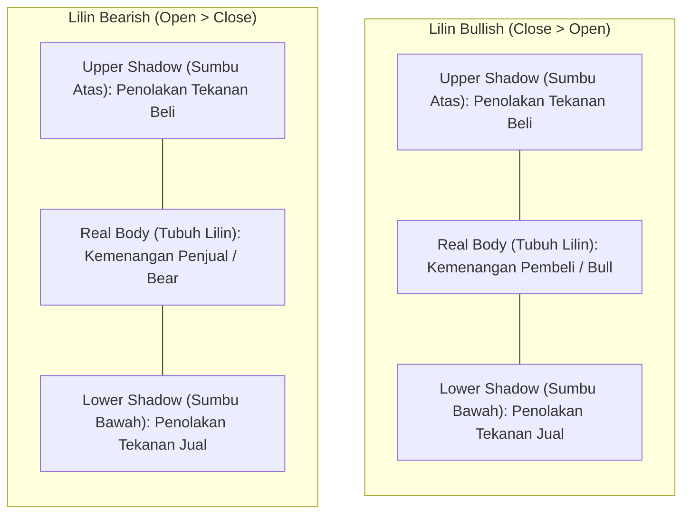
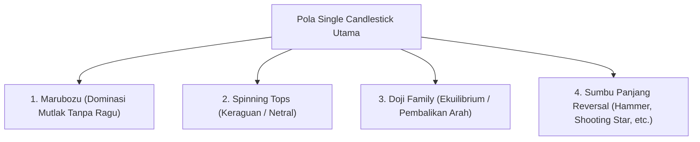
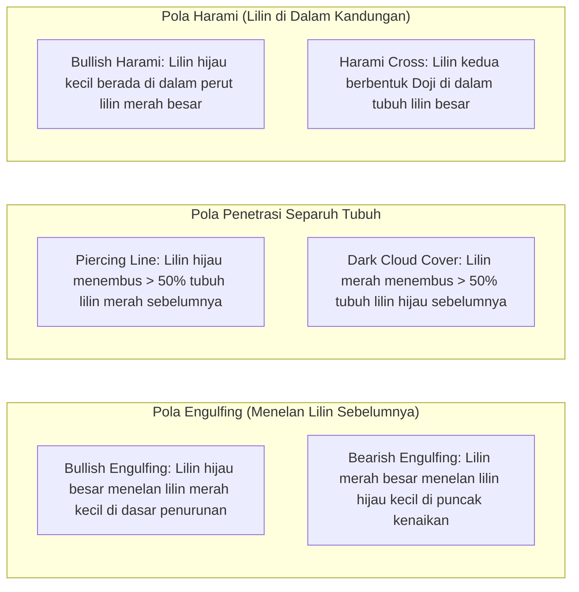
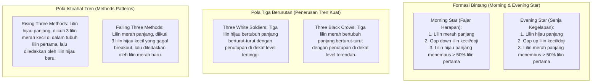

# Bab 24: Candlestick Komprehensif

> "Setiap batang lilin adalah drama pertempuran hidup-mati antara pembeli dan penjual. Tubuh lilin mencerminkan kenyataan hasil pertarungan, sedangkan sumbu lilin memperlihatkan jejak penolakan dan kepalsuan."  
> — **Edianto Ong**, *Technical Analysis for Mega Profit*

---

## 1. Sejarah & Filosofi Candlestick Munehisa Homma

Grafik lilin (*Candlestick Charting*) pertama kali dikembangkan di Jepang pada abad ke-18 oleh seorang pedagang beras legendaris bernama **Munehisa Homma** (1724–1803) dari Sakata. Homma berdagang di Pasar Beras Dojima di Osaka, yang diakui sebagai pasar perdagangan berjangka (*futures market*) pertama di dunia.

Homma menyadari bahwa meskipun panen beras dipengaruhi oleh cuaca dan faktor fundamental, fluktuasi harga harian dikendalikan oleh **emosi psikologis para pedagang**. Metode analisisnya, yang kemudian dikenal sebagai *Sakata Rules*, memungkinkan Homma mendominasi pasar beras hingga konon mencatatkan 100 kemenangan perdagangan beruntun dan diangkat sebagai penasihat keuangan terhormat pemerintah kekaisaran Jepang.

Pada akhir 1980-an, analis Barat **Steve Nison** memperkenalkan metode ini ke dunia keuangan modern melalui bukunya *Japanese Candlestick Charting Techniques*. Di Indonesia, Edianto Ong menjabarkan candlestick bukan sekadar sebagai gambar grafik, melainkan jendela transparan untuk melihat mentalitas massa secara *real-time*.

### Anatomi Anatomi Dasar Lilin

Setiap lilin merangkum empat data harga penting dalam suatu periode waktu (*timeframe*):
* **Open (O):** Harga pembukaan
* **High (H):** Titik tertinggi yang berhasil dicapai
* **Low (L):** Titik terendah yang berhasil diuji
* **Close (C):** Harga penutupan akhir periode

* **Real Body (Tubuh Lilin):** Menunjukkan intensitas dominasi antara kekuatan beli dan jual. Semakin panjang tubuh lilin, semakin mutlak kemenangan pihak pemenang.
* **Shadow / Wick (Sumbu Lilin):** Menunjukkan wilayah penolakan harga (*price rejection*). Sumbu atas panjang mencerminkan bahwa pembeli sempat mendorong harga naik namun dipukul mundur oleh penjual sebelum penutupan. Sumbu bawah panjang mencerminkan bahwa penjual sempat menekan harga turun namun pembeli masuk menyerap penawaran (*buying back*).

---

## 2. Pola Single Candlestick (Lilin Tunggal)

Pola lilin tunggal memberikan gambaran seketika mengenai sentimen pasar dalam satu sesi perdagangan.

### Tabel Klasifikasi Single Candlestick:

| Pola Lilin | Ciri Visual Spesifik | Makna Psikologis & Posisi Pasar |
| :--- | :--- | :--- |
| **Marubozu (Bullish/Bearish)** | Tubuh lilin sangat panjang dan penuh tanpa sumbu atas maupun sumbu bawah (*Open = Low/High, Close = High/Low*). | **Dominasi Mutlak:** Salah satu pihak mengontrol sesi perdagangan dari detik pertama hingga akhir tanpa perlawanan berarti. Menandakan momentum yang sangat kuat untuk kelanjutan tren. |
| **Long vs Short Candle** | Tubuh panjang mencerminkan volatilitas dan komitmen kuat; tubuh pendek mencerminkan konsolidasi dan ketidaktertarikan partisipan. | Lilin pendek di dekat level kritis seringkali menjadi tanda akumulasi diam-diam sebelum *breakout* dengan lilin panjang. |
| **Spinning Tops** | Tubuh lilin kecil di tengah-tengah dengan sumbu atas dan sumbu bawah yang berukuran relatif sama panjang. | **Keraguan (*Indecision*):** Kedua belah pihak sama-sama gagal mempertahankan kendali. Mengindikasikan pasar sedang istirahat atau kehilangan tenaga. |
| **Standard Doji** | Garis tipis menyerupai tanda tambah (+), di mana harga pembukaan sama atau hampir persis sama dengan harga penutupan (*Open = Close*). | Titik impas psikologis total. Menjadi sinyal peringatan dini bahwa tren sebelumnya sedang kehabisan bahan bakar. |
| **Long-legged Doji** | Sumbu atas dan sumbu bawah sangat panjang dengan garis tubuh tipis di tengah. | Volatilitas ekstrem; terjadi perang terbuka besar-besaran antara bull dan bear yang berakhir remis. |
| **Dragonfly Doji** | Sumbu bawah sangat panjang, tanpa sumbu atas (*Open = Close = High*). Terbentuk di dasar tren turun. | **Penolakan Bearish Kuat:** Penjual mencoba membantai harga ke bawah, namun pembeli memborong habis dan mendorong harga kembali ke titik tertinggi. Sangat *bullish*. |
| **Gravestone Doji** | Sumbu atas sangat panjang, tanpa sumbu bawah (*Open = Close = Low*). Terbentuk di puncak tren naik. | **Penolakan Bullish Kuat:** Pembeli mencoba menembus level baru namun dihantam gelombang jual institusi hingga harga terpuruk ke titik pembukaan. Sangat *bearish*. |
| **Hammer** | Tubuh kecil di batas atas rentang harga, sumbu bawah minimal 2x panjang tubuh lilin, sumbu atas sangat kecil/tidak ada. Terjadi di **bawah tren turun**. | Sinyal pembalikan naik (*bullish reversal*). Penjualan panik di awal sesi berhasil diserap tuntas oleh pembeli cerdas. |
| **Hanging Man** | Bentuk fisik identik dengan Hammer, namun muncul di **puncak tren naik**. | Sinyal peringatan bahaya (*bearish warning*). Munculnya tekanan jual intraday yang dalam mengindikasikan bahwa pembeli mulai rapuh. Wajib menunggu konfirmasi lilin berikutnya. |
| **Inverted Hammer** | Tubuh kecil di batas bawah, sumbu atas panjang minimal 2x tubuh, terjadi di **dasar tren turun**. | Pembeli mulai melakukan serangan balik awal untuk menguji pertahanan penjual. Membutuhkan konfirmasi lilin hijau di sesi berikutnya. |
| **Shooting Star** | Bentuk fisik identik dengan Inverted Hammer, namun muncul di **puncak tren naik**. | Sinyal pembalikan turun (*bearish reversal*) berprobabilitas tinggi. Percobaan pembeli mencetak harga tertinggi baru ditolak mentah-mentah oleh tekanan jual agresif. |

---

## 3. Pola Dual Candlestick (Dua Lilin)

Pola dua lilin mengevaluasi pergeseran kendali dari satu sesi ke sesi berikutnya secara dinamis.

### 1. Bullish & Bearish Engulfing
* **Bullish Engulfing:** Sesi 1 adalah lilin merah yang lemah. Sesi 2 dibuka lebih rendah (*gap down*), namun pembeli mengamuk mendorong harga naik hingga tubuh lilin hijau menelan (*engulfs*) seluruh tubuh lilin merah sesi 1. Ini adalah sinyal pembalikan tren naik paling bertenaga.
* **Bearish Engulfing:** Kebalikan dari versi bullish; lilin merah raksasa menelan tubuh lilin hijau di puncak tren, menandakan bahwa penjual telah mengambil alih kemudi pasar secara agresif.

### 2. Piercing Line & Dark Cloud Cover
* **Piercing Line (Bullish):** Muncul di dasar tren turun. Sesi 2 dibuka *gap down*, namun harga kemudian ditutup menembus ke atas garis tengah (lebih dari 50%) dari tubuh lilin merah sesi 1. Pembeli membuktikan kekuatan mereka untuk membalikkan momentum.
* **Dark Cloud Cover / Awan Gelap (Bearish):** Muncul di puncak tren naik. Sesi 2 dibuka *gap up* mencetak rekor baru, namun harga berbalik arah dan ditutup jauh di bawah titik tengah (lebih dari 50%) dari tubuh lilin hijau sesi 1. Menandakan badai koreksi segera tiba.

### 3. Harami & Harami Cross
* **Harami (Secara harfiah berarti "Hamil" dalam bahasa Jepang):** Lilin pertama memiliki tubuh besar (*Mother Candle*), sedangkan lilin kedua memiliki tubuh kerdil (*Baby Candle*) yang sepenuhnya berada di dalam rentang tubuh lilin pertama. Ini mencerminkan hilangnya volatilitas dan momentum secara drastis (*exhaustion*).
* **Harami Cross:** Jika lilin kerdil kedua berbentuk **Doji**, pola ini disebut *Harami Cross* dan memiliki bobot probabilitas pembalikan arah yang jauh lebih kuat dibanding Harami biasa.

---

## 4. Pola Multi Candlestick (Tiga Lilin atau Lebih)

Pola multi-candlestick memberikan konfirmasi terkuat karena merepresentasikan transisi sentimen yang matang selama beberapa hari perdagangan berturut-turut.

### Rangkuman Eksekutif Multi Candlestick:
1. **Morning Star:** Menandai fajar baru setelah malam panjang tren turun. Kombinasi tekanan jual yang melemah, keraguan di hari kedua, dan konfirmasi pembeli yang masuk masif di hari ketiga.
2. **Evening Star:** Sinyal puncak pasar. Mengindikasikan bahwa reli harga telah membentur tembok distribusi institusi yang kokoh.
3. **Three White Soldiers & Three Black Crows:** Pola momentum murni. Tidak ada keraguan, setiap sesi mencatatkan *higher highs* (untuk soldiers) atau *lower lows* (untuk crows) tanpa sumbu panjang.
4. **Rising & Falling Three Methods:** Pola kelanjutan tren (*trend continuation pattern*). Mengajarkan trader untuk tidak panik saat terjadi *pullback* 3 hari berturut-turut, selama koreksi tersebut tidak mampu menembus tubuh lilin pendorong utama.
