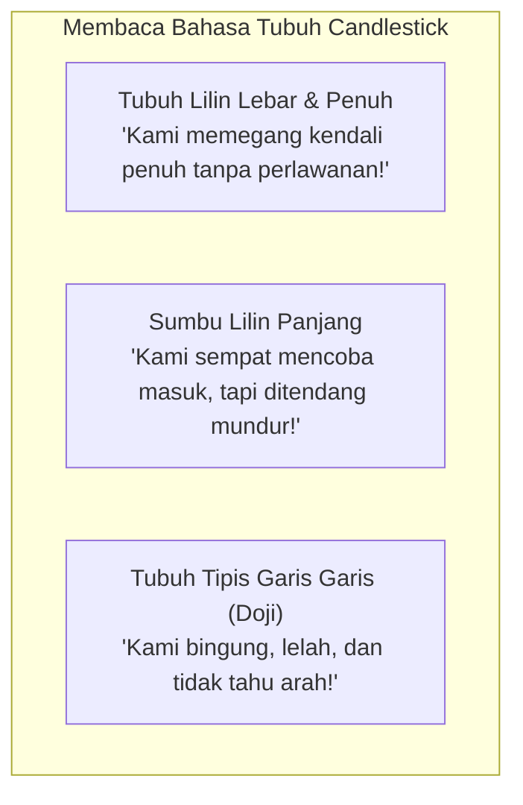
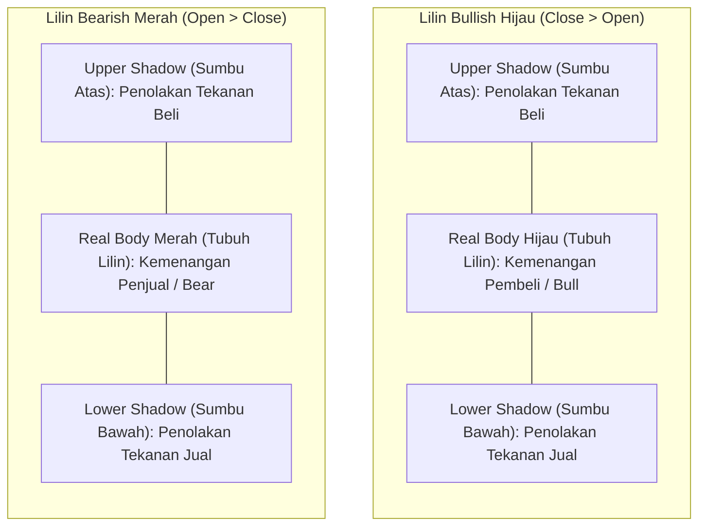
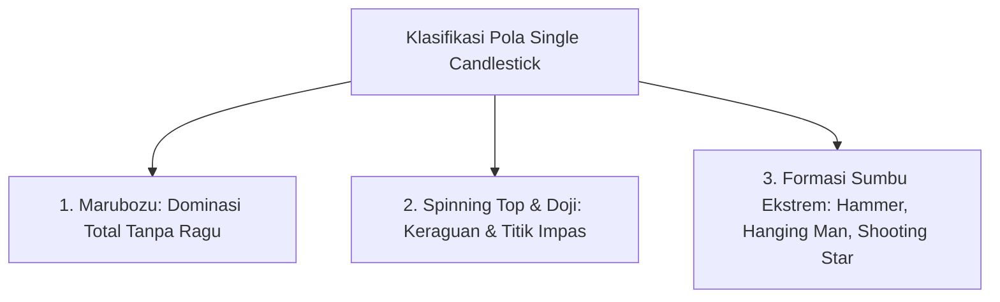
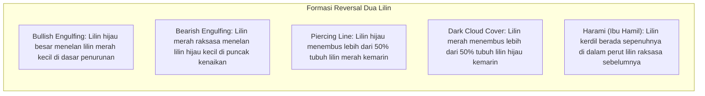
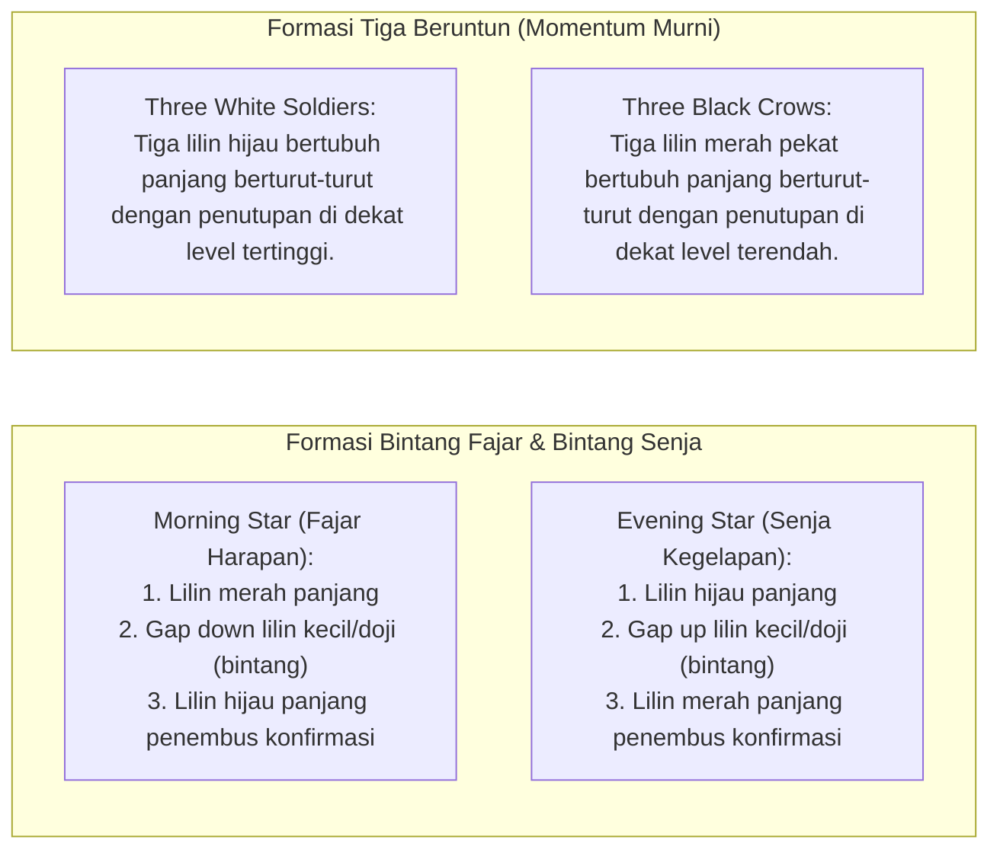
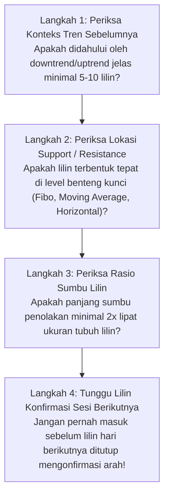

# Bab 24: Candlestick Komprehensif

> "Setiap batang lilin adalah drama pertempuran hidup-mati antara pembeli dan penjual. Tubuh lilin mencerminkan kenyataan hasil pertarungan, sedangkan sumbu lilin memperlihatkan jejak penolakan dan kepalsuan."  
> — **Edianto Ong**, *Technical Analysis for Mega Profit*

---

## 1. Analogi Membumi: Bahasa Tubuh & Raut Wajah Pasar

Bayangkan Anda sedang duduk di meja perundingan bisnis atau sedang menginterogasi seseorang:
- Anda tidak hanya mendengarkan apa yang dia katakan; Anda memperhatikan **bahasa tubuhnya** (*body language*)—apakah bahunya tegap percaya diri, ataukah ia berkeringat dingin dan gelisah?
- Anda membaca **raut mukanya**—apakah senyumnya tulus dan mantap, ataukah senyum masam yang menyembunyikan kepanikan?

Dalam analisa teknikal, grafik batang lilin (*Japanese Candlestick*) adalah **bahasa tubuh dan raut wajah psikologis pasar finansial**:
- **Tubuh Lilin yang Panjang dan Penuh (*Long Body*):** Seperti seorang juara tinju yang berdiri tegap di tengah ring setelah memukul jatuh lawannya—menunjukkan keyakinan mutlak tanpa ragu dari pihak pemenang.
- **Sumbu Lilin yang Menjulang Panjang (*Long Wick/Shadow*):** Seperti jejak langkah kaki seorang pencuri yang sempat menerobos masuk ke dalam rumah, namun berhasil dikejar dan ditendang keluar oleh anjing penjaga—menandakan bahwa pergerakan harga ke wilayah tersebut **ditolak mentah-mentah (*price rejection*)**.
- **Lilin Bertubuh Kerdil dengan Sumbu Lebar (*Doji/Spinning Top*):** Seperti dua orang yang sedang tarik tambang dengan tenaga seimbang hingga keduanya kehabisan napas dan terpaku di tempat—menandakan kebingungan, keletihan, dan keraguan massal.



---

## 2. Sejarah Munehisa Homma & Anatomi Lilin

Grafik lilin dikembangkan di Jepang pada abad ke-18 oleh seorang legenda pedagang beras bernama **Munehisa Homma** (1724–1803) dari kota Sakata. Homma berdagang di Pasar Beras Dojima di Osaka—pasar perdagangan berjangka (*futures market*) pertama di dunia.

Homma menyadari bahwa meskipun pasokan beras dipengaruhi oleh cuaca panen, pergerakan harga harian dikendalikan oleh **emosi dan keserakahan para pedagang beras**. Filosofi analisisnya, yang dikenal sebagai *Sakata Rules*, membuat Homma konon mencatatkan 100 transaksi kemenangan beruntun tanpa pernah kalah dan diangkat menjadi penasihat keuangan kekaisaran Jepang. Metode ini kemudian dipopulerkan ke dunia Barat oleh Steve Nison pada akhir tahun 1980-an.

### Anatomi Fisik Candlestick: 4 Pilar Data Harga

Setiap batang lilin merangkum empat data harga penting dalam suatu kurun waktu (*timeframe*):
- **Open (O):** Harga transaksi pertama saat sesi perdagangan dibuka.
- **High (H):** Titik harga tertinggi yang sempat dicapai selama sesi berlangsung.
- **Low (L):** Titik harga terendah yang sempat diuji selama sesi berlangsung.
- **Close (C):** Harga transaksi terakhir saat sesi perdagangan resmi ditutup.



---

## 3. Kamus Istilah Pemula (Glossary Box)

> [!NOTE]
> **Kamus Istilah Candlestick untuk Pemula:**
> - **Real Body (Tubuh Lilin):** Area persegi di antara harga pembukaan (*Open*) dan penutupan (*Close*). Menunjukkan hasil akhir pertarungan sesi tersebut.
> - **Shadow / Wick (Sumbu Lilin):** Garis tipis vertikal di atas atau di bawah tubuh lilin. Menunjukkan harga ekstrem yang sempat disentuh namun ditolak.
> - **Marubozu:** Batang lilin panjang tanpa sumbu sama sekali (sumbu atas dan bawah nol). Menandakan dominasi 100% mutlak tanpa ampun.
> - **Doji:** Batang lilin di mana harga pembukaan sama persis atau hampir identik dengan harga penutupan (*Open = Close*), sehingga tubuh lilin menyerupai garis tipis atau tanda tambah (+).
> - **Hammer (Palu):** Lilin pembalikan arah naik di dasar penurunan dengan tubuh kecil di atas dan sumbu bawah menjuntai minimal 2 kali panjang tubuhnya.
> - **Shooting Star (Bintang Jatuh):** Lilin pembalikan arah turun di puncak kenaikan dengan tubuh kecil di bawah dan sumbu atas menjulang minimal 2 kali panjang tubuhnya.
> - **Engulfing Pattern:** Formasi dua lilin di mana tubuh lilin kedua menelan (*engulfs*) seluruh rentang tubuh lilin sesi sebelumnya.
> - **Window / Gap:** Celah ruang kosong harga antara harga penutupan sesi kemarin dengan harga pembukaan sesi hari ini tanpa adanya transaksi yang terjadi di antara celah tersebut.

---

## 4. Klasifikasi Pola Single Candlestick (Lilin Tunggal)

Lilin tunggal membaca sentimen psikologis instan yang terjadi dalam satu sesi perdagangan.



### Tabel Rincian Karakter Lilin Tunggal:

| Pola Lilin | Bentuk Fisik Grafis | Lokasi Tren | Makna Psikologis & Strategi |
| :--- | :--- | :--- | :--- |
| **Bullish Marubozu** | Tubuh hijau sangat panjang tanpa sumbu atas/bawah (*Open = Low, Close = High*). | Tren Awal / Breakout | Pembeli menguasai pasar sejak detik pertama hingga lonceng penutupan berbunyi. Sinyal kelanjutan tren sangat kuat. |
| **Bearish Marubozu** | Tubuh merah pekat panjang tanpa sumbu (*Open = High, Close = Low*). | Tren Awal / Breakdown | Penjual membantai harga tanpa ada perlawanan dari pembeli. Segera amankan modal Anda. |
| **Spinning Top** | Tubuh lilin kecil di tengah dengan sumbu atas dan bawah seimbang. | Tengah Tren / Konsolidasi | Kedua kubu sama-sama kuat tapi sama-sama ragu. Mengindikasikan pasar sedang istirahat sejenak. |
| **Standard Doji** | Garis tipis tanda tambah (+), *Open = Close*. | Puncak atau Dasar Tren | Titik ekuilibrium sempurna. Tenaga tren sebelumnya telah habis total (*exhaustion*). Bersiap menyambut pembalikan arah. |
| **Dragonfly Doji** | Huruf "T", sumbu bawah sangat panjang, tanpa sumbu atas. | Dasar Tren Turun | Penjual sempat menekan harga ke jurang terdalam, namun pembeli memborong habis barang hingga harga kembali ke titik pembukaan. Sangat *bullish*. |
| **Gravestone Doji** | Tanda salib terbalik, sumbu atas sangat panjang, tanpa sumbu bawah. | Puncak Tren Naik | Pembeli mencoba menerobos langit, namun dipukul jatuh oleh gelombang jual institusi hingga harga ambruk ke dasar pembukaan. Sangat *bearish*. |
| **Hammer** | Tubuh kecil di atas (hijau/merah), sumbu bawah minimal 2x panjang tubuh, sumbu atas mini/nol. | **Dasar Tren Turun (*Downtrend Bottom*)** | Penolakan telak terhadap harga murah. Sinyal kuat bahwa tren penurunan telah selesai dan harga siap melesat naik. |
| **Hanging Man** | Bentuk fisik identik dengan Hammer, tetapi muncul di **Puncak Tren Naik**. | **Puncak Tren Naik (*Uptrend Top*)** | Munculnya tekanan jual intraday yang dalam mengindikasikan bahwa pertahanan pembeli mulai keropos. Wajib tunggu lilin merah esok hari sebagai konfirmasi. |
| **Shooting Star** | Tubuh kecil di bawah, sumbu atas menjulang minimal 2x tubuh, sumbu bawah mini/nol. | **Puncak Tren Naik (*Uptrend Top*)** | Percobaan pembeli mencetak harga tertinggi baru dihantam telak oleh aksi ambil untung massal. Sinyal pembalikan turun (*bearish reversal*). |
| **Inverted Hammer** | Bentuk fisik identik dengan Shooting Star, tetapi muncul di **Dasar Tren Turun**. | **Dasar Tren Turun (*Downtrend Bottom*)** | Pembeli mulai melakukan serangan gerilya awal menguji kekuatan penjual. Menandakan perlawanan mulai bangkit. |

---

## 5. Pola Dual Candlestick (Formasi Dua Lilin)

Pola dua lilin mengevaluasi pergeseran hegemoni kekuasaan dari satu sesi ke sesi berikutnya secara dinamis.



### 1. Bullish & Bearish Engulfing
- **Bullish Engulfing:** Pada hari ke-1, terbentuk lilin merah kecil tanda tren turun melemah. Pada hari ke-2, harga dibuka turun sejenak (*gap down*), namun mendadak pembeli mengamuk dan memborong masif hingga tubuh lilin hijau menelan (*engulfs*) seluruh rentang tubuh lilin merah kemarin. Ini adalah formasi pembalikan arah paling disegani.
- **Bearish Engulfing:** Kebalikan dari versi bullish; lilin merah raksasa di hari ke-2 menelan seluruh tubuh lilin hijau hari ke-1 di puncak reli, menandakan bahwa institusi telah membuang muatan dalam skala besar.

### 2. Piercing Line & Dark Cloud Cover (Awan Gelap)
- **Piercing Line (Bullish):** Di dasar tren turun, lilin hari ke-2 dibuka *gap down*, namun harga kemudian ditutup menembus ke atas garis tengah (lebih dari 50%) tubuh lilin merah hari ke-1.
- **Dark Cloud Cover (Bearish):** Di puncak kenaikan, lilin hari ke-2 dibuka *gap up* mencetak rekor baru, namun harga tergelincir turun dan ditutup jauh di bawah titik tengah (lebih dari 50%) tubuh lilin hijau hari ke-1. Awan badai hitam telah menutupi langit optimisme.

### 3. Harami (Pola Lilin Ibu Hamil)
Kata *Harami* berasal dari bahasa Jepang kuno yang berarti "mengandung atau hamil". Lilin hari ke-1 berbadan besar dan panjang (*Mother Candle*), sedangkan lilin hari ke-2 berbadan kerdil (*Baby Candle*) yang posisinya berada sepenuhnya di dalam batas tubuh lilin hari pertama. Menandakan hilangnya momentum secara mendadak. Jika lilin kecil kedua berbentuk Doji, pola ini dinamakan **Harami Cross** dengan akurasi pembalikan arah yang jauh lebih tajam.

---

## 6. Pola Multi Candlestick (Tiga Lilin atau Lebih)

Formasi tiga lilin memberikan tingkat konfirmasi tertinggi karena merefleksikan proses transisi psikologis yang matang selama 3 hari berturut-turut.



### Morning Star vs Evening Star:
- **Morning Star (Bintang Fajar):** Mengibaratkan matahari yang terbit mengusir kegelapan malam. Hari ke-1 dikuasai penjual (merah panjang), hari ke-2 terjadi kebuntuan di jurang terdalam (lilin kecil/doji), hari ke-3 pembeli mengambil alih kendali penuh dengan lilin hijau bertenaga yang ditutup di atas separuh tubuh lilin hari pertama.
- **Evening Star (Bintang Senja):** Menandakan terbenamnya matahari keuntungan. Formasi sempurna untuk menutup seluruh posisi beli Anda sebelum badai penurunan melanda.

---

## 7. Panduan Step-by-Step Pemula: Memvalidasi Pola Reversal Candlestick

Banyak pemula yang bangkrut karena langsung membeli saham begitu melihat bentuk mirip lilin palu (*Hammer*) di sembarang tempat. Ikuti checklist 4 langkah ini untuk memastikan validitas pola:



1. **Langkah 1: Lokasi Adalah Raja (*Location is Everything*):**  
   Pola pembalikan arah hanya bermakna jika muncul di **ujung tren yang jelas**. Hammer yang muncul di tengah-tengah pasar *sideways* yang tidak bertren adalah sinyal palsu yang tidak berguna.
2. **Langkah 2: Menempel di Support / Resistance:**  
   Pola lilin harus berbenturan dengan garis pertahanan teknikal lain (misalnya level Fibonacci 61.8% atau garis SMA 200).
3. **Langkah 3: Proporsi Sumbu yang Proporsional:**  
   Pastikan sumbu bawah lilin Hammer benar-benar panjang (minimal dua hingga tiga kali ukuran tubuhnya). Semakin panjang sumbunya, semakin dahsyat perlawanan pembeli.
4. **Langkah 4: Konfirmasi Lilin Penutup:**  
   Jika pola Hammer terbentuk pada hari Senin, tunggu sesi perdagangan hari Selasa. Pembelian baru dianggap sah jika harga hari Selasa ditutup menembus ke atas puncak tertinggi lilin Hammer hari Senin.

---

## 8. Studi Kasus Konkret: Formasi Morning Star pada Saham TLKM

Mari kita pelajari contoh riil transaksi pembalikan arah pada saham PT Telkom Indonesia Tbk (TLKM):

```
Hari 1 (Merah): Penutupan Rp 3.600 (Penjual Panik)
               \
Hari 2 (Star):  ▼ Gap Down Buka Rp 3.520, Tutup Rp 3.530 (Lilin Doji Kecil Bintang)
               /
Hari 3 (Hijau): ▲ Buka Rp 3.550, Meledak Naik & Tutup di Rp 3.750 (Volume Masif)
```

### Detail Perdagangan Berbasis Confluence:
1. **Kondisi Pasar Awal:**  
   Saham TLKM telah terkoreksi selama 3 minggu berturut-turut dari level Rp 4.200 turun ke Rp 3.600.
2. **Pembentukan Pola Bintang (Morning Star):**
   - **Hari 1:** Lilin merah pekat panjang ditutup di Rp 3.600. Sentimen publik sangat tertekan.
   - **Hari 2:** Harga dibuka *gap down* di Rp 3.520, sempat turun ke Rp 3.500, namun memantul dan ditutup di Rp 3.530 membentuk lilin Doji kerdil tepat di atas garis rata-rata **SMA 200 Harian** (Support Dinamis Kuat).
   - **Hari 3:** Pembeli mengamuk sejak pagi hari. Volume perdagangan melonjak 2 kali lipat di atas rata-rata harian, mendorong harga terbang dan ditutup perkasa di **Rp 3.750** (menembus jauh di atas titik tengah lilin hari ke-1).
3. **Rencana Eksekusi Trading Plan:**
   - **Entry Beli:** Pasang order beli di level **Rp 3.760** (pada pembukaan sesi hari ke-4 setelah formasi resmi terkonfirmasi).
   - **Stop Loss:** Pasang proteksi di bawah sumbu terendah hari ke-2 pada level **Rp 3.480** (Risiko kerugian $= 3.760 - 3.480 = \mathbf{Rp\ 280}$ per lembar / sekitar 7.4%).
   - **Target Ambil Untung (TP 1):** Level resistensi horizontal terdekat di **Rp 4.100** (Potensi keuntungan $= 4.100 - 3.760 = \mathbf{Rp\ 340}$).
   - **Target Ambil Untung (TP 2):** Puncak Swing High lama di **Rp 4.300** (Potensi keuntungan $= Rp\ 540$).
   - *Rasio Risk to Reward:* $280 : 540 \approx 1 : 1.93$ (Sangat layak dan aman dieksekusi).

---

## 9. Kesalahan Fatal Pemula dalam Analisis Candlestick

1. **Membeli Hanya Berdasarkan Bentuk Tanpa Melihat Posisi Tren:**  
   Melihat lilin palu (*Hammer*) lalu langsung membeli saham yang sedang berada di puncak harga tertinggi. Ingat: lilin berbentuk palu di puncak kenaikan bukanlah Hammer, melainkan **Hanging Man** yang berpotensi mematikan!
2. **Terburu-buru Masuk Sebelum Lilin Selesai Ditutup (*Premature Entry*):**  
   Pada pukul 10.00 pagi, sebuah lilin tampak membentuk tubuh hijau gagah (*Marubozu*), sehingga pemula bernafsu langsung membeli saham. Namun pada pukul 15.30 sore, harga tiba-tiba dibanting turun hingga menyisakan sumbu atas panjang menyerupai *Shooting Star*. **Jangan pernah menilai lilin sebelum sesi pasar resmi ditutup!**
3. **Mengabaikan Volume Transaksi:**  
   Pola pembalikan lilin hijau yang spektakuler namun dengan volume transaksi tipis ibarat mobil sport bermesin generator sepeda—hanya tampak gagah di luar namun tidak bertenaga untuk melaju jauh. Sinyal pembalikan sejati wajib diiringi ledakan volume.
4. **Trading Candlestick Tanpa Level Stop Loss:**  
   Candlestick bukanlah jaminan kepastian 100%, melainkan permainan probabilitas statistik. Tidak memasang *Stop Loss* saat pola lilin gagal mempertahankan level batas bawahnya adalah kesalahan nomor satu yang melenyapkan portofolio pemula.
