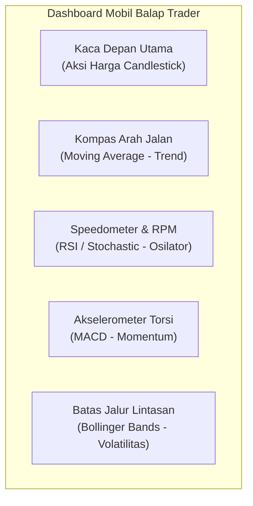
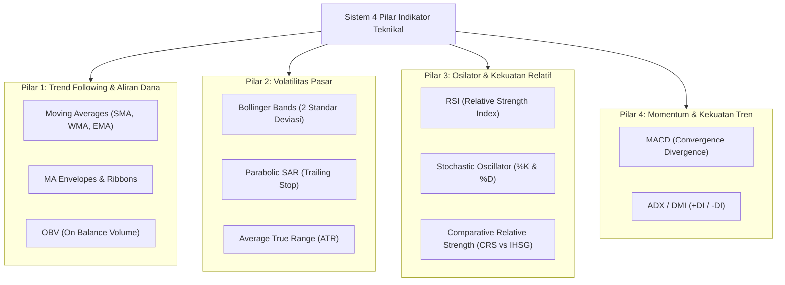
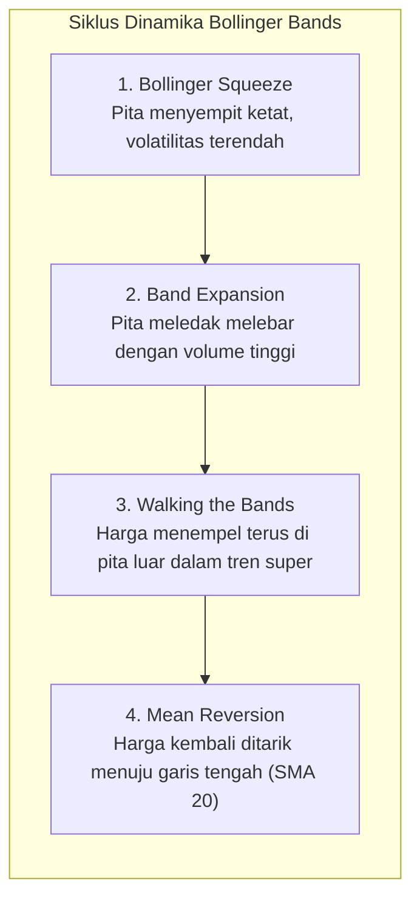
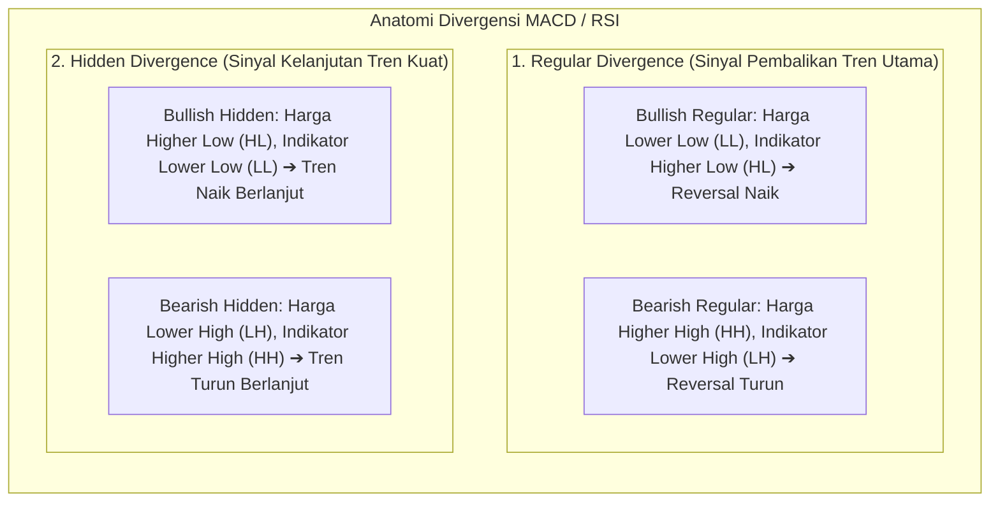
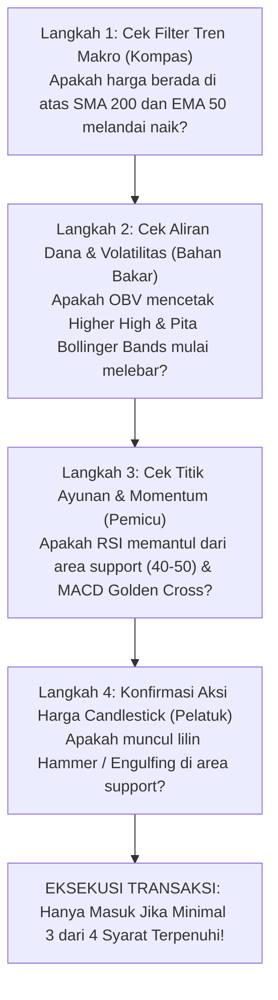

# Bab 25: Technical Indicators

> "Indikator teknikal bukanlah penentu arah masa depan, melainkan cermin matematika yang menyaring kebisingan pasar. Menggunakan terlalu banyak indikator yang sejenis hanya akan menciptakan kelumpuhan analisa (*analysis paralysis*); kunci kemahiran terletak pada perpaduan lintas fungsi (*confluence*) yang harmonis."  
> — **Edianto Ong**, *Technical Analysis for Mega Profit*

---

## 1. Analogi Membumi: Dashboard Speedometer & Kompas Mobil Balap

Bayangkan Anda sedang mengendarai sebuah mobil balap Formula 1 di tengah lintasan sirkuit yang berkabut tebal:
- **Kaca Depan Mobil (Aksi Harga / Candlestick):** Adalah pandangan utama Anda melihat kondisi jalan secara langsung di depan mata.
- **Kompas / Sistem Navigasi GPS (Moving Average):** Menunjukkan ke arah mana lintasan jalan sedang membujur—apakah jalan sedang menanjak curam ke atas, menurun, atau berkelok menyamping.
- **Jarum Speedometer & Tachometer (RSI & Stochastic):** Menunjukkan seberapa kencang putaran mesin bekerja. Jika jarum RPM masuk ke zona merah (*Overbought*), bukan berarti mesin langsung mogok detik itu juga, melainkan peringatan bahwa Anda tidak bisa membejek pedal gas lebih dalam tanpa risiko mesin meledak jika tidak menurunkan gigi.
- **Akselerometer & Torsi Mesin (MACD):** Mengukur apakah laju percepatan mobil sedang bertambah kencang (*momentum acceleration*) ataukah mobil mulai kehilangan tenaga dorong (*deceleration*) meskipun rodanya masih berputar maju.
- **Batas Pembatas Jalan Sirkuit (Bollinger Bands):** Menunjukkan lebar koridor aman aspal lintasan. Saat jalan menyempit di tikungan (*Squeeze*), Anda tahu bahwa trek lurus panjang berkecepatan tinggi akan segera menyambut di depan.



Seorang pembalap handal tidak memenuhi kaca depannya dengan 20 layar monitor kecil hingga ia tidak bisa melihat jalanan. Begitu pula seorang trader: **gunakan indikator sebagai pelengkap dashboard konfirmasi, bukan pengganti pandangan mata Anda terhadap aksi harga!**

---

## 2. Taksonomi 4 Pilar Indikator Teknikal

Untuk mencegah redundansi (memasang banyak indikator dengan rumus matematika yang sama persis), Edianto Ong mengklasifikasikan indikator ke dalam **4 pilar fungsional independen**. Pilih satu perwakilan terbaik dari setiap pilar:



---

## 3. Kamus Istilah Pemula (Glossary Box)

> [!NOTE]
> **Kamus Istilah Indikator Teknikal untuk Pemula:**
> - **Golden Cross:** Perpotongan garis Moving Average jangka pendek menembus ke atas Moving Average jangka panjang (misal: EMA 50 menembus ke atas SMA 200). Sinyal pasar *bullish* makro.
> - **Death Cross:** Perpotongan garis Moving Average jangka pendek menembus ke bawah Moving Average jangka panjang. Sinyal bahaya pasar *bearish* makro.
> - **Overbought (Jenuh Beli):** Kondisi saat harga telah melesat naik terlalu cepat dalam waktu singkat (RSI > 70 atau Stochastic > 80). Bukan sinyal otomatis untuk langsung menjual, melainkan peringatan bahwa tenaga pembeli mulai lelah.
> - **Oversold (Jenuh Jual):** Kondisi saat harga telah anjlok terlalu tajam dalam waktu singkat (RSI < 30 atau Stochastic < 20). Menandakan potensi terjadinya pantulan teknikal.
> - **Divergence (Penyimpangan):** Ketidaksinkronan arah antara grafik harga dan grafik indikator momentum (misal: harga mencetak puncak baru yang lebih tinggi, tetapi indikator justru mencetak puncak yang lebih rendah). Sinyal dini paling akurat mengenai pembalikan tren.
> - **MACD Histogram:** Batang-batang diagram vertikal yang mengukur jarak selisih antara Garis MACD dan Garis Sinyal. Merefleksikan akselerasi kecepatan tren.
> - **Bollinger Squeeze:** Penyempitan ekstrem pita atas dan bawah Bollinger Bands yang menandakan penurunan volatilitas drastis, seringkali menjadi bibit sebelum terjadinya ledakan harga dahsyat.

---

## 4. Bedah Pilar Indikator Utama

### A. Pilar 1: Moving Averages (EMA & SMA) & On Balance Volume (OBV)
- **Simple Moving Average (SMA):** Menghitung nilai rata-rata aritmatika harga penutupan selama $N$ hari ke belakang. SMA 200 hari diakui secara global sebagai batas pemisah resmi antara tren *Bullish* dan *Bearish*.
- **Exponential Moving Average (EMA):** Memberikan bobot persentase lebih besar pada data harga terkini, menjadikannya jauh lebih gesit mendeteksi perubahan arah dibanding SMA tanpa terlalu banyak jeda waktu (*lagging*). EMA 20 dan EMA 50 sangat ideal bagi *swing trader*.
- **On Balance Volume (OBV):** Diciptakan oleh Joseph Granville dengan filosofi dasar: **"Volume selalu mendahului harga (*Volume precedes price*)"**. Jika harga saham sedang bergerak datar (*sideways*) namun garis OBV merangkak naik mencetak rekor baru, itu adalah bukti sah bahwa *smart money* sedang diam-diam memborong saham sebelum harga diledakkan.

### B. Pilar 2: Bollinger Bands (BB) & Volatilitas Pasar
Diciptakan oleh John Bollinger, indikator ini membungkus pergerakan harga dengan kurva lonceng distribusi normal statistik (2 Standar Deviasi $\approx$ mencakup 95.4% fluktuasi harga):
- **Middle Band:** Rata-rata pergerakan sederhana 20 hari (SMA 20).
- **Upper & Lower Band:** Ditambahkan dan dikurangkan dengan $2 \times$ Standar Deviasi dari SMA 20.



> **Aturan Emas Bollinger Bands:**  
> Jangan pernah gegabah melakukan *short-sell* atau panik menjual saham hanya karena lilin menyentuh pita atas (*Upper Band*). Pada tren naik yang super perkasa, harga dapat terus "berjalan menempel" di pita atas (*Walking the Bands*) selama berbulan-bulan!

### C. Pilar 3: RSI (Relative Strength Index) & Stochastic Oscillator
- **RSI 14 Periode (J. Welles Wilder):** Mengukur perbandingan rasio kenaikan rata-rata terhadap penurunan rata-rata dalam rentang 0 hingga 100. Level 70 menandai ambang jenuh beli (*Overbought*) dan level 30 menandai ambang jenuh jual (*Oversold*).
  - *Failure Swing Bullish:* RSI turun di bawah 30, memantul ke atas 30, turun kembali namun tertahan di atas 30 (*Higher Low*), lalu menembus puncak pantulan sebelumnya. Ini adalah sinyal konfirmasi pembalikan arah paling bertenaga.
- **Comparative Relative Strength (CRS vs IHSG):** Mengukur rasio kekuatan saham terhadap indeks pasar acuan ($Price_{Saham} \div Level_{IHSG}$). Saham yang garis CRS-nya menanjak naik di saat IHSG sedang lesu adalah **Saham Pemimpin Pasar (*Market Leader*)** yang wajib Anda koleksi pertama kali saat IHSG mulai pulih.

### D. Pilar 4: MACD (Trend & Momentum King)
Dikembangkan oleh Gerald Appel, MACD terdiri dari tiga komponen inti:
1. **MACD Line:** Selisih antara $EMA(12) - EMA(26)$.
2. **Signal Line:** Garis rata-rata $EMA(9)$ dari MACD Line.
3. **MACD Histogram:** Nilai $MACD\ Line - Signal\ Line$.



---

## 5. Panduan Step-by-Step Pemula: Membaca Indikator Tanpa Kebingungan (Confluence Checklist)

Jangan biarkan layar grafik Anda tampak seperti "piring mi spaghetti". Terapkan sistem penyaringan bertahap (*Filter Funnel System*) 4 langkah berikut sebelum membuka posisi beli:



---

## 6. Studi Kasus Konkret: Setup Confluence Sempurna pada Saham BMRI

Mari kita bedah skenario transaksi nyata dengan kombinasi indikator lintas fungsi pada saham PT Bank Mandiri (Persero) Tbk (BMRI):

```
Harga Saham BMRI: Rp 6.800 (Puncak Swing)
             \
              \  Koreksi Sehat Menuju Support
               \
                ▼ Rp 6.200 (Titik Eksekusi Beli Berbasis Confluence)
```

### Data Pembacaan Multi-Panel Dashboard:
1. **Panel 1 (Grafik Lilin & Tren):**
   - Harga saham BMRI terkoreksi dari Rp 6.800 ke level psikologis **Rp 6.200**.
   - Level Rp 6.200 berhimpit tepat dengan garis **EMA 50 harian** dan **Middle Bollinger Band** (SMA 20).
   - Terbentuk lilin pembalikan arah **Bullish Engulfing** pada penutupan sesi harian di Rp 6.250.
2. **Panel 2 (Aliran Dana Volume):**
   - Volume perdagangan pada saat lilin Bullish Engulfing muncul mencatatkan lonjakan 1.8 kali lipat dari volume rata-rata 20 hari.
   - Garis **OBV** bergerak naik tajam mencetak titik tertinggi baru, membuktikan adanya aksi beli masif oleh institusi asing.
3. **Panel 3 (Momentum MACD):**
   - Garis MACD memotong ke atas Garis Sinyal (*Golden Cross*) tepat di atas garis nol (*Centerline*), menandakan momentum akselerasi tren naik baru dimulai.
   - Histogram MACD berbalik arah dari warna merah negatif menjadi batang hijau positif.
4. **Panel 4 (Kekuatan Relatif RSI):**
   - Indikator RSI 14 memantul kuat dari level 48 (level pertahanan *bull market support* khas RSI).

### Eksekusi Trading Plan:
- **Titik Beli (*Entry Point*):** Rp 6.275 (pada pembukaan sesi berikutnya).
- **Titik Proteksi Kerugian (*Stop Loss*):** Rp 6.050 (di bawah titik terendah lilin engulfing dan di bawah garis EMA 50). Risiko per lembar $= 6.275 - 6.050 = \mathbf{Rp\ 225}$ (sekitar 3.5%).
- **Target Ambil Untung 1 (*Take Profit 1*):** Upper Bollinger Band di **Rp 6.750** (Potensi keuntungan $= Rp\ 475$). Rasio $Risk : Reward = 1 : 2.11$.
- **Target Ambil Untung 2 (*Take Profit 2*):** Level resistensi rekor baru di **Rp 7.200** (Potensi keuntungan $= Rp\ 925$). Rasio $Risk : Reward = 1 : 4.11$.
- *Hasil Transaksi:* Saham BMRI melesat mencapai target keuntungan tanpa pernah menyentuh level stop loss berkat dukungan *confluence* multi-panel yang sangat solid.

---

## 7. Kesalahan Fatal Pemula dalam Menggunakan Indikator

1. **Jebakan Kelumpuhan Analisa (*Analysis Paralysis*):**  
   Memasang 10 hingga 15 indikator sekaligus di satu grafik (misal: RSI, Stochastic, CCI, William %R, dan Williams Accumulation secara bersamaan). Ketika 3 indikator memberi sinyal beli, 4 memberi sinyal netral, dan 3 memberi sinyal jual, trader akhirnya menjadi lumpuh dan tidak berani mengambil keputusan apa pun. Gunakan konsep 4 pilar di atas secara hemat!
2. **Menganggap Overbought Selalu Berarti Harus Langsung Menjual:**  
   Ini adalah kesalahan paling klasik dari pemula. Dalam tren *Super Bullish*, indikator seperti RSI dan Stochastic dapat bertahan di zona *Overbought* (> 70) selama berminggu-minggu bahkan berbulan-bulan seiring saham naik 200%. Menjual saham hanya karena RSI menyentuh level 70 di awal sebuah tren baru akan membuat Anda kehilangan momentum cuan terbesar seumur hidup Anda.
3. **Mengabaikan Arah Tren Pasar Utama:**  
   Mencoba mengambil sinyal *Oversold* (RSI < 20) pada saham yang sedang mengalami tren penurunan bebas di bawah garis SMA 200 (*Downtrending Stock*). Pada saham berkinerja buruk, kondisi *Oversold* bisa terus menjadi "lebih *oversold*" hingga harga saham menyentuh gocap.
4. **Memburu Indikator Ajaib (*The Holy Grail Fallacy*):**  
   Terus-menerus mengganti indikator setiap kali mengalami satu kali transaksi merugi. Sadarilah bahwa tidak ada satupun indikator di dunia ini yang memiliki akurasi 100%. Keunggulan trader sejati terletak pada konsistensi sistem, disiplin manajemen risiko (*Money Management*), dan pemahaman aksi harga.
