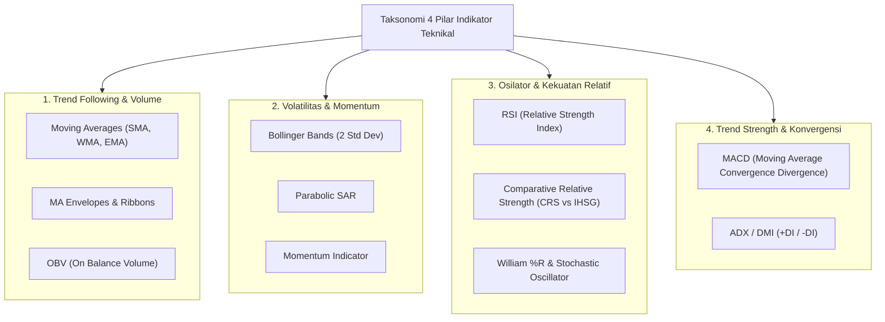
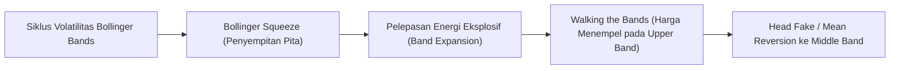
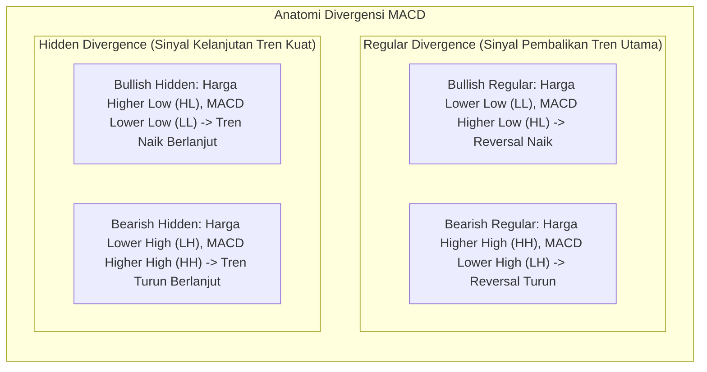
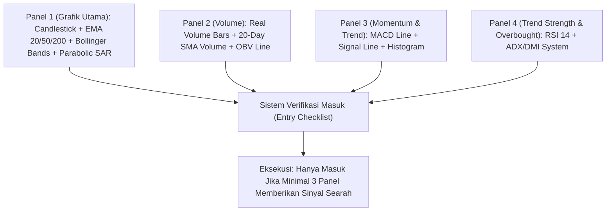

# Bab 25: Technical Indicators

> "Indikator teknikal bukanlah penentu arah masa depan, melainkan cermin matematika yang menyaring kebisingan pasar. Menggunakan terlalu banyak indikator yang sejenis hanya akan menciptakan kelumpuhan analisa (*analysis paralysis*); kunci kemahiran terletak pada perpaduan lintas fungsi (*confluence*) yang harmonis."  
> — **Edianto Ong**, *Technical Analysis for Mega Profit*

---

## 1. Taksonomi & Klasifikasi Indikator Teknikal

Edianto Ong membagi indikator teknikal ke dalam empat kelompok fungsional utama untuk mencegah bias redundansi (menggunakan beberapa indikator dengan rumus yang serupa). Seorang trader profesional idealnya hanya memilih satu perwakilan terbaik dari setiap kategori:

---

## 2. Trend Following & Volume Indicators

### A. Moving Averages (SMA, WMA, EMA)
Moving Average (MA) adalah indikator perata harga yang berfungsi menghaluskan fluktuasi harga harian guna menampilkan arah tren yang mendasari.

1. **Simple Moving Average (SMA):**  
   Memberikan bobot yang sama untuk setiap data harga dalam periode $N$.
   $$SMA = \frac{\sum_{i=1}^{N} Close_i}{N}$$
2. **Weighted Moving Average (WMA):**  
   Memberikan bobot linier lebih besar pada harga terbaru.
3. **Exponential Moving Average (EMA):**  
   Memberikan bobot eksponensial pada harga terkini, menjadikannya jauh lebih responsif terhadap perubahan arah mendadak dibanding SMA.
   $$EMA_{today} = \left( Close_{today} \times \left( \frac{2}{N + 1} \right) \right) + \left( EMA_{yesterday} \times \left( 1 - \frac{2}{N + 1} \right) \right)$$

#### Konsep Kunci Moving Average:
* **Golden Cross:** Perpotongan MA jangka pendek (misal: EMA 50) menembus ke atas MA jangka panjang (misal: SMA 200). Sinyal pasar *bullish* makro.
* **Death Cross:** Perpotongan MA jangka pendek menembus ke bawah MA jangka panjang. Sinyal pasar *bearish* makro.
* **MA Ribbon:** Susunan berlapis dari serangkaian MA (misal: MA 5, 10, 20, 50, 100, 200). Ketika pita MA melebar (*fanning out*) dengan urutan teratur dari kecil ke besar, menandakan tren yang sangat kuat (*raging uptrend*).
* **MA Envelopes:** Pita batas atas dan batas bawah yang diproyeksikan pada persentase tertentu (misal: $\pm 5\%$) dari garis MA sentral untuk mendeteksi kondisi *overbought* dan *oversold* dalam tren.

### B. On Balance Volume (OBV)
Diciptakan oleh **Joseph Granville**, OBV mengaitkan volume transaksi secara kumulatif dengan pergerakan harga:
* Jika harga penutupan hari ini > kemarin: $OBV_{t} = OBV_{t-1} + Volume$
* Jika harga penutupan hari ini < kemarin: $OBV_{t} = OBV_{t-1} - Volume$
* Jika harga penutupan sama: $OBV_{t} = OBV_{t-1}$

> **Aksioma OBV:** Volume selalu mendahului harga (*Volume precedes price*). Jika harga saham bergerak menyamping (*sideways*) namun garis OBV merangkak naik tajam, itu merupakan bukti nyata akumulasi *smart money* sebelum lonjakan harga terjadi.

---

## 3. Indikator Volatilitas & Momentum

### A. Bollinger Bands (BB)
Dikembangkan oleh **John Bollinger**, indikator ini memetakan volatilitas harga dengan menggunakan standar deviasi statistik:
* **Middle Band:** Simple Moving Average 20 periode (SMA 20).
* **Upper Band:** $SMA 20 + (2 \times \sigma)$
* **Lower Band:** $SMA 20 - (2 \times \sigma)$
*(Secara statistik distribusi normal, $\pm 2$ standar deviasi mencakup sekitar 95.4% dari seluruh fluktuasi harga historis).*

* **Bollinger Squeeze:** Ketika pita menyempit ke tingkat ekstrem, mengindikasikan penurunan volatilitas drastis. Ini adalah peringatan bahwa pergerakan eksplosif (*explosive breakout*) akan segera terjadi.
* **Walking the Bands:** Dalam tren *bullish* yang luar biasa kuat, harga tidak memantul turun saat menyentuh *Upper Band*, melainkan terus "berjalan menempel" di pita atas. Jangan terburu-buru melakukan *short sell* hanya karena harga menyentuh Upper Band dalam tren yang sedang mengamuk.

### B. Parabolic SAR (Stop and Reverse)
Dirancang oleh **J. Welles Wilder Jr.**, indikator ini menempatkan titik-titik (*dots*) di atas atau di bawah lilin harga berdasarkan faktor akselerasi:
* Titik SAR di bawah harga = Tren Bullish (pertahankan posisi beli).
* Titik SAR melompat ke atas harga = Tren Bearish (tutup posisi beli dan pasang proteksi jual).
* **Kegunaan Utama:** Sangat efektif sebagai penentu batas *Trailing Stop* dinamis yang objektif.

---

## 4. Osilator & Kekuatan Relatif (Oscillators & Relative Strength)

### A. RSI (Relative Strength Index)
Juga diciptakan oleh J. Welles Wilder, RSI mengukur kecepatan dan perubahan pergerakan harga dalam skala rentang 0 hingga 100 (periode standar: 14):
* **Zona Klasik:** Di atas 70 = *Overbought* (jenuh beli), di bawah 30 = *Oversold* (jenuh jual).
* **Failure Swings (Sinyal Paling Valid):** Sinyal pembalikan arah paling kuat terjadi saat RSI mencetak *Failure Swing*:
  - *Bullish Failure Swing:* RSI turun di bawah 30, memantul ke atas 30, terkoreksi namun bertahan di atas 30 (*Higher Low* pada RSI), lalu menembus titik puncak ayunan sebelumnya.

### B. Comparative Relative Strength (CRS vs IHSG)
Edianto Ong menekankan pentingnya membandingkan performa suatu saham dengan indeks acuannya (IHSG di Bursa Efek Indonesia):
$$CRS = \frac{Price_{Saham}}{Level_{IHSG}}$$
* Jika garis CRS menanjak naik saat IHSG sedang turun atau *sideways*, saham tersebut adalah **Market Leader (Alfa Stock)** yang didukung oleh institusi besar. Saham inilah yang akan melesat paling cepat saat pasar pulih kembali.

### C. Stochastic Oscillator & William %R
* **Stochastic (%K & %D):** Menghitung posisi harga penutupan relatif terhadap rentang tertinggi dan terendah selama $N$ periode. 
  - *Jebakan Tren Kuat:* Dalam tren naik yang kuat, Stochastic dapat bertahan di zona *overbought* (> 80) selama berminggu-minggu. Menjual saham hanya karena Stochastic > 80 di tengah tren naik kuat adalah kesalahan fatal pemula.
* **William %R:** Mirip dengan Stochastic namun berskala negatif (0 hingga -100). Sangat sensitif untuk mendeteksi keletihan momentum jangka pendek.

---

## 5. Indikator Trend Strength, Konvergensi & Divergensi

### A. MACD (Moving Average Convergence Divergence)
Diciptakan oleh **Gerald Appel**, MACD adalah raja indikator momentum-tren:
* **MACD Line:** $EMA(12) - EMA(26)$
* **Signal Line:** $EMA(9)$ dari MACD Line
* **MACD Histogram:** $MACD\ Line - Signal\ Line$

### B. ADX & DMI (Directional Movement Index)
Sistem DMI karya Wilder terdiri dari tiga garis: **+DI**, **-DI**, dan **ADX**:
1. **+DI & -DI (Arah):** Jika +DI melintas di atas -DI, pembeli memegang kendali. Jika -DI di atas +DI, penjual memegang kendali.
2. **ADX (Kekuatan Murni):** ADX tidak mengukur arah, melainkan **intensitas kekuatan tren**:
   - $ADX < 20$: Pasar tidak memiliki tren (*non-trending / choppy / sideways*). Hindari indikator *trend following*.
   - $20 \le ADX \le 25$: Tren mulai terbentuk.
   - $ADX > 25$: Tren sangat kuat (*strong trend*). Gunakan sistem Moving Average dan tahan posisi (*riding the trend*).
   - $ADX > 40$: Tren ekstrem (waspadai klimaks euforia atau kapitulasi).

---

## 6. Studi Kasus Integrasi Multi-Panel (Confluence Dashboard)

Berikut adalah cetak biru konfigurasi multi-panel profesional yang direkomendasikan Edianto Ong:

### Checklist Eksekusi Sinyal Beli Mega Profit:
1. **Kondisi Tren (Panel 1):** Lilin harga membentuk pola pembalikan (*Hammer/Bullish Engulfing*) di atas EMA 50 yang sedang melandai naik, memantul dari Middle Bollinger Band.
2. **Kondisi Aliran Dana (Panel 2):** Volume transaksi di atas rata-rata 20 hari dan garis OBV mencetak *Higher High* (terjadi akumulasi nyata).
3. **Kondisi Momentum (Panel 3):** MACD Histogram berputar dari negatif ke positif, atau MACD Line memotong ke atas Signal Line (*Golden Cross*) tepat di atas garis nol.
4. **Kondisi Kekuatan Tren (Panel 4):** ADX berada di atas level 20 dan mulai mendaki naik bersamaan dengan +DI yang memotong ke atas -DI; RSI memantul dari level 45–50 (*support bounce* dalam kondisi tren sehat).

Dengan mengintegrasikan keempat dimensi ini, probabilitas keberhasilan transaksi meningkat secara drastis, sekaligus melindungi modal dari sinyal palsu (*whipsaw*) yang mematikan.
