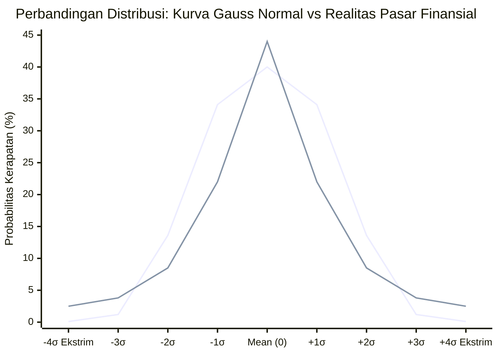

# Bab 26: Random Walk Theory & Efisiensi Pasar

> "Akademisi di menara gading berasumsi bahwa manusia bertindak rasional sempurna dan harga bergerak acak tanpa memori seperti lemparan koin. Namun di lantai bursa yang berdebu dan penuh keringat, ketakutan serta keserakahan manusia tidak pernah berdistribusi normal—ia selalu meninggalkan jejak tren nyata, kepanikan massa, dan ledakan pergerakan ekstrem."  
> — **Edianto Ong**, *Technical Analysis for Mega Profit*

---

## 1. Analogi Membumi: Melempar Koin vs Kawanan Burung Terbang

Bayangkan Anda sedang duduk santai di teras rumah dan melempar koin seratus rupiah ke udara:

1. **Pelemparan Koin (Dunia Acak Murni / Random Walk):**
   * Jika lemparan pertama keluar "Gambar", apakah lemparan kedua pasti "Angka"? Tentu tidak.
   * Koin tidak memiliki otak, tidak memiliki emosi, dan tidak mengingat hasil lemparan semenit yang lalu. Setiap lemparan adalah peristiwa independen 50:50 yang terisolasi (*memoryless process*).
   * Kaum akademisi penganut teori *Random Walk* mengklaim pergerakan harga saham di bursa persis seperti pelemparan koin ini. Menurut mereka, naik-turunnya harga hari ini sama sekali tidak ada hubungannya dengan harga kemarin.

2. **Kawanan Burung Murai Terbang Melintasi Langit (Realitas Pasar Modal):**
   * Sekarang perhatikan sekawanan burung terbang di langit sore. Mereka tidak terbang secara acak menabrak satu sama lain. Ketika satu atau dua burung pemimpin berbelok ke kanan menghindari elang, puluhan burung lainnya seketika ikut bermanuver memutar ke kanan membentuk formasi gelombang yang teratur dan serasi.
   * Mengapa? Karena burung-burung tersebut memiliki mata, insting mempertahankan diri, saling mengamati gerakan kawannya, dan bereaksi bersama terhadap ancaman atau peluang makan.
   * **Pasar modal berisi manusia, bukan koin logam mati.** Ketika investor besar (institusi) mulai mengumpulkan saham, tindakannya diperhatikan oleh ribuan trader lain. Kepanikan dan antusiasme menular secara sosial, menciptakan **momentum dan tren terarah** yang bisa bertahan berminggu-minggu bahkan berbulan-bulan!


---

## 2. Kritik Kaum Akademisi: Random Walk Theory & Hipotesis Pasar Efisien (EMH)

Sejak dekade 1960-an hingga 1970-an, berkembang perdebatan sengit antara kalangan akademisi ekonomi keuangan dengan para praktisi pasar (*traders* dan analis teknikal). Kalangan akademisi yang dipelopori oleh Profesor Eugene Fama dari University of Chicago memperkenalkan **Hipotesis Pasar Efisien** (*Efficient Market Hypothesis* / EMH) dan **Teori Pergerakan Acak** (*Random Walk Theory*).

### Premis Utama Random Walk Theory
Secara terminologis, teori ini mengajukan tiga dalil utama:
1. **Perubahan harga masa lalu tidak memiliki keterkaitan dengan masa depan (*Independence of Price Changes*):** Fluktuasi harga harian bersifat acak (*stochastic*), independen, dan tanpa memori masa lalu.
2. **Grafik historis tidak memiliki nilai prediktif:** Mempelajari grafik candlestick, pola formasi (seperti *Head and Shoulders* atau *Double Bottom*), garis tren, atau indikator teknikal dianggap ilusi kesia-siaan—sama halnya dengan mencoba menebak hasil lemparan koin berikutnya berdasarkan riwayat 10 lemparan terakhir.
3. **Harga saham diibaratkan langkah orang mabuk (*A Drunken Man's Walk*):** Seseorang yang mabuk berat berjalan terhuyung-huyung di jalan setapak. Arah langkah berikutnya bisa ke kiri, ke kanan, maju, atau mundur dengan probabilitas simetris yang sepenuhnya acak dan tidak berpola.


### Tiga Bentuk Efficient Market Hypothesis (EMH)
Kalangan akademisi membagi efisiensi pasar ke dalam tiga tingkatan:

1. **Bentuk Lemah (*Weak-Form Efficiency*):**
   * Seluruh data harga historis dan volume masa lalu dianggap sudah tercermin sempurna pada harga saat ini.
   * **Klaim Akademisi:** Analisis teknikal tidak berguna (*useless*) untuk menghasilkan keuntungan di atas rata-rata pasar (*alpha*).
2. **Bentuk Semi-Kuat (*Semi-Strong Form Efficiency*):**
   * Harga saat ini sudah mencerminkan seluruh data historis ditambah seluruh informasi publik yang tersedia (laporan keuangan, berita makro, dividen, rencana akuisisi).
   * **Klaim Akademisi:** Baik analisis teknikal maupun analisis fundamental dasar tidak mampu mengalahkan pasar secara konsisten.
3. **Bentuk Kuat (*Strong-Form Efficiency*):**
   * Harga mencerminkan segalanya secara sempurna, termasuk informasi orang dalam (*insider information*).
   * **Klaim Akademisi:** Tidak ada satu orang pun—bahkan pemegang saham pengendali atau komisaris emiten—yang bisa meraih keuntungan abnormal secara konsisten.

---

## 3. Asumsi Rapuh Kaum Akademisi

Mengapa kesimpulan para profesor di universitas bisa begitu bertolak belakang dengan kenyataan para trader sukses di bursa efek? Edianto Ong membongkar tiga asumsi dasar akademisi yang rapuh ketika dihadapkan pada realitas:

1. **Asumsi Rasionalitas Sempurna (*Homo Economicus*):**
   * Teori ekonomi neoklasik mengasumsikan seluruh pelaku pasar selalu berpikir dingin, memiliki kalkulasi matematis tanpa batas, dan bebas dari bias emosional.
   * *Realitas:* Manusia di pasar modal dipandu oleh dua emosi purba paling kuat: **ketakutan (*fear*)** saat melihat portofolio merosot, dan **keserakahan (*greed*)** saat melihat harga melambung tinggi.
2. **Penyebaran Informasi Simetris & Seketika:**
   * Akademisi membayangkan ketika berita baik diumumkan pukul 09.00 WIB, semua investor di Indonesia membaca berita itu serentak di detik yang sama dan menginterpretasikannya secara identik, sehingga harga saham langsung meloncat ke titik ekuilibrium baru tanpa proses tawar-menawar yang berlarut-larut.
   * *Realitas:* Informasi selalu mengalir secara **asimetris**. Pemilik modal besar (*smart money*, fund manager institusi) memiliki tim riset mendalam yang mendeteksi perubahan fundamental jauh sebelum masyarakat umum membacanya di portal berita koran keesokan harinya.
3. **Asumsi Distribusi Normal (Kurva Lonceng Gaussian):**
   * Statistika konvensional mengasumsikan return harian pasar modal mengikuti kurva lonceng Gauss (*Normal Distribution*), di mana 68,2% pergerakan berada dalam 1 standar deviasi ($\pm 1\sigma$), 95,4% dalam 2 standar deviasi ($\pm 2\sigma$), dan 99,7% dalam 3 standar deviasi ($\pm 3\sigma$).
   * Menurut kurva ini, pergerakan harga saham anjlok di atas 10% dalam sehari adalah anomali langka yang hanya terjadi sekali dalam ribuan tahun!

---

## 4. Bantahan Praktisi: Realitas Fat Tails & Volatility Clustering

Edianto Ong membongkar kepicikan model *Random Walk* dengan menghadirkan bukti empiris tak terbantahkan dari lantai bursa riil:

### A. Bahaya Model Bell Curve vs Fenomena Fat Tails (Ekor Gemuk)
Bila *Random Walk* dan distribusi normal benar, peristiwa krisis pasar seperti *Black Monday* 1987 (Dow Jones anjlok 22,6% dalam satu hari) atau fenomena beruntun *Auto Reject Bawah* (ARB) di Bursa Efek Indonesia secara statistik adalah peristiwa 20-sigma yang secara teoritis mustahil terjadi sepanjang usia alam semesta!

Namun kenyataannya, krisis pasar (*market crash*), fenomena saham tidur yang tiba-tiba melesat ratusan persen (*multibagger*), atau kejatuhan dramatis terjadi berulang kali setiap siklus 5 hingga 10 tahun. Hal ini membuktikan distribusi pasar modal memiliki karakteristik:
* **Fat Tails (Ekor Gemuk):** Peluang terjadinya peristiwa ekstrem (kejatuhan dahsyat atau lonjakan fantastis) jauh lebih besar daripada ramalan kurva lonceng normal akademisi.
* **Leptokurtic:** Puncaknya sangat tinggi di tengah (pasar sering bergerak *sideways* lambat), tetapi ekor di kedua sisinya tebal dan panjang.

```
       Distribusi Normal (Gaussian) vs Distribusi Pasar Riil (Fat Tails)

                     Titik Puncak (Peakedness)
                               |
                               /\  <- Leptokurtic (Pasar Riil: Banyak waktu sideways)
                              /  \
                             / /\ \  <- Kurva Normal Gauss (Teori Akademisi)
                            / /  \ \
                           / /    \ \
                          / /      \ \
  Fat Tail (Pasar Riil) _/ /        \ \_ Fat Tail (Crash / Reli Ekstrim)
  ____________________/___/__________\___\____________________
 -4σ        -3σ       -2σ     0      +2σ       +3σ        +4σ
```



### B. Volatility & Trend Clustering (Mandelbrot & Fenomena Memori Pasar)
Benoit Mandelbrot, matematikawan jenius penemu geometri fraktal, membuktikan bahwa pasar finansial memiliki sifat *long memory* dan *volatility clustering*. Sebagaimana dirumuskan secara gamblang oleh Robert Engle (peraih Nobel ekonomi penemu model ARCH/GARCH):
> *"Hari yang bergejolak cenderung diikuti oleh hari yang bergejolak lagi; hari yang tenang cenderung diikuti oleh hari yang tenang lagi."*

Prinsip ini bertentangan 180 derajat dengan *Random Walk*. Di pasar riil:
1. **Volatilitas Mengelompok (*Clustering*):** Saat saham mulai bergerak aktif dengan volume besar, volatilitas tinggi akan terus berlanjut selama beberapa waktu.
2. **Kesenjangan Penyerapan Informasi (*Underreaction to Overreaction*):** Ketika emiten mencatatkan kenaikan kinerja spektakuler, pasar awalnya merespons lambat (*underreaction*). Seiring berjalannya waktu dan berita menyebar, trader ritel berbondong-bondong masuk hingga akhirnya terjadi euforia berlebihan (*overreaction*). Kesenjangan waktu inilah yang menciptakan **tren harga** yang dapat dieksploitasi oleh analis teknikal untuk mendulang keuntungan.

### C. Inersia Genetik Sifat Manusia (*Human Nature Does Not Change*)
Analisis teknikal bekerja bukan karena ia rumus sihir masa depan, melainkan karena ia adalah cermin dari psikologi massa yang berulang:
* Pola *Double Bottom* atau *Head and Shoulders* telah muncul di bursa beras Dojima Jepang abad ke-18 pada masa Munehisa Homma.
* Pola yang sama persis muncul di bursa Wall Street awal abad ke-20 pada era Charles Dow.
* Dan pola itu tetap muncul di Bursa Efek Indonesia abad ke-21 yang sarat dengan transaksi online trading dan kecerdasan buatan.

Mengapa polanya tidak berubah selama ratusan tahun? Karena kode genetik emosi manusia tidak pernah bermutasi. Saat menghadapi ancaman rugi, manusia panik (*fear*); saat melihat peluang untung cepat, manusia rakus (*greed*). Karena grafik harga merekam jejak emosi kolektif ini, pergerakan bursa **tidak akan pernah menjadi garis acak murni**.

---

## 5. Kamus Istilah Pemula (Glossary Box)

> [!NOTE]
> * **Random Walk Theory:** Teori keuangan akademis yang menyatakan bahwa pergerakan harga saham bersifat acak, independen, dan tidak memiliki memori masa lalu, sehingga pergerakan esok hari tidak dapat diprediksi dari grafik historis.
> * **Efficient Market Hypothesis (EMH):** Hipotesis pasar efisien yang menyatakan bahwa seluruh informasi (harga masa lalu, berita publik, hingga rahasia perusahaan) telah terdiskon secara instan ke dalam harga saat ini.
> * **Fat Tails (Ekor Gemuk):** Ciri statistik distribusi di pasar finansial nyata di mana probabilitas terjadinya peristiwa ekstrem (seperti crash atau reli luar biasa) jauh lebih tinggi daripada prediksi kurva lonceng normal Gaussian.
> * **Volatility Clustering:** Fenomena di mana periode berfluktuasi tinggi cenderung berkelompok diikuti fluktuasi tinggi, dan periode tenang cenderung diikuti periode tenang.
> * **Asymmetric Information:** Kondisi di mana pelaku pasar tertentu (misalnya pemodal institusi besar atau insider) mendapatkan dan memahami informasi lebih awal daripada publik ritel.
> * **Alpha ($\alpha$):** Imbal hasil (keuntungan) ekstra yang diperoleh trader atau investor di atas rata-rata imbal hasil pasar/indeks acuan (IHSG).

---

## 6. Studi Kasus Konkret: Dua Trader dengan Paradigma Berbeda

Untuk memahami dampak pemahaman ini terhadap hasil rekening Anda, mari kita pelajari kisah dua trader fiktif:

### Kasus: Pergerakan Saham Bank Swasta "BANK-XYZ"
Saham BANK-XYZ sedang berkonsolidasi di rentang harga Rp2.000 selama 4 bulan. Tiba-tiba perusahaan mengumumkan laba bersih melonjak 80% dan laba tersebut didorong oleh efisiensi digital berkelanjutan.

```
Kronologi Transaksi:
- Hari 1: Harga menembus Resistance Rp2.100 dengan lonjakan Volume 5x lipat rata-rata harian.
- Hari 2 s/d 10: Harga terus merangkak naik bertahap dari Rp2.200 ke Rp2.500 (Tren Uptrend terbentuk).
- Hari 15: Berita masuk ke koran nasional headline utama, harga mencapai Rp2.800 (Fase Euforia Ritel).
```

* **Trader A (Penganut Buta Random Walk / Skeptis Akademis):**
  * Trader A memandang penembusan harga di Rp2.100 sebagai kebetulan acak semata (*noise*).
  * Ia meyakini harga tidak memiliki tren dan akan kembali ke rata-rata (*mean reversion*) secara acak.
  * Ketika harga naik ke Rp2.300, ia justru melakukan *short-selling* atau menolak beli karena menganggap pasar sudah efisien dan kenaikan itu murni keberuntungan.
  * **Hasil:** Trader A melewatkan reli 33% dan modalnya stagnan tergerus inflasi karena selalu ragu mengambil posisi pada momentum tren.

* **Trader B (Praktisi Teknikal Modern Edianto Ong):**
  * Trader B memahami bahwa penembusan Resistance Rp2.100 dengan volume raksasa menandakan akumulasi *smart money* yang sedang menyerap barang.
  * Ia tahu informasi fundamental membutuhkan waktu berhari-hari untuk diserap oleh pasar publik secara luas (*information cascade*).
  * Trader B mengeksekusi pembelian di harga Rp2.120 dengan memasang Stop Loss ketat di Rp2.040 (di bawah garis support breakout).
  * Ketika tren terus berlanjut (*volatility clustering*), ia membiarkan keuntungannya berlari (*let profits run*) hingga sinyal pembalikan muncul di Rp2.750.
  * **Hasil:** Trader B mengantongi keuntungan bersih +29% dengan risiko yang terukur sejak awal hanya 3,7%.

---

## 7. Rangkuman Komparasi Paradigma

| Parameter Evaluasi | Random Walk Theory / EMH (Akademisi) | Analisis Teknikal Modern (Edianto Ong) |
| :--- | :--- | :--- |
| **Sifat Pergerakan Harga** | Acak murni, independen, tanpa memori (*stochastic*) | Membentuk tren dinamis terarah dan siklus fraktal |
| **Model Distribusi Return** | Kurva Lonceng Normal Gaussian ($\mu, \sigma$) | *Fat Tails* (Leptokurtic, kejadian ekstrem sering berulang) |
| **Karakter Pelaku Pasar** | Rasional murni (*Homo Economicus*) | Manusia emosional, rentan keserakahan (*greed*) & ketakutan (*fear*) |
| **Penyerapan Informasi** | Seketika (*instantaneous*) & simetris sempurna | Bertahap (*lagging*), asimetris (*smart money first, ritel last*) |
| **Relevansi Grafik Historis** | Tidak bernilai / sekadar ilusi optik | Peta probabilitas perilaku kolektif massa manusia |
| **Peluang Mengalahkan Pasar** | Nol (hanya faktor keberuntungan semata) | Tinggi, melalui disiplin sistem trading terukur & manajemen risiko |

> [!IMPORTANT]
> Jangan biarkan teori akademisi melumpuhkan keyakinan Anda terhadap kekuatan grafik teknikal. Grafik bukan ramalan mistis masa depan, melainkan rekaman jejak kaki uang besar (*smart money*) yang dipandu oleh psikologi massa manusia. Dengan menunggangi tren yang tercipta dari ketidakteraturan emosi pasar, Anda memiliki keunggulan kompetitif (*edge*) untuk meraih profit berkesinambungan.
