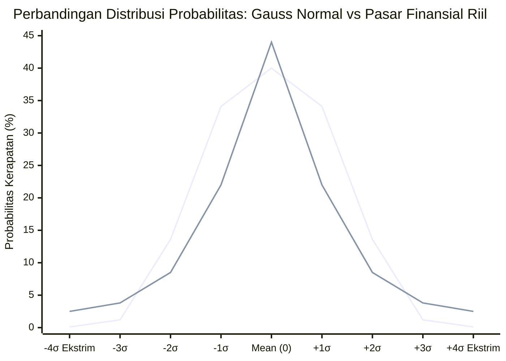

# Bab 26: Random Walk Theory & Efisiensi Pasar

> "Akademisi di menara gading berasumsi bahwa manusia bertindak rasional sempurna dan harga bergerak acak tanpa memori. Namun di lantai bursa yang berdebu dan penuh keringat, ketakutan serta keserakahan manusia tidak pernah berdistribusi normal—ia selalu meninggalkan jejak tren dan ledakan ekstrim."  
> — **Edianto Ong**, *Technical Analysis for Mega Profit*

---

## 1. Kritik Kaum Akademisi: Random Walk Theory & EMH

Sejak dekade 1960-an hingga 1970-an, berkembang perdebatan sengit antara kalangan akademisi ekonomi keuangan dengan para praktisi pasar (*traders* dan analis teknikal). Kalangan akademisi yang dipelopori oleh Eugene Fama memperkenalkan **Hipotesis Pasar Efisien** (*Efficient Market Hypothesis* / EMH) dan **Teori Pergerakan Acak** (*Random Walk Theory*).

### Premis Utama Random Walk Theory
Secara terminologis, *Random Walk Theory* menyatakan bahwa:
1. **Perubahan harga masa lalu tidak memiliki keterkaitan dengan pergerakan harga masa depan (*independence of price changes*).** Setiap fluktuasi harga harian bersifat acak (*stochastic*), independen, dan tidak memiliki memori (*memoryless process*).
2. **Grafik historis tidak memiliki nilai prediktif.** Mempelajari grafik candlestick, pola formasi, garis tren, atau indikator teknikal dianggap sia-sia—sama halnya dengan mencoba menebak pelemparan koin berikutnya berdasarkan hasil lemparan sebelumnya.
3. **Harga saham diibaratkan langkah orang mabuk (*a drunken man's walk*):** Arah langkah berikutnya bisa ke kiri, ke kanan, maju, atau mundur dengan probabilitas simetris yang sepenuhnya acak.

```mermaid
flowchart TD
    subgraph EMH_Academic["Paradigma Akademisi (EMH / Random Walk)"]
        Info["Informasi Baru Masuk Pasar"] --> InstantDiscount["Diserap Seketika & Sempurna Oleh Pelaku Rasional"]
        InstantDiscount --> RandomJump["Harga Melompat Acak Sesuai Sifat Berita Baru"]
        RandomJump --> NoPattern["Tidak Ada Pola / Tren<br/>(Noise Acak & Bell Curve)"]
    end

    subgraph RealWorld_Practitioner["Paradigma Realitas Praktisi (Edianto Ong)"]
        InfoReal["Informasi Baru Masuk Pasar"] --> AsymmetricAbsorption["Diserap Asimetris (Smart Money vs Publik)"]
        AsymmetricAbsorption --> HerdBehavior["Perilaku Massa, Emosi, & Ekspektasi"]
        HerdBehavior --> TrendClustering["Terbentuk Tren & Fat Tails<br/>(Pola Fraktal Berulang)"]
    end
```



### Tiga Bentuk Efficient Market Hypothesis (EMH)
Kalangan akademisi membagi efisiensi pasar ke dalam tiga tingkatan:

1. **Bentuk Lemah (*Weak-Form Efficiency*):**
   * Menyatakan bahwa seluruh data harga historis dan volume masa lalu telah tercermin sempurna pada harga saat ini.
   * **Implikasi:** Analisis teknikal dianggap tidak berguna (*useless*) untuk menghasilkan keuntungan di atas rata-rata pasar (*alpha*).
2. **Bentuk Semi-Kuat (*Semi-Strong Form Efficiency*):**
   * Menyatakan bahwa harga telah mencerminkan seluruh data historis ditambah seluruh informasi publik yang tersedia (laporan keuangan, berita makro, akuisisi, dividen).
   * **Implikasi:** Baik analisis teknikal maupun analisis fundamental dasar dianggap tidak mampu mengalahkan pasar secara konsisten.
3. **Bentuk Kuat (*Strong-Form Efficiency*):**
   * Menyatakan bahwa harga mencerminkan segalanya, termasuk informasi orang dalam (*insider information*).
   * **Implikasi:** Tidak ada seorang pun—bahkan komisaris atau pemegang saham pengendali—yang bisa meraih keuntungan abnormal secara konsisten.

---

## 2. Mengapa Akademisi Menganggap Harga Tidak Bisa Ditebak?

Argumen akademisi dibangun di atas serangkaian asumsi matematis yang elegan namun kaku:

1. **Asumsi Rasionalitas Sempurna (*Homo Economicus*):**
   Model ekonomi neoklasik berasumsi bahwa seluruh partisipan pasar selalu berpikir dingin, memiliki kalkulasi matematis tanpa batas, dan bebas dari bias emosional.
2. **Penyebaran Informasi Simetris & Seketika:**
   Diasumsikan semua orang menerima informasi dalam waktu yang sama persis dan menginterpretasikannya secara identik. Begitu laba perusahaan diumumkan naik 20%, harga saham langsung meloncat ke titik ekuilibrium baru tanpa proses tawar-menawar yang berlarut-larut.
3. **Asumsi Distribusi Normal (Kurva Lonceng Gaussian):**
   Statistika konvensional mengasumsikan return harian pasar finansial mengikuti kurva lonceng Gauss (*Normal Distribution*), di mana 68,2% pergerakan berada dalam 1 standar deviasi ($\pm 1\sigma$), 95,4% dalam 2 standar deviasi ($\pm 2\sigma$), dan 99,7% dalam 3 standar deviasi ($\pm 3\sigma$). Pergerakan ekstrim di atas 4 hingga 6 standar deviasi dihitung secara matematis hanya terjadi sekali dalam ribuan atau jutaan tahun.

---

## 3. Bantahan Praktisi Teknikal Menurut Edianto Ong

Edianto Ong membongkar kepicikan asumsi *Random Walk* dengan menghadirkan fakta empiris dari lantai bursa riil. Di pasar finansial nyata, manusia bukanlah robot kalkulator, melainkan makhluk biologis yang dipandu oleh hormon adrenalin, endorfin, ketakutan (*fear*), dan keserakahan (*greed*).

### A. Fat Tails & Kurtosis Tinggi (Pasar Riil Bukan Kurva Normal)
Bila *Random Walk* dan distribusi normal benar, peristiwa krisis pasar seperti *Black Monday* 1987 (Dow Jones anjlok 22,6% dalam satu hari) atau *Flash Crash* 2010 secara statistik adalah peristiwa 20-sigma yang secara teoritis hanya terjadi satu kali dalam rentang waktu yang lebih lama dari usia alam semesta!

Namun, dalam sejarah pasar modal dunia dan Bursa Efek Indonesia (BEI), kejatuhan tajam (*market crash*), fenomena *auto reject bawah* (ARB) berhari-hari, atau reli fantastis ratusan persen (*multibagger*) terjadi secara berulang dalam hitungan tahun atau dekade. Fenomena ini membuktikan bahwa distribusi pasar memiliki karakteristik:
* **Fat Tails (Ekor Gemuk):** Probabilitas terjadinya pergerakan ekstrim jauh lebih besar daripada prediksi model kurva lonceng normal.
* **Leptokurtic:** Puncak distribusi sangat tinggi di tengah (banyak periode stagnan/sideways sempit), namun diimbangi dengan ekor yang sangat tebal di kedua ujungnya.

```
       Distribusi Normal (Gaussian) vs Distribusi Pasar Riil (Fat Tails)

                     Titik Puncak (Peakedness)
                               |
                               /\  <- Leptokurtic (Pasar Riil: Banyak waktu sideways)
                              /  \
                             / /\ \  <- Kurva Normal Gauss (Teori Akademisi)
                            / /  \ \
                           / /    \ \
                          / /      \ \
  Fat Tail (Pasar Riil) _/ /        \ \_ Fat Tail (Crash / Reli Ekstrim)
  ____________________/___/__________\___\____________________
 -4σ        -3σ       -2σ     0      +2σ       +3σ        +4σ
```



### B. Volatility & Trend Clustering (Mandelbrot & Fenomena Memori Pasar)
Benoit Mandelbrot, penemu geometri fraktal, membuktikan bahwa pasar finansial memiliki sifat *long memory* dan *volatility clustering*. Sebagaimana dirumuskan secara lugas oleh ekonom Robert Engle (pemenang Nobel pemodel ARCH/GARCH):
> *"Hari yang bergejolak cenderung diikuti oleh hari yang bergejolak lagi; hari yang tenang cenderung diikuti oleh hari yang tenang lagi."*

Hal ini bertentangan 180 derajat dengan prinsip dasar *Random Walk* yang menyatakan perubahan harga hari ini independen dari hari kemarin. Di pasar riil:
1. Volatilitas tidak tersebar merata, melainkan mengelompok (*clustering*).
2. Ketika tren terbentuk (apakah akumulasi institusional atau kepanikan distribusi), terjadi efek bola salju (*positive feedback loop*).
3. Informasi baru tidak langsung terdiskon seketika, melainkan mengalami fase *underreaction* (reaksi lambat dari investor publik) yang diikuti oleh *overreaction* (euforia atau kepanikan berlebihan). Kesenjangan waktu inilah yang menciptakan **tren harga** yang dapat dieksploitasi oleh analis teknikal.

### C. Inersia Psikologi Massa (Human Nature Does Not Change)
Analisis teknikal bekerja bukan karena ia adalah rumus sihir, melainkan karena ia memetakan respon biologis manusia terhadap risiko keuangan. Pola-pola seperti *Head and Shoulders*, *Double Bottom*, atau penembusan garis tren (*trendline breakout*) telah muncul di grafik komoditas beras di Jepang abad ke-18 (zaman Munehisa Homma), di bursa Wall Street awal abad ke-20 (era Charles Dow), hingga bursa saham modern berbasis kecerdasan buatan abad ke-21.

Manusia purba merespon bahaya dengan *fight or flight*; trader modern merespon ancaman kerugian finansial dengan kepanikan jual (*panic selling*) atau penyangkalan (*denial*). Karena kode genetik emosi manusia tidak berubah, grafik harga yang mencerminkan psikologi massa tersebut **tidak akan pernah menjadi garis acak murni**.

---

## 4. Rangkuman Komparasi Paradigma

| Parameter Evaluasi | Random Walk Theory / EMH (Akademisi) | Analisis Teknikal Modern (Edianto Ong) |
| :--- | :--- | :--- |
| **Sifat Pergerakan Harga** | Acak, independen, tanpa memori (*stochastic*) | Membentuk tren dinamis dan siklus fraktal |
| **Model Distribusi Return** | Kurva Lonceng Normal Gaussian ($\mu, \sigma$) | *Fat Tails* (Leptokurtic, ekstrim berulang) |
| **Karakter Pelaku Pasar** | Rasional murni (*Homo Economicus*) | Emosional, rentan bias kognitif & serakah/takut |
| **Penyerapan Informasi** | Seketika (*instantaneous*) & simetris | Bertahap (*lagging*), asimetris (*smart money first*) |
| **Relevansi Grafik Historis** | Tidak bernilai / halusinasi ilutif | Peta probabilitas perilaku kolektif massa |
| **Peluang Mengalahkan Pasar** | Nol (hanya faktor keberuntungan semata) | Tinggi, melalui disiplin sistem trading terukur |

Dengan memahami runtuhnya teori *Random Walk* di medan nyata, seorang trader tidak lagi memandang grafik sebagai sekumpulan angka acak, melainkan sebagai medan pertempuran probabilitas di mana tren dan ketidakteraturan psikologis manusia dapat dipetakan secara terstruktur untuk menghasilkan profit konsisten.
