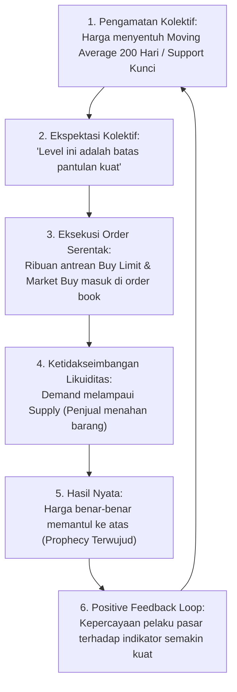
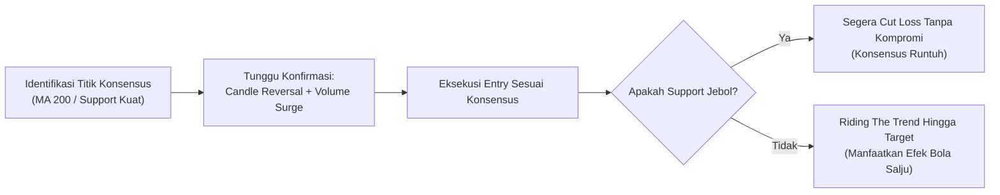

# Bab 27: Self-Fulfilling Prophecy di Pasar Finansial

> "Ketika satu orang melihat garis support 5.000, itu hanyalah sebuah opini. Ketika sepuluh ribu trader dan ratusan algoritma institusi melihat garis support 5.000 yang sama lalu menaruh order beli bersamaan, opini tersebut seketika menjelma menjadi kenyataan fisik pasar."  
> — **Edianto Ong**, *Technical Analysis for Mega Profit*

---

## 1. Konsep Dasar Self-Fulfilling Prophecy

Istilah **Self-Fulfilling Prophecy** (Ramalan yang Terwujud dengan Sendirinya) pertama kali dipopulerkan oleh sosiolog terkemuka Robert K. Merton pada tahun 1948. Merton mendefinisikannya sebagai:
> *"Sebuah keyakinan atau ekspektasi keliru yang melahirkan perilaku baru, yang pada gilirannya menyebabkan ekspektasi awal yang awalnya keliru tersebut benar-benar menjadi kenyataan konkret."*

Di pasar modal dan bursa finansial, fenomena ini tidak terjadi karena sihir atau kebetulan mistis, melainkan melalui mekanisme **koordinasi psikologis terdesentralisasi**. Ribuan analis, pengelola reksa dana (*fund manager*), pelaku pasar institusi, hingga jutaan trader ritel di seluruh penjuru dunia mengamati grafik yang sama, memakai rumus matematika indikator yang sama, dan menarik kesimpulan aksi yang searah.



---

## 2. Mengapa Indikator Teknikal Bekerja: Mekanisme Konsensus Kolektif

Salah satu pertanyaan mendasar yang kerap dilontarkan pemula adalah: *"Apakah Moving Average 200 hari memiliki kekuatan fundamental gaib sehingga harga saham selalu berbalik arah di sana?"*

Jawaban tegas Edianto Ong: **Tidak.**  
Garis Moving Average 200 hanyalah rata-rata aritmatika sederhana dari harga penutupan selama 200 periode ke belakang. Nilai intrinsiknya nol jika tidak ada manusia yang memperhatikannya. Namun, indikator tersebut menjadi luar biasa kuat karena ia berfungsi sebagai **titik fokus Schelling (*Schelling Focal Point*)** dalam teori permainan (*game theory*).

### Studi Kasus: Mengapa Level MA 200 dan Support Psikologis Begitu Keramat?

1. **Titik Konsensus Institusional:**
   Lembaga riset perbankan global (seperti Goldman Sachs, Morgan Stanley, JP Morgan) dan manajer investasi domestik menggunakan MA 200 harian (*200-day Simple Moving Average*) sebagai patokan baku untuk mendefinisikan batas antara pasar *bullish* dan *bearish* jangka panjang.
2. **Keterlibatan Algoritma & High-Frequency Trading (HFT):**
   Sistem perdagangan otomatis (*algorithmic trading*) diprogram dengan skrip logika yang seragam. Ketika harga menyentuh MA 200 atau garis tren utama, algoritma secara serentak mengeksekusi parameter *buy on support* atau *sell on breakdown*.
3. **Penyusutan Pasokan (*Supply Drying Up*):**
   Di titik support yang disepakati (misalnya angka bulat psikologis Rp5.000 atau MA 200), para pemegang saham yang berniat menjual (*potential sellers*) enggan melepas barang karena berharap pantulan. Sebaliknya, pembeli (*prospective buyers*) membanjiri antrean bid. Akibatnya, sedikit saja volume beli masuk, harga langsung melonjak.

```
       Visualisasi Pantulan Self-Fulfilling Prophecy pada Support MA 200

  Harga
    ^
    |             *     *
    |            * *   * *
    |           *   * *   *
    |----------*-----*-----*-------------------- MA 200 (Titik Konsensus)
    |         ^     ^     ^
    |         |     |     |
    |       Order Beli Kolektif Muncul Karena Semua Melihat Garis Yang Sama!
    +--------------------------------------------> Waktu
```

---

## 3. Keberhasilan vs Jebakan: Bahaya Dogma Kaku

Meskipun *self-fulfilling prophecy* memberikan validitas fungsional pada analisis teknikal, Edianto Ong memperingatkan bahaya terbesar yang sering menjerumuskan trader: **terjebak dogma kaku (*rigid dogmatism*)**.

### Mengapa Ramalan Bisa Gagal Total?
Ramalan teknikal runtuh seketika saat muncul faktor dominan yang menghancurkan konsensus massa:

1. **Munculnya *Whale / Smart Money* yang Berlawanan Arah:**
   Jika sebuah institusi besar sedang mengalami likuidasi paksa (*forced margin call*) atau redemption reksa dana besar-besaran, mereka wajib menjual ratusan ribu lot saham terlepas dari apakah harga sedang berada di support MA 200 atau garis tren utama. Pasokan raksasa ini akan melibas seluruh antrean beli kolektif ritel.
2. **Kejutan Fundamental Ekstrim (*Black Swan Events*):**
   Krisis finansial global, perang, atau skandal kecurangan laporan keuangan (*fraud*) emiten seketika menyingkirkan pertimbangan teknikal.
3. **Crowded Trades & Liquidity Trap:**
   Ketika "terlalu banyak" trader ritel menempatkan Stop Loss di titik yang sama (misalnya tepat di bawah garis support), level tersebut menjadi sasaran empuk bagi bandar/market maker untuk melakukan *stop-hunt* (memancing harga turun sekejap guna melibas likuiditas stop loss, lalu membawanya terbang kembali).

---

## 4. Cara Trader Memanfaatkan Fenomena Ini Sebagai Trading Edge

Agar tidak menjadi korban, melainkan pemetik keuntungan dari *self-fulfilling prophecy*, Edianto Ong merumuskan tiga pilar strategis:

### A. Gunakan Parameter Populer yang Diperhatikan Mayoritas Pelaku Pasar
Jangan menciptakan indikator eksotis dengan parameter aneh (misal: Moving Average periode 37,2 atau Fibonacci 43,1%) yang hanya Anda sendiri yang melihatnya di dunia. Kekuatan *self-fulfilling prophecy* berbanding lurus dengan jumlah pengamatnya.
* **Gunakan parameter standar industri:**
  * MA: 20, 50, 100, 200.
  * RSI: Periode 14 dengan ambang batas 30 dan 70.
  * Fibonacci Retracement: 38.2%, 50.0%, 61.8%.
  * Support & Resistance horizontal klasik serta angka bulat psikologis (*round numbers*).

### B. Konfirmasi Melalui Volume dan Price Action
Jangan pernah mendahului pasar (*front-running*) dengan langsung memasang order beli saat harga baru mendekati support. Tunggu hingga pelaku pasar lain benar-benar masuk dan memicu aksi pantulan:
* Perhatikan apakah ada formasi *candlestick reversal* (seperti *Hammer*, *Bullish Engulfing*, atau *Morning Star*).
* Pastikan pantulan didukung oleh lonjakan volume transaksi (*volume surge*). Volume adalah bukti otentik bahwa uang besar (*big money*) ikut mengonfirmasi ramalan tersebut.

### C. Tetap Objektif dengan Stop Loss Ketat
Selalu ingat prinsip probabilitas: Anda tidak sedang meramal masa depan dengan kepastian 100%. Anda hanya bertransaksi berdasarkan kecenderungan massa.
* Apabila garis support atau MA 200 ditembus ke bawah dengan volume tinggi, jangan bertahan pada dogma Anda!
* Terima fakta bahwa konsensus telah gagal, ekspektasi pasar telah berbalik arah (*bias shift*), dan potong kerugian (*cut loss*) tanpa kompromi.



Dengan memahami *self-fulfilling prophecy*, Anda tidak lagi memperlakukan analisis teknikal sebagai ramalan mistis, melainkan sebagai instrumen strategis untuk memetakan di mana mayoritas modal dunia akan bertindak, menunggangi momentum tersebut, dan segera keluar ketika ekspektasi pasar tidak terwujud.
