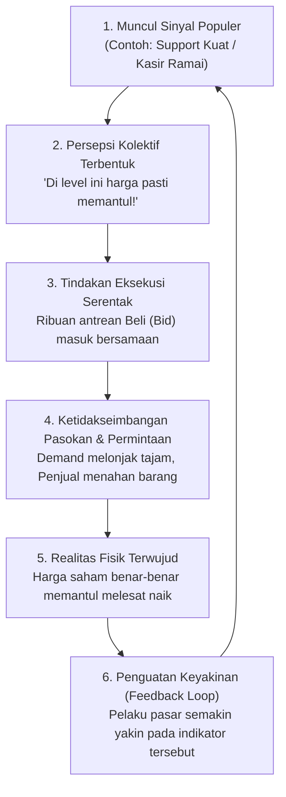
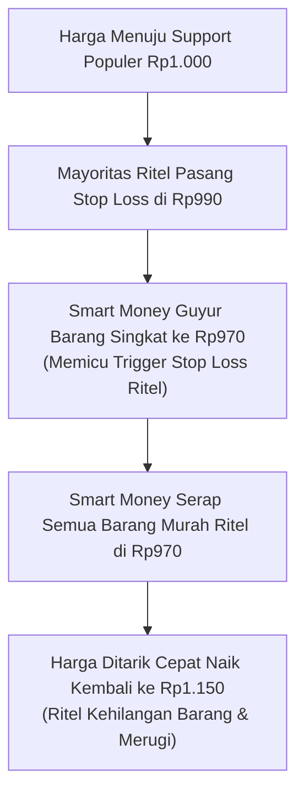
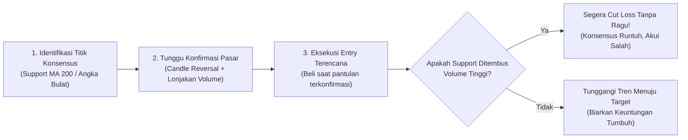

# Bab 27: Self-Fulfilling Prophecy di Pasar Finansial

> "Ketika satu orang melihat garis support Rp5.000, itu hanyalah sebuah opini pribadi. Namun ketika sepuluh ribu trader, puluhan manajer investasi, dan ratusan algoritma komputer institusi melihat garis support Rp5.000 yang sama lalu menaruh order beli bersamaan, opini tersebut seketika menjelma menjadi kenyataan fisik bursa!"  
> — **Edianto Ong**, *Technical Analysis for Mega Profit*

---

## 1. Analogi Membumi: Efek Antrean Kasir Supermarket

Bayangkan Anda sedang berbelanja di sebuah supermarket besar pada akhir pekan:

1. **Situasi Kasir:**
   * Di depan Anda ada 5 kasir pembayaran. Kasir A, B, C, dan D tampak sepi atau baru ada 1 orang.
   * Tiba-tiba di Kasir E, ada 3 orang pembeli yang berdiri mengantre dengan tertib.
   * Pembeli baru yang masuk ke area kasir melihat Kasir E lebih ramai dan langsung berpikir: *"Pasti kasir E kasirnya paling cepat, atau promonya berlaku di sana."*
   * Orang ke-4 dan ke-5 ikut bergabung ke Kasir E. Melihat antrean Kasir E semakin panjang, orang ke-6, ke-7, dan ke-8 pun ikut berbondong-bondong mengantre di sana.
2. **Hasilnya:**
   * Kasir E benar-benar menjadi kasir paling ramai dan paling cepat memproses transaksi omzet terbanyak hari itu—bukan karena mesin Kasir E memiliki mukjizat ajaib, melainkan karena **ekspektasi orang banyak yang memicu tindakan serentak**, sehingga ramalan tersebut mewujudkan dirinya sendiri!
3. **Penerapannya di Pasar Modal:**
   * Ketika para analis dan trader melihat garis Moving Average 200 hari atau Support Kuat Rp2.000, mereka semua bersiap membeli. Karena jutaan orang memasang antrean beli (*bid*) di titik yang sama, harga saham tersebut benar-benar memantul ke atas. Ramalan teknikal terbukti akurat berkat konsensus tindakan kolektif.



---

## 2. Hakikat Teori: Apa Itu Self-Fulfilling Prophecy?

Istilah **Self-Fulfilling Prophecy** (Ramalan yang Terwujud dengan Sendirinya) pertama kali dirumuskan oleh sosiolog terkemuka Robert K. Merton pada tahun 1948. Merton mendefinisikannya sebagai:
> *"Sebuah keyakinan awal atau ekspektasi keliru yang melahirkan perilaku baru, yang pada gilirannya menyebabkan ekspektasi awal tersebut benar-benar menjadi kenyataan konkret."*

Di pasar modal dan bursa finansial, fenomena ini tidak terjadi karena sihir gaib atau ramalan dukun, melainkan melalui **koordinasi psikologis terdesentralisasi**:
* Ribuan analis sekuritas mengeluarkan ulasan teknikal harian yang seragam di pagi hari.
* Manajer investasi (*fund manager*) mengelola dana triliunan rupiah dengan algoritma yang mengacu pada level Moving Average standar industri.
* Jutaan investor ritel membuka aplikasi chart yang sama (TradingView, chart sekuritas) dan melihat indikator yang persis sama.
* Hasilnya adalah **keselarasan tindakan (*synchronized action*)** yang menggerakkan likuiditas pasar ke arah yang sama.

---

## 3. Mengapa Indikator Teknikal Populer Selalu Bekerja? (Konsep Titik Schelling)

Pertanyaan klasik yang sering diajukan oleh pemula:
> *"Apakah garis Moving Average 200 hari atau garis Fibonacci Retracement 61.8% memiliki rumus mistis dari alam semesta sehingga harga selalu berbalik arah tepat di titik itu?"*

Jawaban tegas Edianto Ong: **Sama sekali tidak!**  
Secara matematika dasar, Simple Moving Average 200 hanyalah penjumlahan harga penutupan selama 200 hari dibagi angka 200. Garis itu tidak memiliki nyawa intrinsik. Namun, indikator itu bekerja luar biasa efektif karena bertindak sebagai **Titik Fokus Schelling (*Schelling Focal Point*)** dalam teori permainan (*Game Theory*).

### Konsep Titik Schelling:
Jika Anda dan seorang kawan lama diminta bertemu di kota Jakarta pada hari ini jam 12.00 siang, namun Anda berdua sama sekali tidak bisa berkomunikasi lewat telepon atau pesan, ke mana Anda akan pergi?  
Mayoritas orang akan memilih **Monas (Monumen Nasional)** tepat di depan pintu cawan jam 12.00. Mengapa? Karena Monas adalah titik fokus yang paling menonjol dan disepakati secara alami tanpa perlu bicara.

Di bursa saham:
1. **Titik Konsensus Institusional:**
   Bank investasi dunia (seperti JP Morgan, Goldman Sachs) dan manajer reksa dana besar menjadikan MA 200 harian (*200-day SMA*) sebagai batas resmi antara tren *bullish* sehat dan tren *bearish* berbahaya.
2. **Pemrograman Algoritma Robot & HFT (*High-Frequency Trading*):**
   Ratusan mesin perdagangan otomatis diprogram dengan logika matematis yang sama: *Buy Limit* di dekat MA 200 atau *Breakout Buy* di atas Resistance horizontal.
3. **Penyusutan Pasokan Jual (*Supply Drying Up*):**
   Ketika harga mendekati garis support yang diakui semua orang, para pemilik saham menolak menjual murah karena mereka tahu pantulan segera tiba. Pada saat yang sama, pembeli baru membanjiri antrean *bid*. Karena penawaran jual kering sementara permintaan beli melimpah, harga tidak punya pilihan lain selain **melonjak naik**!

```
       Visualisasi Pantulan Self-Fulfilling Prophecy pada Support MA 200

  Harga
    ^
    |             *     *
    |            * *   * *
    |           *   * *   *
    |----------*-----*-----*-------------------- MA 200 (Titik Konsensus Bersama)
    |         ^     ^     ^
    |         |     |     |
    |       Order Beli Kolektif Muncul Karena Jutaan Trader Melihat Garis Yang Sama!
    +--------------------------------------------> Waktu
```

---

## 4. Keberhasilan vs Jebakan: Bahaya Dogma Kaku & Keruntuhan Ramalan

Meskipun *self-fulfilling prophecy* memberikan keunggulan probabilitas bagi analis teknikal, Edianto Ong memberikan peringatan keras: **Jangan pernah jatuh cinta pada dogma teknikal secara buta (*rigid dogmatism*)!**

Pasar modal bukanlah mesin deterministik yang kaku. Ramalan teknikal bisa dan sering kali **gagal total** ketika terjadi kondisi-kondisi berikut:

1. **Munculnya Tekanan Jual Uang Raksasa (*Whale / Forced Selling*):**
   Jika sebuah dana pensiun raksasa atau pemilik saham pengendali terpaksa melakukan likuidasi darurat (*margin call* atau penarikan dana reksa dana besar-besaran), mereka wajib menjual jutaan lembar saham ke pasar pasar reguler. Tekanan pasokan (*supply*) raksasa ini akan melibas habis seluruh antrean beli di garis support MA 200 seolah garis tersebut tidak pernah ada!
2. **Kejutan Peristiwa Tak Terduga (*Black Swan Event*):**
   Krisis geopolitik, perang meletus, pandemi mendadak, atau terbongkarnya kecurangan laporan keuangan (*fraud*) emiten seketika meruntuhkan konsensus psikologis massa.
3. **Jebakan Likuiditas & Perburuan Stop Loss (*Stop-Hunt Trap*):**
   Ketika terlalu banyak trader pemula memasang order Stop Loss di titik yang sama persis (misalnya 1 tick tepat di bawah garis support yang sangat kentara), level tersebut menjadi sasaran empuk *Market Maker* (Bandar). Mereka akan membanting harga sedikit ke bawah untuk memicu *automatic stop loss* ritel, menampung barang murah dari ritel yang panik, lalu menerbangkan harga kembali ke atas (*false breakdown*).



---

## 5. Kamus Istilah Pemula (Glossary Box)

> [!NOTE]
> * **Self-Fulfilling Prophecy:** Fenomena di mana suatu ekspektasi atau ramalan menjadi kenyataan semata-mata karena keyakinan orang banyak yang memicu tindakan serentak ke arah tersebut.
> * **Schelling Point (Focal Point):** Titik fokus solusi alami dalam teori permainan (*game theory*) yang dipilih secara spontan oleh banyak orang tanpa komunikasi eksplisit sebelumnya (contoh: MA 200 atau angka bulat Rp1.000).
> * **Stop-Hunt:** Kondisi di mana harga sengaja digerakkan sementara menembus level support kunci guna memicu eksekusi order stop loss ritel yang menumpuk di sana, sebelum kemudian harga berbalik arah sesuai tren awal.
> * **False Breakdown (Whipsaw):** Penembusan level support ke bawah yang hanya berlangsung sesaat dan segera berbalik naik kembali ke atas zona support.
> * **Confirmation (Konfirmasi):** Bukti tambahan dari pergerakan harga riil (seperti bentuk candle dan volume transaksi) yang menegaskan bahwa sinyal indikator benar-benar direspon oleh pelaku pasar.

---

## 6. Tiga Protokol Praktis Memanfaatkan Self-Fulfilling Prophecy Sebagai Trading Edge

Agar Anda tidak menjadi korban perburuan likuiditas, Edianto Ong menyusun tiga aturan taktis:

### A. Gunakan Parameter Standar Industri (Indikator Populer)
Kekuatan *self-fulfilling prophecy* berbanding lurus dengan jumlah manusia dan komputer yang melihatnya. **Jangan pernah menciptakan indikator aneh dengan angka eksotis yang hanya Anda sendiri di dunia yang menggunakannya** (misalnya Moving Average periode 37,2 atau Fibonacci 43,8%).
* **Moving Average Standar:** MA 20 (jangka pendek), MA 50 (jangka menengah), MA 100 & MA 200 (jangka panjang).
* **Relative Strength Index (RSI):** Periode standar 14 dengan level batas 30 (*oversold*) dan 70 (*overbought*).
* **Fibonacci Retracement:** Rasio emas klasik 38.2%, 50.0%, dan 61.8%.
* **Level Horisontal Klasik:** Puncak tertinggi sebelumnya (*previous high*), lembah terendah sebelumnya (*previous low*), dan angka bulat psikologis (misal: Rp500, Rp1.000, Rp2.500, Rp5.000).

### B. Wajib Menunggu Konfirmasi Price Action & Volume
Jangan mendahului pasar (*front-running*) dengan langsung membeli saat harga baru menyentuh support. Tunggu hingga pelaku pasar lain benar-benar bereaksi memantulkan harga:
* Pastikan muncul formasi candlestick pembalikan (*Reversal Candle*) seperti *Hammer*, *Bullish Engulfing*, atau *Morning Star*.
* Pastikan pantulan tersebut diiringi **lonjakan volume transaksi (*volume surge*)**. Volume adalah bukti sah bahwa uang besar (*big money*) telah masuk mengawal konsensus tersebut.

### C. Pasang Batas Toleransi (*Buffer*) pada Stop Loss
Jangan menaruh Stop Loss persis di bawah garis support garis tipis chart Anda. Berikan ruang nafas (*buffer*) sebesar 1% hingga 2% (atau 1 s/d 2 tick fraksi harga di BEI) untuk menghindari sengatan jarum *stop-hunt*.



---

## 7. Studi Kasus Konkret: Trader A vs Trader B Menghadapi Garis MA 200

Mari kita bandingkan dua pendekatan trader pada saham telekomunikasi "TLKM-XYZ":

```
Kondisi Pasar:
Harga saham TLKM-XYZ turun dari Rp4.200 menuju level MA 200 hari di harga Rp3.500.
Level Rp3.500 juga bertepatan dengan angka bulat psikologis.
```

* **Trader A (Gagap Self-Fulfilling Prophecy / Trader Nekat):**
  * Trader A membaca di internet bahwa MA 200 adalah support keramat.
  * Begitu harga menyentuh Rp3.500 pada pukul 09.05 WIB pagi hari, Trader A langsung memborong seluruh modalnya (*all-in*) tanpa melihat volume atau candlestick.
  * Ternyata ada dana asing yang sedang mencairkan portofolionya secara masif. Tekanan jual asing menembus Rp3.500, harga ambles ke Rp3.400, Rp3.300, dan ditutup di Rp3.150.
  * Trader A panik, tidak memasang stop loss karena yakin "MA 200 tidak boleh bohong", dan akhirnya terjebak *loss* mendalam sebesar -10% dalam sehari.

* **Trader B (Trader Taktis Disiplin Konsensus):**
  * Trader B menandai area Rp3.500 sebagai area konsensus potensial, namun ia bersabar menunggu reaksi pasar.
  * Pada saham lain "BBNI-XYZ" yang juga menyentuh MA 200 di Rp4.800:
    * Terbentuk candle jarum bawah panjang (*Hammer*) di area Rp4.800.
    * Volume transaksi penutupan melonjak 2 kali lipat rata-rata 20 hari, menandakan antrean beli institusi benar-benar masuk menampung barang.
  * Trader B mengeksekusi pembelian di Rp4.850 saat candle terkonfirmasi, dengan Stop Loss terukur di Rp4.740 (di bawah ekor candle Hammer).
  * Efek konsensus pasar bekerja sempurna: para investor lain melihat candle palu tersebut dan ikut memborong di hari-hari berikutnya. Saham melesat kembali ke Rp5.500.
  * **Hasil:** Trader B meraih keuntungan bersih +13,4% dengan risiko yang terkunci rapi hanya 2,2%.

> [!TIP]
> Jadikan *Self-Fulfilling Prophecy* sebagai sahabat navigasi Anda. Anda tidak perlu menebak masa depan secara ajaib; Anda hanya perlu memetakan di mana ribuan kapal modal besar akan berlabuh, menunggu mereka melempar jangkarnya, lalu mengarungi arus keuntungan bersama mereka dengan perlindungan Stop Loss yang kokoh.
