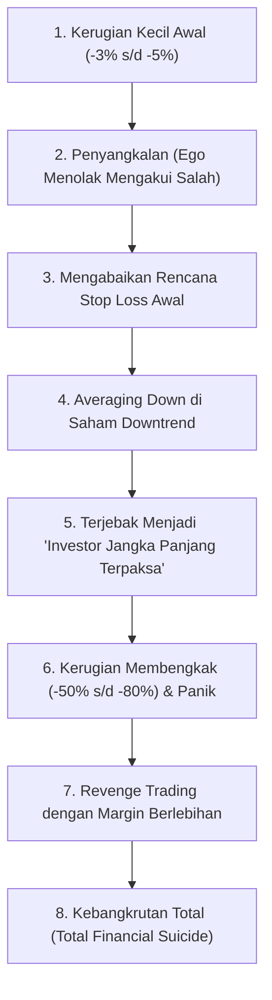
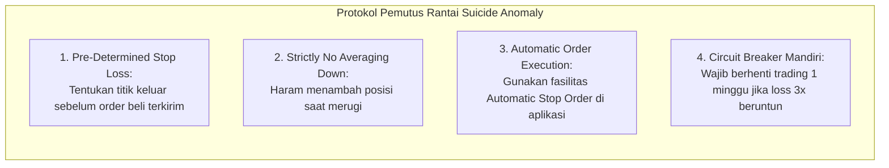

# Bab 28: Suicide Anomaly (Psikologi Kehancuran Trader)

> "Musuh terbesar seorang trader bukanlah bandar, bukan algoritma canggih Wall Street, dan bukan pula berita buruk di televisi. Musuh paling kejam yang siap menghabisi modal dan masa depan finansial Anda sedang menatap balik dari cermin di kamar mandi Anda setiap pagi."  
> — **Edianto Ong**, *Technical Analysis for Mega Profit*

---

## 1. Hakikat The Suicide Anomaly

Bab ini merupakan salah satu bab paling monumental dan berbobot filosofis dalam karya Edianto Ong. Istilah **The Suicide Anomaly** (Anomali Bunuh Diri Finansial) merujuk pada fenomena tragis di mana seorang pelaku pasar secara sadar atau setengah sadar melakukan serangkaian tindakan irasional yang secara matematis dan psikologis pasti berujung pada kebangkrutan total portofolionya.

Di pasar finansial, kehancuran modal 90% trader pemula bukanlah akibat kurangnya indikator teknikal atau keterbatasan informasi, melainkan akibat kegagalan mengelola psikologi internal ketika menghadapi situasi tertekan (*loss position*).



---

## 2. Mengapa Kaum Intelektual Sukses Sering Hancur di Bursa Saham?

Salah satu paradoks terbesar yang diungkap oleh Edianto Ong adalah: **mengapa dokter spesialis bedah, insinyur terkemuka, profesor matematika, akuntan senior, dan pengacara sukses sangat sering mengalami kegagalan mengenaskan di pasar saham?**

Secara intuitif, masyarakat mengira mereka yang berpendidikan tertinggi dan memiliki IQ superior akan paling mudah menaklukkan bursa. Namun kenyataan di lantai bursa membuktikan sebaliknya.

### Akar Masalah: Benturan Mindset Profesi vs Realitas Pasar

1. **Ilusi Kontrol (*Illusion of Control*):**
   * Di dunia nyata, seorang dokter yang mendiagnosis penyakit atau insinyur yang merancang jembatan memegang kendali penuh berdasarkan keahlian teknis dan kepastian hukum fisika/biologi. Makin keras mereka belajar dan menganalisis, makin pasti hasilnya.
   * Di pasar finansial, tidak ada seorang pun yang bisa mengendalikan harga. Pasar bergerak berdasarkan hukum probabilitas, bukan kepastian mutlak. Kerja keras menganalisis laporan keuangan selama 100 jam tidak menjamin harga saham tidak akan turun 10% esok hari.
2. **Kerapuhan Ego (*Intellectual Ego & Fragility*):**
   * Kaum profesional terbiasa selalu benar di bidangnya. Bagi mereka, mengakui bahwa analisisnya salah dan mengeksekusi *cut loss* terasa seperti pukulan telak yang menghancurkan reputasi harga diri.
   * Sebaliknya, seorang trader sukses bukanlah orang yang selalu benar, melainkan orang yang **berani memotong kerugian sekecil mungkin ketika ia salah, dan membiarkan keuntungannya membesar ketika ia benar**.

---

## 3. Empat Anatomi Jebakan Bunuh Diri Finansial

Edianto Ong mengupas tuntas empat tahapan proses patologis yang menjebak trader dalam spiral kehancuran:

### A. Ego yang Menolak Salah (*Refusal to Admit Mistakes*)
Ketika harga menembus level Stop Loss yang telah direncanakan (misalnya batas toleransi risiko 5%), trader amatir mengalami pergulatan batin (*cognitive dissonance*). Alih-alih menekan tombol jual, mereka mulai mencari-cari pembenaran baru:
* Membuka forum diskusi saham untuk mencari orang lain yang masih optimis (*confirmation bias*).
* Mencari berita atau rumor bagus dari emiten tersebut untuk menenangkan rasa cemas.
* Beranggapan: *"Selama belum dijual, saya belum rugi (*paper loss*)!"* Ini adalah ilusi paling berbahaya dalam dunia trading.

### B. Bahaya Mematikan *Averaging Down* pada Tren Turun (*Downtrend*)
Setelah harga turun lebih dalam (misalnya minus 15%), godaan paling mematikan muncul: **Averaging Down** (membeli lebih banyak lot saham di harga yang lebih murah dengan maksud menurunkan harga rata-rata modal).

```
         Ilusi Fatal Averaging Down pada Saham Downtrend

  Harga
    ^
    |  Beli Awal (Rp1.000) -> 100 Lot
    |      \
    |       \  Beli Lagi (Rp800) -> 200 Lot (Modal Rata-rata jadi Rp866)
    |        \
    |         \  Beli Lagi (Rp600) -> 400 Lot (Modal Rata-rata jadi Rp714)
    |          \
    |           \  Harga Ambles ke Rp300 -> Kerugian Membengkak Masif!
    |            \
    +------------------------------------------------------------> Waktu
```

Edianto Ong menggarisbawahi:
> *"Averaging down pada saham yang berada dalam siklus Downtrend struktural atau emiten bermasalah adalah tindakan melempar bensin ke dalam kobaran api. Anda sedang melipatgandakan ukuran posisi Anda pada sebuah ide transaksi yang telah terbukti gagal!"*

### C. Sindrom "Investor Terpaksa" (*The Reluctant Investor Syndrome*)
Ketika kerugian telah mencapai -40% hingga -70%, kapasitas mental trader telah lumpuh (*numbness*). Pada fase inilah terjadi perubahan status yang menggelikan sekaligus menyedihkan:
* Awalnya membeli saham gorengan atau saham lapis tiga untuk *scalping* atau *swing trading* 3 hari.
* Begitu nyangkut parah, mereka berkata: *"Saya sekarang menjadi investor fundamental jangka panjang. Saham ini bagus untuk anak cucu."*
* Modal kerja terikat mati (*capital lock-up*), kehilangan *opportunity cost* untuk masuk ke saham-saham yang sedang uptrend sehat, dan mental terkuras habis melihat penurunan nilai aset setiap hari.

### D. Perdagangan Balas Dendam (*Revenge Trading*)
Ketika trader akhirnya tidak tahan menahan sakit hati setelah berbulan-bulan melihat portofolionya tergerus, mereka seringkali melakukan kapitulasi (*panic sell*) tepat di dasar pasar (*market bottom*).

Namun alih-alih beristirahat dan menenangkan diri, amarah membakar akal sehat. Mereka ingin membalas dendam kepada bursa dan merebut kembali uangnya seketika.
* Masuk ke saham yang bergejolak liar (*high volatility penny stocks*) tanpa rencana trading.
* Menggunakan fasilitas pinjaman broker (*margin trading*) secara maksimal.
* Hasil akhirnya adalah *margin call*, *forced sell* oleh sekuritas, dan lenyapnya seluruh modal tanpa sisa.

---

## 4. Studi Kasus Nyata Kehancuran Portofolio

### Profil Kasus: Dr. H (Insinyur Senior & Eksekutif Perusahaan)
* **Modal Awal:** Rp1.000.000.000 (Satu Miliar Rupiah).
* **Rencana Awal:** Membeli saham emiten komoditas cyclical ABC di harga Rp2.500 sebanyak 4.000 lot dengan rencana Stop Loss di Rp2.350 (Risiko: 6% atau Rp60.000.000).
* **Perjalanan Bencana:**
  1. Harga turun menyentuh Rp2.350. Dr. H menolak cut loss: *"Fundamental komoditas dunia masih bagus, analis broker bilang targetnya Rp3.500."*
  2. Harga turun ke Rp1.800. Dr. H menyuntikkan sisa tabungannya Rp500.000.000 untuk melakukan *averaging down* besar-besaran. Harga modal rata-rata turun ke Rp2.200.
  3. Laporan keuangan kuartal berikutnya menunjukkan laba emiten anjlok drastis dan utang membengkak. Saham terkena suspensi dan dibuka anjlok hingga Rp800.
  4. Nilai portofolio tersisa hanya Rp400.000.000 (merugi Rp1,1 Miliar).
  5. Dalam keputusasaan, Dr. H meminjam fasilitas margin 3x lipat dan mempertaruhkan sisa modalnya pada saham waran berisiko tinggi (*penny warrant*). Dalam tiga hari perdagangan, waran tersebut kedaluwarsa tanpa nilai (*worthless*).
  6. **Hasil Akhir:** Modal lenyap 100%, mengalami depresi klinis berat, dan kehancuran keharmonisan keluarga.

---

## 5. Protokol Memutus Rantai Anomali Bunuh Diri

Untuk membentengi diri dari jebakan mematikan ini, Edianto Ong menetapkan aturan besi (*iron rules*) yang tidak boleh dilanggar dalam kondisi apa pun:



1. **Tentukan Titik Keluar Sebelum Titik Masuk:**
   Jangan pernah menaruh order beli sebelum Anda tahu persis di mana Anda akan keluar jika pasar tidak bergerak sesuai rencana.
2. **Haramkan *Averaging Down* pada Posisi Merugi:**
   Jika ingin melakukan penambahan posisi (*pyramiding*), hanya lakukan ketika posisi pertama Anda telah menghasilkan keuntungan (*averaging up on a winning trend*).
3. **Delegasikan Eksekusi ke Sistem Otomatis:**
   Gunakan fitur *trailing stop* atau *automatic stop loss order* yang disediakan oleh aplikasi sekuritas modern. Singkirkan ego manusia dari tombol eksekusi darurat.
4. **Terapkan *Cooling-Off Period* Pasca-Kerugian:**
   Jika Anda mengalami 3 kali kerugian beruntun (*consecutive losses*), segera tutup layar laptop Anda. Ambil cuti minimal satu minggu dari pasar modal untuk memulihkan kejernihan psikologis dan mengikis racun emosi balas dendam.

Bursa saham adalah tempat paling mahal untuk membuktikan bahwa Anda pintar. Jadilah orang yang rendah hati di hadapan pasar, karena hanya mereka yang berani mengakui kekalahan kecillah yang akan bertahan untuk menikmati kemenangan besar.
