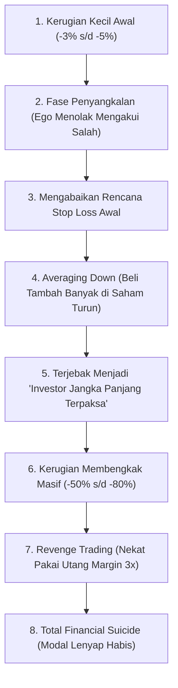
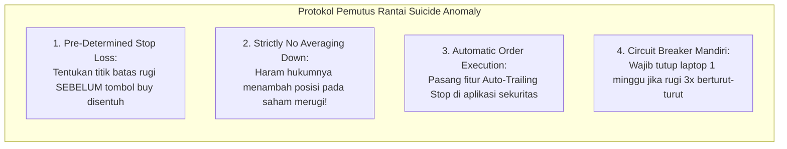

# Bab 28: Suicide Anomaly (Psikologi Kehancuran Trader)

> "Musuh terbesar seorang trader bukanlah bandar misterius, bukan algoritma canggih Wall Street, dan bukan pula berita buruk di media televisi. Musuh paling kejam yang siap melenyapkan modal dan masa depan finansial Anda adalah sosok yang sedang menatap balik dari cermin di kamar mandi Anda setiap pagi: **Ego dan ketidakmampuan Anda mengakui kesalahan.**"  
> — **Edianto Ong**, *Technical Analysis for Mega Profit*

---

## 1. Analogi Membumi: Ego Dokter Bedah vs Kapten Kapal di Tengah Badai

Untuk memahami mengapa trader bisa menghancurkan dirinya sendiri di pasar modal, renungkan dua perbandingan analogi nyata ini:

### A. Penyakit Ego Profesional (Dokter Bedah / Profesor Terhormat)
Di ruang operasi, seorang dokter bedah senior adalah otoritas mutlak. Selama bertahun-tahun ia terbiasa selalu benar; pasien sembuh berkat keahliannya, dan semua orang di sekitarnya mengagumi kecerdasannya.  
Namun, apa yang terjadi ketika sang dokter masuk ke bursa saham?
* Ia menganalisis sebuah saham farmasi, membaca seluruh jurnal medis, dan menyimpulkan harga saham tersebut harusnya naik ke Rp3.000.
* Tiba-tiba pasar membawa harga turun ke Rp2.000.
* **Ego intelektualnya menolak:** *"Pasar yang bodoh! Mereka tidak paham farmasi sedalam saya. Saya tidak mungkin salah!"*
* Alih-alih menjual di batas rugi kecil, ia terus membeli lebih banyak saham yang sedang terjun bebas demi membuktikan bahwa ia benar. Hasil akhirnya: sang dokter hancur bukan karena kurang pintar, melainkan karena egonya terlalu besar untuk mengakui kekalahan.

### B. Kebijaksanaan Kapten Kapal Kargo di Samudera Lepas
Bandingkan dengan seorang kapten kapal kargo pengangkut kontainer di tengah samudera:
* Saat badai topan dahsyat menghantam dan air mulai masuk ke lambung kapal, sang kapten tidak berdebat dengan ombak laut. Ia tidak bersikeras mengatakan: *"Saya sekolah perkapalan 10 tahun, badai ini tidak sopan mengganggu saya!"*
* Tanpa ragu dan tanpa penyesalan, sang kapten segera memerintahkan anak buahnya untuk **memotong tali dan membuang separuh peti kemas muatan ke dasar laut** (*jettison cargo*).
* Apakah sang kapten rugi kehilangan kontainer barang? Ya, tentu rugi. Namun dengan membuang beban muatan tersebut, kapal kembali seimbang, mengapung selamat, dan seluruh nyawa awak kapal terselamatkan dari karam di dasar samudera!
* **Di pasar saham, melakukan Cut Loss adalah tindakan membuang peti kemas kargo.** Anda merelakan kerugian kecil 2% demi menyelamatkan nyawa kapal portofolio Anda dari karam total!

```mermaid
flowchart TD
    subgraph EgoDokter["Mindset Ego Intelektual (Suicide Anomaly)"]
        D1["Analisis Mendalam & Merasa Pasti Benar"] --> D2["Harga Saham Turun Menembus Stop Loss"]
        D2 --> D3["Menolak Salah: 'Pasar yang Keliru!'"]
        D3 --> D4["Averaging Down Membeli di Tren Turun"]
        D4 --> D5["Modal Ludes 80% & Kapal Portofolio Tenggelam"]
    end

    subgraph KaptenKapal["Mindset Kapten Kapal (Trader Profesional)"]
        K1["Beli Saham Sesuai Sistem Terukur"] --> K2["Badai Datang: Harga Turun Sentuh SL"]
        K2 --> K3["Buang Sebagian Muatan: Cut Loss 2% Tanpa Ragu"]
        K3 --> K4["Modal 98% Tetap Utuh Mengapung Selamat"]
        K4 --> K5["Siap Berlayar Menangkap Peluang Badai Berikutnya"]
    end
```



---

## 2. Hakikat The Suicide Anomaly

Bab ini merupakan salah satu bab paling monumental dan berbobot filosofis dalam seluruh karya Edianto Ong. Istilah **The Suicide Anomaly** (Anomali Bunuh Diri Finansial) merujuk pada fenomena tragis di mana seorang pelaku pasar secara sadar atau setengah sadar melakukan serangkaian tindakan irasional yang secara matematis dan psikologis pasti berujung pada kebangkrutan total akunnya.

Di bursa efek, kehancuran 90% trader pemula bukanlah akibat kurangnya indikator teknikal atau keterbatasan informasi rahasia, melainkan akibat **ketidakmampuan mental mengelola posisi yang merugi (*loss position*)**.



---

## 3. Empat Anatomi Jebakan Bunuh Diri Finansial

Edianto Ong mengupas tuntas empat tahapan proses patologis yang menjebak trader dalam spiral kehancuran:

### A. Ego yang Menolak Salah (*Refusal to Admit Mistakes*)
Ketika harga menembus level Stop Loss yang telah direncanakan (misalnya batas toleransi risiko 5%), trader pemula mengalami pergulatan batin (*cognitive dissonance*). Alih-alih menekan tombol jual, mereka mulai mencari-cari pembenaran palsu:
* Membuka grup obrolan saham untuk mencari orang lain yang juga sedang menyangkut agar merasa ada kawan senasib (*confirmation bias*).
* Menghibur diri dengan ungkapan klise paling menyesatkan di pasar saham:  
  > *"Selama belum ditekan tombol jual, saya belum rugi (*paper loss*). Nanti juga harganya pasti balik lagi!"*
* **Realitas Brutal:** Kerugian di portofolio adalah kenyataan finansial yang nyata. Nilai daya beli uang Anda sudah berkurang seketika. Menolak melihat layar tidak akan membuat harga saham berbalik naik.

### B. Bahaya Mematikan *Averaging Down* pada Tren Turun (*Downtrend*)
Setelah harga saham turun lebih dalam (misalnya minus 15%), godaan paling mematikan muncul: **Averaging Down** (membeli lebih banyak lot saham di harga yang lebih murah dengan maksud menurunkan harga beli rata-rata modal).

```
         Ilusi Fatal Averaging Down pada Saham Downtrend

  Harga
    ^
    |  Beli Awal (Rp1.000) -> 100 Lot (Modal Rp10 Juta)
    |      \
    |       \  Beli Lagi (Rp800) -> 200 Lot (Modal Tambah Rp16 Juta, Rata-rata Rp866)
    |        \
    |         \  Beli Lagi (Rp600) -> 400 Lot (Modal Tambah Rp24 Juta, Rata-rata Rp714)
    |          \
    |           \  Harga Ambles ke Rp200 -> Total Modal Rp50 Juta Sekarang Tinggal Rp14 Juta!
    |            \  (Kerugian Menjadi Rp36 Juta / -72% dari Portofolio Total!)
    +------------------------------------------------------------> Waktu
```

Edianto Ong menggarisbawahi peringatan keras ini:
> *"Averaging down pada saham yang berada dalam siklus Downtrend struktural adalah tindakan menyiram bensin ke kobaran api. Anda sedang melipatgandakan ukuran taruhan Anda pada sebuah posisi yang secara nyata telah terbukti salah!"*

### C. Sindrom "Investor Terpaksa" (*The Reluctant Investor Syndrome*)
Ketika kerugian telah membengkak melampaui -40% hingga -70%, kapasitas rasional trader telah lumpuh (*emotional numbness*). Pada fase inilah terjadi transformasi identitas yang tragis:
* Awalnya membeli saham lapis tiga (*penny stocks*) untuk trading cepat 3 hari (*scalping / swing*).
* Begitu harga anjlok parah, sang trader tiba-tiba bersabda: *"Saya sekarang berubah menjadi investor fundamental jangka panjang. Saham ini prospeknya bagus untuk tabungan anak cucu nanti."*
* Modal kerja terikat mati (*capital lock-up*), kehilangan peluang emas (*opportunity cost*) untuk membeli saham-saham lain yang sedang *uptrend* perkasa, dan energi batin terkuras habis setiap hari karena rasa sesak melihat porto merah padam.

### D. Perdagangan Balas Dendam (*Revenge Trading*)
Ketika penderitaan mental mencapai titik jenuh, trader akhirnya menyerah dan menjual seluruh sahamnya dalam kondisi panik (*capitulation selling*) tepat di titik terendah pasar (*market bottom*).

Namun alih-alih beristirahat dan menenangkan pikiran, amarah membakar akal sehat. Muncul dendam membara untuk "mengambil kembali uang saya dari bursa hari ini juga":
* Membeli saham-saham gorengan yang bergerak liar tanpa analisa apa pun.
* Menggunakan fasilitas pinjaman broker (*margin trading*) secara maksimal (2x s/d 3x limit portofolio).
* Hasil akhirnya sudah pasti: terkena *Margin Call*, *Forced Sell* oleh pihak sekuritas pada penutupan sesi bursa, dan rekening modal ludes tak bersisa.

---

## 4. Studi Kasus Perbandingan: Trader A (Averaging Down) vs Trader B (Disiplin Cut Loss)

Mari kita bedah secara matematis perjalanan dua trader fiktif dengan modal awal yang sama persis: **Rp100.000.000 (Seratus Juta Rupiah)**.

```
Kondisi Pasar:
Kedua trader membeli saham "XYZ-MINING" di harga Rp1.000 sebanyak 200 lot (Nilai: Rp20.000.000).
Tiba-tiba harga komoditas global jatuh dan saham XYZ-MINING patah tren ke bawah menembus support Rp950.
```

### Jalur Trader A (Averaging Down & Ego Intelektual):
1. **Harga Rp950:** Trader A menolak *cut loss*. *"Ah, cuma koreksi sehat, fundamentalnya bagus kok!"*
2. **Harga Rp800 (-20%):** Trader A melakukan *averaging down*. Ia menyuntikkan Rp20.000.000 lagi untuk membeli 250 lot di Rp800. Total posisi sekarang 450 lot dengan modal rata-rata Rp888.
3. **Harga Rp600 (-40%):** Panik semakin menjadi. Trader A menyuntikkan sisa uangnya Rp40.000.000 membeli 666 lot di Rp600. Total posisi sekarang 1.116 lot dengan modal rata-rata Rp716. Portofolio sudah tersedot Rp80.000.000 (80% modal total) di satu saham sekarat ini!
4. **Harga Anjlok ke Rp300:** Emiten terlilit utang PKPU. Nilai 1.116 lot sahamnya di harga Rp300 kini hanya berharga **Rp33.480.000**.
5. **Kenyataan Pahit:** Trader A kehilangan modal sebesar **-Rp46.520.000** (minus hampir 50% dari total kekayaannya). Untuk mengembalikan modal ke Rp80 juta semula, saham tersebut harus naik **+138%**—sebuah keajaiban yang hampir mustahil terjadi dalam waktu singkat!

### Jalur Trader B (Disiplin Cut Loss 2% & Menjaga Modal):
1. **Perencanaan Awal:** Sebelum membeli di Rp1.000, Trader B telah menetapkan Stop Loss tegas di harga Rp950 (Risiko Rp50 per lembar).
2. **Perhitungan Risiko:** 200 lot = 20.000 lembar. Risiko finansial jika menyentuh Rp950 adalah:  
   $20.000 \text{ lembar} \times \text{Rp50} = \text{Rp1.000.000}$ (Tepat 1% dari total modal Rp100 juta).
3. **Harga Rp950:** Sistem otomatis mengeksekusi order *Sell Stop*. Trader B keluar dari pasar dengan kerugian Rp1.000.000. Sisa modalnya masih utuh **Rp99.000.000 (99%)**.
4. **Mencari Peluang Baru:** Uang Rp99 juta dialihkan ke saham perbankan yang sedang mengonfirmasi pola *Cup and Handle* uptrend. Dalam 3 minggu, saham tersebut menghasilkan keuntungan +10% (untung Rp9,9 juta).
5. **Hasil Akhir Portofolio:** Total modal Trader B tumbuh menjadi **Rp108.900.000**.

| Indikator Perbandingan | Trader A (Averaging Down) | Trader B (Disiplin Cut Loss) |
| :--- | :--- | :--- |
| **Sikap terhadap Kesalahan** | Menolak salah, egois, berdebat dengan bursa | Rendah hati, memotong rugi kecil tanpa emosi |
| **Tindakan saat Harga Turun** | Menambah modal beli (*averaging down*) | Keluar seketika di titik invalidasi (*cut loss*) |
| **Sisa Modal Portofolio** | Sisa Rp33.480.000 (-58% modal kerja) | Tumbuh menjadi Rp108.900.000 (+8,9% net) |
| **Kondisi Psikologis** | Stres berat, insomnia, putus asa | Tenang, objektif, tidur nyenyak setiap malam |

---

## 5. Kesalahan Fatal Pemula Terkait Stop Loss

> [!WARNING]
> Waspadai dua dosa besar psikologis yang sering membunuh akun pemula:
> 1. **Menggeser-geser Garis Stop Loss Menjauh:**  
>    Awalnya berencana cut loss di Rp950. Begitu harga turun mendekati Rp955, karena takut rugi diakui, garis Stop Loss di aplikasi digeser turun ke Rp900. Begitu mendekati Rp900, digeser lagi ke Rp800. Ini bukan manajemen risiko, ini adalah penipuan terhadap diri sendiri!
> 2. **Menganggap Averaging Down sebagai Trik Investasi Cerdas:**  
>    Averaging down hanya valid bagi *value investor* bernyali baja yang menghitung nilai intrinsik kas perusahaan dan siap menahan saham selama 5-10 tahun tanpa utang. Bagi seorang trader harian atau swing trader teknikal, **averaging down pada posisi merugi adalah racun sianida tercepat bagi portofolio Anda!**

---

## 6. Protokol Pemutus Rantai Suicide Anomaly

Untuk membentengi diri Anda dari jebakan mematikan ini, Edianto Ong menetapkan aturan besi (*iron rules*) yang wajib dipatuhi tanpa kompromi:



1. **Prinsip *Pre-Determined Stop Loss*:**  
   Jangan pernah berani memasukkan order beli satu lot pun sebelum Anda tahu di angka berapa persisnya Anda akan membuang saham tersebut jika analisa Anda keliru.
2. **Haramkan *Averaging Down* pada Posisi Merugi:**  
   Jika Anda ingin menambah muatan posisi (*pyramiding*), Anda hanya diizinkan melakukannya ketika posisi pertama Anda telah membukukan keuntungan (*averaging up on a winning trend*).
3. **Gunakan Fitur *Automatic Stop Loss* di Aplikasi Sekuritas:**  
   Jangan mengandalkan jari Anda untuk menekan tombol jual saat panik. Manfaatkan fitur canggih *Auto Order / Conditional Order* di aplikasi broker online Anda. Biarkan komputer yang menjadi algojo dingin pemotong kerugian Anda.
4. **Terapkan *Circuit Breaker* Mandiri (Aturan 3x Kalah Beruntun):**  
   Jika Anda mengalami kerugian 3 kali berturut-turut dalam satu pekan, itu adalah sinyal bahwa kondisi mental Anda sedang terganggu atau kondisi pasar sedang tidak cocok dengan gaya trading Anda. **Wajib tutup laptop, hapus aplikasi dari ponsel selama minimal 3 sampai 7 hari**, dan lakukan penyegaran pikiran di luar bursa saham.

---

## 7. Kamus Istilah Pemula (Glossary Box)

> [!NOTE]
> * **Suicide Anomaly:** Pola perilaku irasional di mana trader melakukan tindakan kontra-produktif (seperti menolak cut loss, averaging down saat downtrend, dan overleveraging) yang secara sistematis menghancurkan modalnya sendiri.
> * **Averaging Down:** Tindakan membeli saham tambahan saat harga sedang turun dengan tujuan memperkecil rata-rata harga beli modal per lembar. Sangat berbahaya bagi trader teknikal.
> * **Revenge Trading:** Dorongan emosional tak terkontrol untuk segera membalas kekalahan pasar dengan melakukan transaksi ugal-ugalan dan ukuran posisi berlebih tanpa analisa terukur.
> * **Paper Loss (Unrealized Loss):** Kerugian di atas kertas yang belum direalisasikan dengan tombol jual. Sering dijadikan alasan palsu pemula untuk menyangkal kenyataan penurunan nilai portofolio.
> * **Circuit Breaker Mandiri:** Batasan disiplin pribadi untuk berhenti melakukan transaksi trading selama jangka waktu tertentu setelah mengalami rentetan kerugian tertentu.
> * **Preservation of Capital:** Prinsip utama trading profesional yang menempatkan perlindungan keutuhan modal sebagai prioritas tertinggi di atas pencarian keuntungan.
