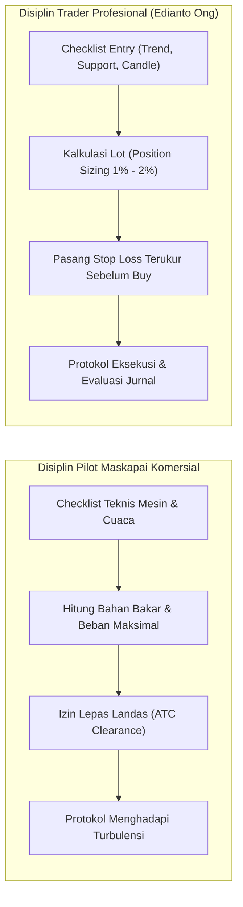
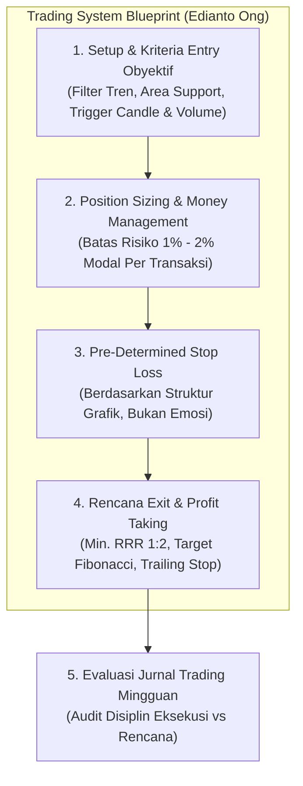
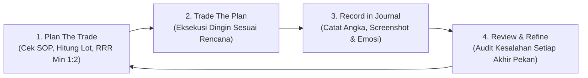

# Bab 29: So What? (Sintesis Sistem Trading, Risk & Eksekusi)

> "Anda telah mempelajari puluhan indikator, garis tren, Fibonacci, pola candlestick, hingga anatomi psikologi pasar. Pertanyaan paling krusial sekarang adalah: **So What?** Semua pengetahuan teoritis tersebut tidak bernilai sepeser pun jika Anda tidak mampu merangkumnya menjadi sebuah sistem trading yang mekanis, terukur, dan dieksekusi tanpa keraguan!"  
> — **Edianto Ong**, *Technical Analysis for Mega Profit*

---

## 1. Analogi Membumi: Checklist Pilot Sebelum Pesawat Lepas Landas

Bayangkan Anda naik pesawat komersial berbadan lebar untuk penerbangan rute Jakarta menuju Tokyo:
* Apakah sang kapten pilot duduk santai di kokpit dan berkata: *"Wah, cuaca hari ini kelihatannya cerah, perasaan saya enak, langsung tancap gas saja lepas landas!"*? Tentu tidak!
* Jika pilot bertindak berdasarkan perasaan (*mood*) dan insting semata, pesawat tersebut memiliki peluang besar untuk jatuh mengalami kecelakaan fatal.
* Apa yang sebenarnya dilakukan oleh pilot profesional?
  1. Pilot memegang **Checklist Prosedur Operasi Standar (SOP)** tertulis di tangannya.
  2. Memeriksa bahan bakar: Apakah cukup untuk rute utama plus cadangan darurat ke bandara alternatif?
  3. Memeriksa kemudi sayap (*flaps*), tekanan hidrolik, sistem navigasi radar cuaca, dan sensor altimeter.
  4. Hanya ketika **seluruh kotak centang terisi valid**, izin lepas landas dimintakan ke menara ATC (*Air Traffic Controller*).
  5. Jika di tengah penerbangan muncul badai turbulensi ekstrem, pilot telah memiliki protokol darurat otomatis tanpa perlu panik berdebat.

**Bursa saham adalah kokpit finansial Anda.** Tanpa sistem trading dan checklist tertulis, Anda ibarat pilot amatir yang menerbangkan pesawat di tengah badai malam hari dengan mata tertutup!

---

## 2. Cetak Biru Sistem Trading yang Obyektif (Trading System Blueprint)

Sebuah sistem trading yang solid wajib memiliki empat komponen pilar yang saling mengunci secara matematis dan logis:

### Pilar 1: Kriteria Entry Obyektif (*Objective Entry Setup*)
Jangan pernah membeli saham hanya karena "merasa harganya sudah murah" atau karena rumor di grup pesan instan. Entry harus memenuhi tiga lapis saringan (*three-tier filter*):
1. **Penyaring Arah Tren (*Trend Filter*):** Harga berada di atas Moving Average utama (misal: MA 50 atau MA 200) atau sedang mematahkan garis tren turun (*downtrend line breakout*).
2. **Pemicu Lokasi Nilai (*Value Area / Support*):** Harga berada di area Support horizontal kuat, batas bawah saluran (*channel bottom*), atau rasio emas Fibonacci Retracement (50% - 61.8%).
3. **Pemicu Momentum & Volume (*Trigger Candle*):** Terbentuk pola konfirmasi candlestick pembalikan (*Hammer*, *Bullish Engulfing*) yang diiringi lonjakan volume transaksi di atas rata-rata 20 hari (*Volume > 20-MAV*).

### Pilar 2: Titik Proteksi Kerugian (*Stop Loss*)
Stop loss diletakkan **secara teknikal di tempat di mana ide analisis Anda terbukti batal (*invalidation level*)**, bukan di sembarang angka acak:
* Sedikit di bawah lembah ayunan terakhir (*Recent Swing Low*).
* Di bawah garis tren support yang ditembus.
* Di bawah batas toleransi penembusan palsu (*whipsaw filter* 1% - 2%).

### Pilar 3: Strategi Mengunci Keuntungan (*Take Profit & Trailing Stop*)
Untuk memaksimalkan keuntungan saat tren berjalan kencang (*let your profits run*):
1. **Target Terukur (*Measured Move*):** Dihitung berdasarkan ketinggian formasi pola grafik (seperti formasi *Double Bottom*, *Rectangle*, atau proyeksi Fibonacci Extension 161.8%).
2. **Skema Penjualan Bertahap (*Scaling Out*):** Amankan 50% posisi saat mencapai Target 1 (misal Risk-to-Reward 1:2), lalu pindahkan Stop Loss sisa posisi ke titik impas (*Breakeven / Entry Price*).
3. **Trailing Stop Dinamis:** Gunakan garis MA 20 atau indikator Parabolic SAR untuk mengunci sisa posisi hingga harga menembus ke bawah indikator tersebut.

---

## 3. Panduan Step-by-Step Pemula: Cara Menghitung Position Sizing (Aturan Risiko 1% - 2%)

Bagi Edianto Ong, instrumen utama yang memisahkan antara trader profesional dan penjudi bursa adalah **Formula Ukuran Posisi (*Position Sizing Formula*)**.

> *"Bukan Win Rate tinggi yang membuat seorang trader menjadi kaya raya, melainkan seberapa kecil ia merugi ketika ia salah dan seberapa besar ia meraup laba ketika ia benar."*

### A. Aturan Baku 1% - 2% Risk Per Trade
Jangan pernah mempertaruhkan lebih dari **1% hingga maksimal 2% dari total modal portofolio Anda** pada satu transaksi tunggal.

$$\text{Rupiah Risiko Maksimal} = \text{Total Modal Portofolio} \times 1\% \text{ (atau } 2\%)$$

### B. Rumus Perhitungan Lot Posisi yang Presisi
Banyak pemula salah kaprah dengan membeli saham menggunakan alokasi dana sembarangan (misal: "beli saham A sebesar Rp5 juta, saham B sebesar Rp5 juta"). Metode ini cacat fatal karena tidak memperhitungkan jarak risiko Stop Loss!

Rumus baku position sizing Edianto Ong:

$$\text{Risiko Per Lembar} = \text{Harga Beli (Entry)} - \text{Harga Stop Loss}$$

$$\text{Jumlah Lembar Saham Maksimal} = \frac{\text{Rupiah Risiko Maksimal}}{\text{Risiko Per Lembar}}$$

$$\text{Jumlah Lot (Bursa Efek Indonesia)} = \frac{\text{Jumlah Lembar Saham Maksimal}}{100}$$

---

### Kalkulator Langkah Demi Langkah untuk Pemula:

Bayangkan Anda memiliki modal awal **Rp10.000.000 (Sepuluh Juta Rupiah)** di rekening sekuritas. Anda ingin membeli saham emiten konstruksi "JKTO-PROPERTI":

* **Langkah 1: Tentukan Batas Toleransi Risiko Modal Anda**  
  Pilihlah risiko konservatif 1% per transaksi:  
  $$\text{Rupiah Risiko Maksimal} = \text{Rp10.000.000} \times 1\% = \text{Rp100.000}$$  
  *(Artinya: Apapun yang terjadi pada transaksi ini, jika analisis Anda salah total, Anda hanya rela kehilangan Rp100.000!)*

* **Langkah 2: Tentukan Harga Entry & Titik Stop Loss Berdasarkan Grafik**  
  * Harga Beli (Entry saat ini): **Rp500** per lembar.  
  * Garis Support Swing Low berada di Rp455. Berikan buffer, maka Stop Loss dipasang di: **Rp450** per lembar.  
  * Jarak Risiko per lembar:  
    $$\text{Risiko Per Lembar} = \text{Rp500} - \text{Rp450} = \text{Rp50 per lembar}$$

* **Langkah 3: Hitung Jumlah Lembar Saham yang Boleh Dibeli**  
  $$\text{Jumlah Lembar} = \frac{\text{Rp100.000}}{\text{Rp50}} = 2.000 \text{ lembar}$$

* **Langkah 4: Konversikan ke Satuan Lot (1 Lot = 100 Lembar di BEI)**  
  $$\text{Jumlah Lot} = \frac{2.000 \text{ lembar}}{100} = \mathbf{20 \text{ Lot}}$$

* **Langkah 5: Hitung Total Uang Belanja yang Dialokasikan**  
  $$20 \text{ Lot} \times 100 \text{ lembar} \times \text{Rp500} = \mathbf{Rp1.000.000}$$  
  *(Perhatikan: Anda membelanjakan Rp1.000.000 atau 10% dari kas portofolio Anda. Sisa Rp9.000.000 tetap aman mengendap di kas rdn Anda!)*

* **Uji Bukti Ketahanan Risiko:**  
  Jika esok hari saham JKTO-PROPERTI anjlok dan menyentuh Stop Loss Anda di Rp450:  
  $$\text{Nilai Jual} = 20 \text{ Lot} \times 100 \times \text{Rp450} = \text{Rp900.000}$$  
  $$\text{Realisasi Kerugian} = \text{Rp1.000.000} - \text{Rp900.000} = \mathbf{Rp100.000}$$  
  Portofolio total Anda kini menjadi **Rp9.900.000 (Sisa 99% modal utuh!)**. Mental Anda tidak terguncang sedikit pun, dan Anda siap masuk ke saham lain dengan kepala dingin!

---

## 4. Matematika Probabilitas: Win Rate vs Risk-to-Reward Ratio (RRR)

Salah satu mitos terbesar yang menjebak pemula adalah mencari indikator dengan *Win Rate* (tingkat kemenangan) 90%. Edianto Ong menegaskan bahwa mengejar kesempurnaan adalah ilusi sia-sia. Dengan memegang prinsip **Risk-to-Reward Ratio (RRR) minimal 1:2**, Anda bisa tetap kaya raya bahkan jika 6 dari 10 transaksi Anda berakhir rugi (*Win Rate* hanya 40%)!

### Formula Ekspektansi Matematika (*Trading Expectancy*)

$$\text{Expectancy} = (\text{Win Rate} \times \text{Rata-rata Profit}) - (\text{Loss Rate} \times \text{Rata-rata Rugi})$$

### Tabel Matriks Probabilitas: Kunci Mengapa RRR 1:2 atau 1:3 Wajib Diterapkan
Simulasi 10 Transaksi dengan Risiko Kerugian Tetap Rp1.000.000 per Trade:

| Win Rate | Risk-to-Reward Ratio (RRR) | Perhitungan Matematis (10 Trade) | Hasil Bersih (Net Profit) | Evaluasi Portofolio |
| :---: | :---: | :---: | :---: | :---: |
| **30%** | **1 : 1** | $(3 \times \text{Rp1jt}) - (7 \times \text{Rp1jt})$ | **- Rp4.000.000** | Hancur / Rugi |
| **40%** | **1 : 1** | $(4 \times \text{Rp1jt}) - (6 \times \text{Rp1jt})$ | **- Rp2.000.000** | Tergerus Perlahan |
| **40%** | **1 : 2** | $(4 \times \text{Rp2jt}) - (6 \times \text{Rp1jt})$ | **+ Rp2.000.000** | **Profit Konsisten!** |
| **40%** | **1 : 3** | $(4 \times \text{Rp3jt}) - (6 \times \text{Rp1jt})$ | **+ Rp6.000.000** | **Sangat Menguntungkan!** |
| **50%** | **1 : 2** | $(5 \times \text{Rp2jt}) - (5 \times \text{Rp1jt})$ | **+ Rp5.000.000** | **Mega Profit Terbukti!** |

> [!NOTE]
> Perhatikan baris ketiga: Dengan tingkat kemenangan hanya 40% (Anda salah 6 kali dan hanya benar 4 kali), akun Anda **tetap mencetak profit bersih +Rp2.000.000** berkat disiplin RRR 1:2. Inilah keindahan matematika trading profesional!

---

## 5. Panduan Pemula: Cara Membuat Jurnal Trading Pertama

Sebuah sistem secanggih apa pun akan menjadi sampah jika tidak dibarengi dengan pencatatan dan evaluasi berkala. Edianto Ong mewajibkan setiap trader memiliki **Buku Catatan Transaksi (*Trading Journal*)**.

### Template Kolom Wajib Jurnal Trading Pemula (Gunakan Excel / Google Sheets / Notion):

| No | Tgl Beli | Kode Saham | Setup Teknikal / Alasan Entry | Harga Entry | Harga Stop Loss | Target Profit | Jarak RRR | Jml Lot | Risiko Finansial (Rp) | Tgl Jual | Harga Jual | Realisasi Net (Rp) | Audit Emosi / Kesalahan Eksekusi |
| :---: | :---: | :---: | :---: | :---: | :---: | :---: | :---: | :---: | :---: | :---: | :---: | :---: | :---: |
| 1 | 05/11 | BBRI | Breakout Cup & Handle + Vol Surge | Rp4.500 | Rp4.350 | Rp4.850 | 1 : 2.3 | 15 Lot | Rp225.000 | 12/11 | Rp4.850 | +Rp525.000 | Disiplin menunggu TP, eksekusi sempurna. |
| 2 | 08/11 | ASII | Pantulan MA 200 + Candle Hammer | Rp5.100 | Rp4.950 | Rp5.500 | 1 : 2.6 | 10 Lot | Rp150.000 | 09/11 | Rp4.950 | -Rp150.000 | Support jebol, langsung cut loss tanpa ragu. Good! |
| 3 | 14/11 | BRIS | FOMO berita di grup WhatsApp | Rp1.800 | - | Rp2.000 | N/A | 30 Lot | N/A | 18/11 | Rp1.600 | -Rp600.000 | **FATAL!** Melanggar SOP, tidak pasang SL, FOMO. Jangan ulangi! |

---

## 6. Protokol Eksekusi Cut Loss Tanpa Penyesalan (*Preservation of Capital*)

Bagi banyak pemula, menekan tombol *cut loss* terasa menyakitkan seperti memotong jari sendiri. Edianto Ong mengajarkan cara mengubah cara pandang Anda terhadap *cut loss*:

1. **Ubah Definisi Cut Loss dalam Pikiran Anda:**
   * Cut loss bukanlah kegagalan atau tanda kebodohan.
   * **Cut loss adalah "biaya operasional" (*cost of doing business*)**, sama seperti seorang pemilik warung kopi yang harus membayar tagihan listrik dan membeli biji kopi setiap bulan. Tanpa biaya operasional, bisnis tidak bisa berjalan.
2. **Keluarkan Tombol Eksekusi dari Pengaruh Emosi:**
   * Jangan menunggu jam penutupan bursa untuk berpikir apakah akan menjual atau tidak.
   * Pasang fitur **Automatic Stop Order / GTC (Good-Til-Cancelled)** tepat 1 menit setelah order beli Anda selesai (*match*). Biarkan sistem server sekuritas yang mengeksekusinya tanpa campur tangan rasa ragu Anda.
3. **Doktrin Pelindung Modal (*Preservation of Capital*):**
   * Modal uang adalah senjata prajurit di medan perang. Jika prajurit kehabisan peluru, ia masih bisa mundur mencari perlindungan. Namun jika prajurit kehilangan nyawanya (modal ludes total), permainan berakhir selamanya (*Game Over*).
   * **Pangkas kerugian saat masih kecil (2%), lindungi modal Anda, dan pasar akan selalu menyediakan ratusan peluang baru esok hari.**

---

## 7. Kamus Istilah Pemula (Glossary Box)

> [!NOTE]
> * **Trading System (Sistem Trading):** Rangkaian aturan baku, obyektif, dan terukur yang mengatur kapan seorang trader harus masuk (*entry*), membatasi risiko (*stop loss*), mengambil keuntungan (*take profit*), serta menentukan jumlah lot (*position sizing*).
> * **Position Sizing:** Metode matematis untuk menentukan berapa banyak jumlah lot saham yang boleh dibeli berdasarkan jarak stop loss dan batas toleransi risiko modal akun.
> * **Risk-Reward Ratio (RRR):** Perbandingan antara potensi risiko kerugian (*stop loss*) dengan potensi imbal hasil keuntungan (*take profit*) pada suatu transaksi (disarankan minimal 1:2).
> * **Win Rate:** Persentase jumlah transaksi yang menghasilkan keuntungan dibandingkan dengan total seluruh transaksi yang dilakukan.
> * **Expectancy:** Nilai rata-rata keuntungan atau kerugian yang dapat diharapkan oleh seorang trader pada setiap rupiah yang dipertaruhkan dalam jangka panjang.
> * **Trailing Stop:** Batas pengaman stop loss yang digeser naik secara dinamis seiring dengan kenaikan harga saham untuk mengunci keuntungan yang sudah berjalan (*floating profit*).
> * **Cut Loss:** Tindakan menutup posisi transaksi yang sedang merugi pada batas level yang telah ditetapkan guna mencegah kerugian yang lebih besar dan fatal.

---

## 8. Kata Penutup: Filosofi Mega Profit Edianto Ong

Buku *Technical Analysis for Mega Profit* ditutup dengan sebuah pesan abadi yang patut Anda cetak dan tempel di samping layar monitor trading Anda:

> "Keberhasilan sejati dalam trading bukanlah tentang kemampuan meramal masa depan bursa saham yang perkasa. Bursa saham adalah samudera raya tanpa batas yang tidak pernah peduli siapa nama Anda, berapa gelar profesor yang Anda sandang, atau berapa banyak uang warisan yang Anda bawa ke lantai bursa.  
>  
> Keberhasilan trading adalah **kemenangan Anda atas diri Anda sendiri**:
> * Kemenangan kesabaran menunggu momentum di atas ketergesaan yang ceroboh.
> * Kemenangan kepatuhan pada checklist SOP di atas bisikan keserakahan sesaat.
> * Dan kemenangan kerendahan hati mengakui kerugian kecil di atas keangkuhan ego intelek.  
>  
> Patuhi sistem Anda dengan disiplin militer, lindungi keutuhan modal Anda seperti Anda melindungi nyawa Anda, dan biarkan keajaiban bunga majemuk (*compound interest*) mengantarkan Anda meraih **Mega Profit** yang berkelanjutan sepanjang masa."
