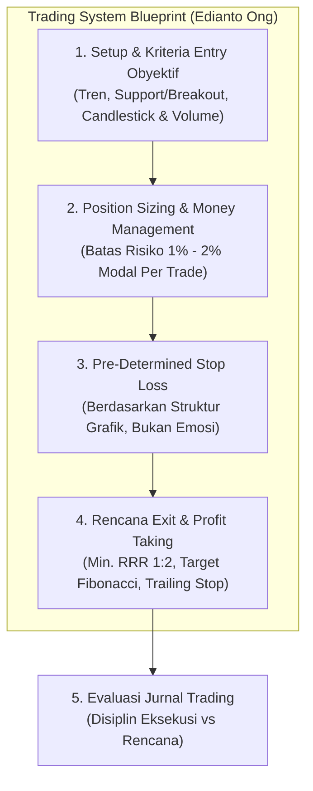
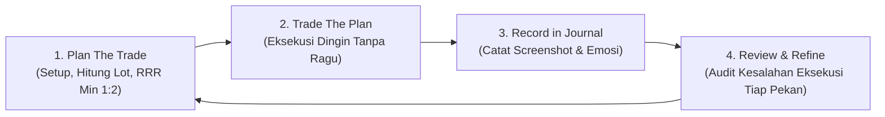

# Bab 29: So What? (Sintesis Sistem Trading, Risk & Eksekusi)

> "Anda telah mempelajari puluhan indikator, garis tren, Fibonacci, pola candlestick, hingga anatomi psikologi pasar. Pertanyaan paling krusial sekarang adalah: So What? Semua pengetahuan teoritis tersebut tidak bernilai sepeser pun jika Anda tidak mampu merangkumnya menjadi sebuah sistem trading yang mekanis, terukur, dan dieksekusi tanpa keraguan."  
> — **Edianto Ong**, *Technical Analysis for Mega Profit*

---

## 1. Hakikat Bab "So What?": Dari Teori Menuju Aksi Nyata

Bab 29 merupakan puncak mahakarya dan sintesis penutup dari seluruh perjalanan belajar buku *Technical Analysis for Mega Profit*. Edianto Ong menekankan bahwa perbedaan mendasar antara seorang pengamat/analis pasar dengan seorang **trader profesional penghasil profit konsisten** terletak pada keberadaan **Sistem Trading yang Komprehensif (*Comprehensive Trading System*)**.

Seorang analis dapat berbicara berjam-jam mengenai prediksi tren masa depan tanpa mempertaruhkan modalnya; namun seorang trader harus mengambil keputusan konkret dalam hitungan detik di tengah ketidakpastian pasar:
* Berapa banyak lot yang harus dibeli?
* Kapan waktu masuk yang presisi?
* Di mana batas kerugian yang tidak boleh ditawar?
* Kapan dan bagaimana merealisasikan keuntungan secara optimal?

---

## 2. Cetak Biru Sistem Trading yang Obyektif (Trading System Blueprint)

Sebuah sistem trading yang solid wajib memiliki empat komponen pilar yang saling mengunci secara matematis dan logis:

### Pilar 1: Kriteria Entry Obyektif (*Objective Entry Setup*)
Jangan pernah membeli saham hanya karena "merasa harganya sudah murah" atau karena rumor di grup pesan instan. Entry harus memenuhi tiga lapis konfirmasi (*three-tier filter*):
1. **Penyaring Arah Tren (*Trend Filter*):** Harga berada di atas Moving Average utama (misal: MA 50 atau MA 200) atau sedang mematahkan garis tren turun (*downtrend line breakout*).
2. **Pemicu Lokasi Nilai (*Value Area / Support*):** Harga berada di area Support horizontal kuat, batas bawah saluran (*channel bottom*), atau rasio emas Fibonacci (50% - 61.8%).
3. **Pemicu Momentum & Volume (*Trigger Candle*):** Terbentuk pola konfirmasi candlestick pembalikan (*Hammer*, *Bullish Engulfing*) yang diiringi lonjakan volume transaksi di atas rata-rata 20 hari (*Volume > 20-MAV*).

### Pilar 2: Titik Proteksi Kerugian (*Stop Loss*)
Stop loss diletakkan **secara teknikal di tempat di mana ide analisis Anda terbukti batal (*invalidation level*)**, bukan di sembarang angka acak:
* Sedikit di bawah lembah ayunan terakhir (*Recent Swing Low*).
* Di bawah garis tren support yang ditembus.
* Di bawah batas toleransi penembusan palsu (*whipsaw filter* 1% - 3%).

### Pilar 3: Strategi Mengunci Keuntungan (*Take Profit & Trailing Stop*)
Untuk memaksimalkan keuntungan saat tren berjalan kencang (*let your profits run*):
1. **Target Terukur (*Measured Move*):** Dihitung berdasarkan ketinggian formasi pola grafik (seperti formasi *Double Bottom*, *Rectangle*, atau proyeksi Fibonacci Extension 161.8%).
2. **Skema Penjualan Bertahap (*Scaling Out*):** Amankan 50% posisi saat mencapai Target 1 (misal Risk-to-Reward 1:2), lalu pindahkan Stop Loss sisa posisi ke titik impas (*Breakeven / Entry Price*).
3. **Trailing Stop Dinamis:** Gunakan garis MA 20 atau Parabolic SAR untuk mengunci sisa posisi hingga harga menembus ke bawah indikator tersebut.

---

## 3. Manajemen Risiko & Formula Position Sizing Presisi

Bagi Edianto Ong, instrumen utama yang memisahkan antara trader profesional dan penjudi bursa adalah **Formula Ukuran Posisi (*Position Sizing Formula*)**.

> *"Bukan Win Rate tinggi yang membuat seorang trader menjadi kaya raya, melainkan seberapa kecil ia merugi ketika ia salah dan seberapa besar ia meraup laba ketika ia benar."*

### A. Aturan Baku 1% - 2% Risk Per Trade
Jangan pernah mempertaruhkan lebih dari **1% hingga maksimal 2% dari total modal portofolio Anda** pada satu transaksi tunggal.

$$\text{Rupiah Risiko Maksimal} = \text{Total Modal Portofolio} \times 1\% \text{ (atau } 2\%)$$

### B. Rumus Perhitungan Lot Posisi yang Presisi
Banyak pemula salah kaprah dengan membeli saham menggunakan rumus "beli saham A sebesar 20 juta, saham B sebesar 20 juta". Metode alokasi dana statis ini cacat fatal karena mengabaikan volatilitas jarak Stop Loss.

Rumus baku position sizing Edianto Ong:

$$\text{Jumlah Lembar Saham} = \frac{\text{Rupiah Risiko Maksimal}}{\text{Harga Beli (Entry)} - \text{Harga Stop Loss}}$$

$$\text{Jumlah Lot (Bursa Efek Indonesia)} = \frac{\text{Jumlah Lembar Saham}}{100}$$

#### Contoh Kasus Nyata:
* **Total Modal Portofolio:** Rp100.000.000
* **Batas Risiko Transaksi (2%):** Rp2.000.000
* **Harga Beli (Entry) Saham XYZ:** Rp1.000
* **Titik Stop Loss Teknikal (di bawah Swing Low):** Rp920
* **Risiko Per Lembar:** $\text{Rp1.000} - \text{Rp920} = \text{Rp80}$ per lembar
* **Kalkulasi Posisi:**
  $$\text{Lembar Saham} = \frac{\text{Rp2.000.000}}{\text{Rp80}} = 25.000 \text{ lembar}$$
  $$\text{Jumlah Lot} = \frac{25.000}{100} = 250 \text{ Lot}$$
* **Total Alokasi Modal:** $250 \text{ Lot} \times 100 \times \text{Rp1.000} = \text{Rp25.000.000}$ (25% dari modal portofolio).
* **Hasil:** Jika transaksi ini gagal dan harga menyentuh Stop Loss Rp920, portofolio Anda hanya merugi tepat Rp2.000.000 (2% dari total portofolio). Modal Anda tetap utuh 98% untuk mencari peluang berikutnya!

---

## 4. Matematika Probabilitas: Win Rate vs Risk-to-Reward Ratio (RRR)

Salah satu mitos terbesar di kalangan pemula adalah obsesi mencari indikator atau sistem dengan *Win Rate* 80% hingga 90%. Edianto Ong membuktikan bahwa dengan disiplin *Risk-to-Reward Ratio* yang sehat, Anda tetap dapat mencetak kekayaan luar biasa bahkan hanya dengan *Win Rate* 40%!

### Formula Ekspektansi Matematika (*Trading Expectancy*)

$$\text{Expectancy} = (\text{Win Rate} \times \text{Average Win}) - (\text{Loss Rate} \times \text{Average Loss})$$

### Tabel Matriks Probabilitas: Kunci Mengapa RRR 1:2 atau 1:3 Wajib Diterapkan

| Win Rate | Risk-to-Reward Ratio (RRR) | Hasil dari 10 Transaksi (Risk Rp1 Juta) | Net Profit / Loss | Status Portofolio |
| :---: | :---: | :---: | :---: | :---: |
| **30%** | **1 : 1** | $(3 \times 1\text{jt}) - (7 \times 1\text{jt})$ | **- Rp4.000.000** | Hancur / Rugi |
| **40%** | **1 : 1** | $(4 \times 1\text{jt}) - (6 \times 1\text{jt})$ | **- Rp2.000.000** | Tergerus |
| **40%** | **1 : 2** | $(4 \times 2\text{jt}) - (6 \times 1\text{jt})$ | **+ Rp2.000.000** | **Profit Konsisten** |
| **40%** | **1 : 3** | $(4 \times 3\text{jt}) - (6 \times 1\text{jt})$ | **+ Rp6.000.000** | **Sangat Menguntungkan** |
| **50%** | **1 : 2** | $(5 \times 2\text{jt}) - (5 \times 1\text{jt})$ | **+ Rp5.000.000** | **Mega Profit** |

Prinsip dasar ini membebaskan mental seorang trader dari stres mencari kepastian. Anda tidak perlu selalu benar untuk menghasilkan keuntungan besar; Anda hanya perlu memastikan bahwa ketika Anda benar, hasil keuntungan Anda minimal dua kali lipat dari risiko kerugian Anda.

---

## 5. Jurnal Trading & Disiplin Eksekusi Bebas Bias Emosi

Sebuah sistem secanggih apa pun akan menjadi sampah jika tidak dibarengi dengan pencatatan dan evaluasi berkala. Edianto Ong mewajibkan setiap trader memiliki **Buku Catatan Transaksi (*Trading Journal*)**.

### Kolom Standar Jurnal Trading Profesional:
1. **Tanggal & Ticker Saham**
2. **Katalis / Alasan Masuk (*Reason for Entry*):** Pola teknikal apa yang melandasi keputusan?
3. **Harga Entry, Rencana Stop Loss, dan Target Take Profit**
4. **Risk-to-Reward Ratio Terhitung**
5. **Jumlah Lot & Risiko Finansial (Rp)**
6. **Harga Realisasi Exit & Tanggal Penutupan Posisi**
7. **Net Profit/Loss (Rp dan %)**
8. **Catatan Evaluasi Psikologis (*Psychological Audit*):** Apakah Anda mengeksekusi rencana dengan disiplin, ataukah ada rasa takut/serakah yang membuat Anda menggeser Stop Loss atau menutup posisi terlalu dini?

---

## 6. Kata Penutup: Filosofi Mega Profit Edianto Ong

Buku *Technical Analysis for Mega Profit* ditutup dengan sebuah pesan abadi bagi seluruh penjelajah pasar modal:

> "Keberhasilan sejati dalam trading bukanlah tentang menaklukkan pasar saham yang perkasa. Pasar saham adalah samudera luas yang tidak pernah peduli siapa Anda, berapa gelar akademis Anda, atau berapa banyak uang yang Anda bawa.  
>  
> Keberhasilan trading adalah kemenangan atas diri sendiri—kemenangan kesabaran atas ketidaksabaran, kemenangan disiplin sistem atas godaan keserakahan sesaat, dan kemenangan kerendahan hati atas keangkuhan ego. Kuasai sistem Anda, lindungi modal Anda dengan nyawa Anda, dan biarkan keajaiban bunga majemuk (*compound interest*) menghantarkan Anda menuju Mega Profit yang berkesinambungan."
